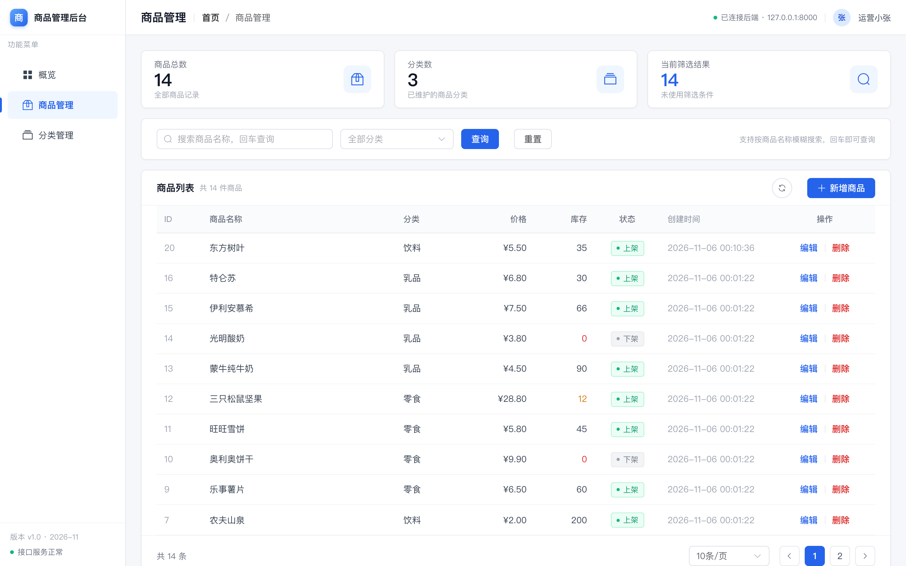
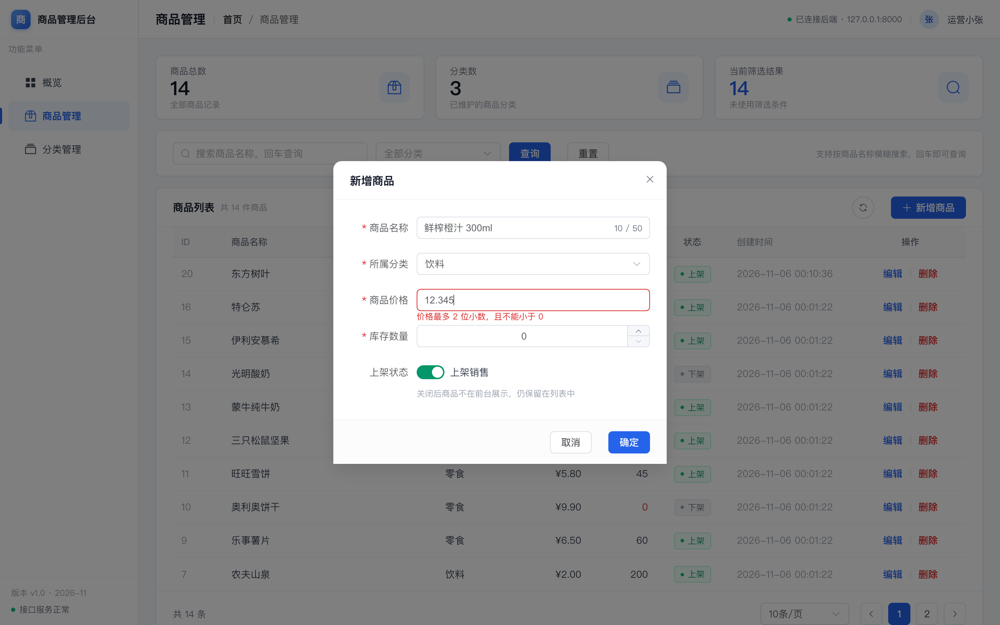

# 交付与验收记录

> 回答一个问题：**这个后台做到了没有？证据在哪？**
> 需求与验收标准见 [`product/prd.md`](product/prd.md)；接口契约见 [`api-product-admin.md`](api-product-admin.md)。



## 1. 结论

| 项 | 内容 |
|---|---|
| 版本 | v1.0（2026-11-06 首次交付，2026-11-07 复核） |
| 范围 | 前端 `frontend/` + 后端 `backend/` |
| 需求 | P0 十六条（F-01…F-16）全部实现 |
| 自动化 UI 验收 | **18/18 通过**（`pnpm acceptance`，真实浏览器 + 真实后端） |
| 后端自检 | `make check` 绿：ruff 全过 + 120 passed + 覆盖率 87.88% |
| 前端自检 | `pnpm lint` / `pnpm test`（26 passed）/ `pnpm build` 全过 |
| CI | GitHub Actions 两个 job 全绿（backend 13s、frontend 26s） |

## 2. 怎么复跑

```bash
# 后端自检（不需要 MySQL）
cd backend && make check

# 起服务（验收前提：MySQL 可用、已执行 make migrate 与 python -m app.seed）
cd backend && make run            # :8000
cd frontend && pnpm dev        # :5173，/api 代理到 8000

# 端到端验收（最后一行应为「汇总：18/18 通过」）
cd frontend && pnpm acceptance
```

验收脚本产物（过程截图 + `result.json`）落在 `.acceptance/`，已被 `.gitignore` 忽略；脚本会自动清理它创建的商品与分类。

## 3. UI 用例（自动化 18 项）

| 用例 | 做了什么 | 期望 | 实际 |
|---|---|---|---|
| UI-01 | 打开 `/products` | 表格有数据、8 列表头齐全 | 10 行，列齐全 |
| UI-02 | 看分页条 | 显示总数与多页 | 共 14 条，页码 1、2 |
| UI-03 | 看统计卡 | 总数 / 分类数 / 筛选结果 | 14 / 3 / 14 |
| UI-04 | 点「新增商品」 | 弹窗出现 | 标题「新增商品」 |
| UI-05 | 分类下拉选「饮料」 | 选中并回填 | 显示「饮料」 |
| UI-06 | 价格填 `12.345` 提交 | 前端拦截，提示 2 位小数 | 红框 +「价格最多 2 位小数，且不能小于 0」，未发请求 |
| UI-07 | 价格 `12.34`、库存 `7` 提交 | 成功提示，首行出现且分类正确 | 「商品新增成功」，¥12.34 / 7 / 饮料 |
| UI-08 | 关键词搜「E2E测试商品」回车 | 命中 1 条 | 命中 1 条，URL 带 `keyword` |
| UI-09 | 编辑库存为 `9` 保存 | 行内库存变 9 | 「商品修改成功」，库存 9 |
| UI-10 | 点「删除」 | 二次确认含「不可恢复」 | 文案符合 |
| UI-11 | 确认框点「取消」 | 行仍在 | 行仍在 |
| UI-12 | 再次删除并确认 | 行消失 | 「删除成功」，行消失 |
| UI-13 | 搜「不存在的商品XYZ」 | 空态 + 清空筛选 | 「没有符合条件的商品」+「清空筛选」 |
| UI-14 | 分类页新增「E2E测试分类」 | 成功提示，列表出现 | 「分类新增成功」 |
| UI-15 | 再建同名分类 | 后端 409，前端原样提示 | 「分类名称已存在」 |
| UI-16 | 改名「E2E测试分类2」 | 名称更新 | 「分类名称已更新」 |
| UI-17 | 删除该空分类 | 行消失 | 「删除成功」 |
| UI-18 | 打开 `/dashboard` | 统计卡 + 分类分布 + 最近新增 | 三块齐全，数据与列表一致 |

## 4. 接口抽查（真实 MySQL）

| 场景 | 期望 | 实际 |
|---|---|---|
| `GET /api/products?page=1&page_size=2` | 200，`items/total`，price 为两位小数字符串 | `total: 14`，`price: "5.50"` |
| `GET /api/products/999999` | 404 | 「商品不存在」 |
| `POST /api/categories`（重名） | 409 | 「分类名称已存在」 |
| `PATCH /api/categories/{id}`（改成已存在名） | 409 | 同上 |
| `DELETE /api/categories/{有商品的分类}` | 409 | 「分类下有其他商品，不能删除分类」 |
| `POST /api/products`（price 三位小数） | 422 + 字段级报错 | 符合 |
| `GET /api/categories/statistics` | 各分类商品数（含 0） | 与列表一致 |
| CORS 预检（Origin: 5173） | 带 `access-control-allow-origin` | 符合 |

## 5. 视觉核对

| 项 | 要求 | 实测 |
|---|---|---|
| 统计卡高度 | 92px（13/18 + 28/32 + 12/16 + padding 13） | 92px |
| 表头 / 行高 | 44 / 48px | 44 / 48 |
| 数字对齐 | 价格、库存右对齐 + tabular-nums | 一致 |
| 状态色语义 | 上架绿、下架灰；红仅删除与库存 0；橙仅库存 1–20 | 一致 |
| 概览第二行 | 三卡底边对齐、无半行裁切 | 三卡 bottom 均 435，4 行完整 44px |
| 首屏 | 1440×900 无纵向滚动 | `scrollHeight = 900` |



## 6. 交付过程中发现并修复的问题

| # | 问题 | 定位 | 处理 |
|---|---|---|---|
| D-01 | 统计卡 `line-height:1.25` 实际 ~35px，撑破 92px 预算 | `.stat-card` | 改为 label 13/18、value 28/32、hint 12/16 |
| D-02 | 概览左列下方空白 ~270px | `Dashboard.vue` | 第一轮 `stretch` 引出更大空洞，**回退**后改三列等高栅格 |
| D-03 | 库存预警把第 3/4 条切成半行 | `.stock-warning__list` | 去掉内部滚动，行高固定 44px，4 条自然展开 |
| D-04 | 验收脚本 15/18：确认按钮文案是「删除」不是「确定」；分类名子串互撞 | 验收脚本 | 修脚本（非产品缺陷），复跑 18/18 |
| D-05 | UI-08 命中 2 条 | 上次残留脏数据 | 清理后重跑通过 |

> 教训：D-02/D-03 说明「看起来只是留白」的问题，改法不当会引出更严重的裁切。这类版式问题必须用 DOM 实测（bottom 坐标、行高、scrollHeight）验收，不能只看截图。

## 7. 已知限制

| # | 限制 | 影响 | 状态 |
|---|---|---|---|
| L-01 | 无登录与权限 | 谁打开都能改数据 | v1.1 登录后叠加 |
| L-02 | 概览的上下架/库存预警取前 100 条商品前端聚合 | 商品 > 100 条时数字偏小 | 待后端加聚合接口 |
| L-03 | 分类接口不分页 | 分类极多时下拉很长（已开 `filterable`） | 分类 > 50 时再加 |
| L-04 | 编辑提交整表单（名称/分类/价格/库存/状态全部带上），非仅改动字段 | 并发编辑同一商品时，后提交者会覆盖前者未改动的字段 | 后续改 diff 提交或加乐观锁；PRD AC-08 已对齐当前实现 |
| L-05 | 404 文案不统一（详情/删除「商品不存在」、PATCH「未找到商品」） | 前端透传，用户看到两种说法 | 待统一后端文案 |
| L-06 | ——（原「分类改名不 strip 空白」） | —— | ✅ 已修复：PATCH 分类与商品均先 strip 再判空，纯空白 400 |
| L-07 | ——（原「建表用 create_all」） | —— | ✅ 已由 Alembic 解决 |
| L-08 | 组件级 UI 无单测 | 回归依赖端到端脚本 | ⚠️ 已补 `src/api` 单测（17 项），组件层仍未覆盖 |

## 8. 未覆盖范围

商品 > 100 条时的统计、并发编辑冲突、登录/权限、批量操作与导出、移动端适配、组件单测——都已在 PRD 第 9 章列为非目标或 v1.1 候选。

## 9. 相关文档

- 需求与验收标准：[`product/prd.md`](product/prd.md)
- 视觉规范：[`design/design.md`](design/design.md)
- 接口契约：[`api-product-admin.md`](api-product-admin.md)
- 前端说明：见 `archive/product-admin/frontend/`（原 `frontend/README.md` 已随模块归档，未保留副本）
