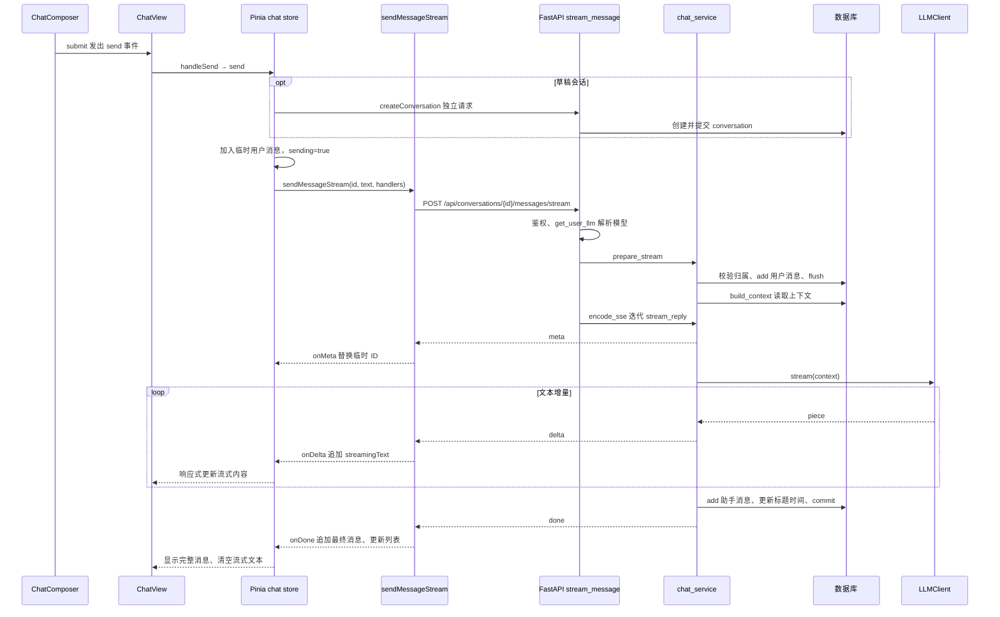

# My Agent 项目接手与 SSE 对话链路说明

本次核对日期为 2026-11-13，代码基线为 `d28d15a`。开始时 Git 工作区干净。本文以当前代码与本轮 CodeGraph MCP 返回的源码为依据，记录接手认知、函数位置和验证边界。

## 1. 项目定位与当前状态

My Agent 是面向个人、自托管的 AI 助手，也是学习全栈 Agent 开发的实践项目。基础闭环包括账号、多会话、模型配置、流式回复、历史持久化、设备管理和主题同步。当前代码同时包含 Agent 执行循环、人工审批、MCP 接入与应用内技能包。此前聊天中“Agent 已移除”的判断针对另一份工作区快照，当前基线已恢复这些模块，不能继续沿用该结论。

文档记录阶段 1–7 的交付，11 阶段计划继续作为排期依据。阶段 8 为 RAG / Memory，阶段 9 为应用完善，阶段 10 为桌面端，阶段 11 为部署测试发布。Electron + PyInstaller onedir 已有选型 ADR，桌面安装包仍待实现与验证。商品、分类、概览模块于 2026-11-08 归档，保存在 `archive/product-admin/`。 [阶段计划](playbooks/05-development-plan-and-mvp-tasks.md) · [架构决策](adr/README.md) · [归档说明](../archive/product-admin/README.md)

## 2. 项目框架与边界

| 模块 | 职责与实现 |
|---|---|
| `frontend/` | Vue 3、TypeScript、Vite、Element Plus、Pinia。页面与组件负责展示，store 管会话运行时状态，API 层负责 HTTP 和 SSE 解析。 |
| `backend/app/api/` | FastAPI 接口与依赖注入，注册账号、对话、Agent、审批、设置、MCP、技能路由。 |
| `schemas/`、`services/`、`models/` | Pydantic 数据结构、业务服务、SQLAlchemy ORM。普通对话的事务和上下文集中于 `chat_service.py`。 |
| `auth/` | 服务端会话、HttpOnly Cookie、令牌哈希和 Argon2id 密码。业务查询按用户限定数据归属。 |
| `llm/` | `LLMClient` 提供普通、流式和工具调用接口。Fake 用于确定性验证，OpenAI 兼容客户端可接 DeepSeek 等服务。 |
| `agent/` | 模型与工具往返、执行预算、工具注册、策略检查、审批挂起恢复、步骤记录。 |
| `mcp/`、`skills/` | MCP 接入外部工具，Skill 把工作方法注入提示并限制工具范围。项目开发用的 `.agents/skills/` 则指导 AI 协作者。 |
| MySQL 与 Alembic | 核心关系为用户拥有会话、消息归属于会话。另有 sessions、user_settings、agent_runs、agent_steps、agent_approvals、mcp_servers、skills。迁移负责 schema 演进。 |
| 工程化 | uv / pnpm 锁依赖，Ruff / pytest / ESLint / Vitest 与构建组成门禁。Docker Compose 编排 MySQL、后端、Nginx 和可选 Caddy。 |

本地通过 `scripts/dev.sh` 启动前后端热更新。浏览器请求 `/api` 经开发代理或 Nginx 到 FastAPI，后端经 SQLAlchemy 访问 MySQL，经模型适配层访问上游。规范要求优先复用、小步验证、重要决策记录 ADR。视觉由根 `DESIGN.md` 定义，UI 改动须同步 token 与规范。 [系统说明](how-it-works.md) · [工具链](toolchain.md) · [部署](deploy.md) · [设计规范](../DESIGN.md)

## 3. 普通 SSE 对话的完整过程

以下链路对应 `agentMode=false`。发送入口会根据开关选择 `send()` 或 `sendWithAgent()`，因此调试时应先确认开关状态。

### 3.1 关键函数与源码位置

行号来自本轮 CodeGraph 源码，后续修改可能使其移动。

| 函数或绑定 | 文件及行号 | 本次请求中的作用 |
|---|---|---|
| `submit()` / `handleKeydown()` | `frontend/src/components/chat/ChatComposer.vue:39 / 33` | 点击发送触发 submit；Enter 在非输入法组合且无 Shift 时也触发。检查 canSend 后 emit send。 |
| `handleSend()` | `frontend/src/views/ChatView.vue:90` | 读取输入并按 agentMode 选普通或 Agent 分支，成功后恢复焦点。 |
| `ensureConversation()` | `frontend/src/stores/chat.ts:239` | 首次发送创建会话并绑定真实 ID。 |
| `createConversation()` | `frontend/src/api/chat.ts:13` | POST 创建会话，后端 `chat_service.create_conversation()`（第 26 行）独立 commit。 |
| `send()` / `threadOf()` | `frontend/src/stores/chat.ts:296 / 115` | 取得固定会话的响应式状态，插入负时间戳 ID 的用户消息，设置 sending，注册三个 SSE 回调。 |
| `sendMessageStream()` | `frontend/src/api/chat.ts:85` | fetch POST，读取 ReadableStream，TextDecoder 解码，按空行分帧并解析 JSON，分发事件。 |
| `stream_message()` | `backend/app/api/chat.py:169` | 依赖注入当前用户、Session、模型，先 prepare_stream，再以 StreamingResponse 输出编码后的生成器。 |
| `get_user_llm()` → `resolve_llm()` → `build_llm_for()` | `backend/app/llm/__init__.py:130 / 122 / 93` | 读取用户设置，解析并解密模型配置，构造 Fake 或 OpenAI 兼容客户端。未配置模型的账号回落环境变量。 |
| `prepare_stream()` → `get_conversation()` / `build_context()` | `backend/app/services/chat_service.py:195 / 79 / 121` | 校验会话归属和内容，add + flush 用户消息，拼 system 与最近 20 条非 system 消息。 |
| `stream_reply()` | `backend/app/services/chat_service.py:227` | 产生 meta / delta / done / error，调用模型，负责消息提交和失败清理。 |
| `OpenAICompatibleClient.stream()` | `backend/app/llm/openai_compatible.py:112` | httpx POST 上游 `/chat/completions`，请求体带 stream=true，提取 choices[0].delta.content，遇 `[DONE]` 结束。 |
| `FakeLLM.stream()` | `backend/app/llm/fake.py:50` | 按 4 字符分片回显，提供可控的延迟和异常。 |
| `encode_sse()` | `backend/app/api/sse.py:16` | 把事件编码为 `data: {json}\n\n`，响应头关闭缓存和 Nginx 缓冲。 |
| `onMeta` / `onDelta` / `onDone` | `frontend/src/stores/chat.ts:326 / 330 / 333` | 替换临时用户消息、追加流式文本、写入最终助手消息并更新标题与排序。 |
| `scrollToBottom()`、watch | `frontend/src/views/ChatView.vue:75 / 113` | 文本或消息数变化触发 nextTick + requestAnimationFrame 滚动。 |
| `ChatMessage` 的 html computed | `frontend/src/components/chat/ChatMessage.vue:12` | 完整助手消息通过 renderMarkdown 展示，用户消息显示为纯文本。 |

### 3.2 消息何时真正保存

`prepare_stream()` 的 `flush()` 会执行 SQL 并分配用户消息 ID，事务尚未提交。因此前端收到 meta 与真实 ID 时，这轮对话仍可能被回滚。`stream_reply()` 收集模型片段后，创建助手消息，首轮默认标题取用户输入前 30 字，更新会话时间，在第 269 行 `commit()` 一起提交两条消息，然后发送 done。新建会话是此前独立提交的请求，模型失败时可能留下空会话。

生成阶段报错会 rollback 并发 error；生成器在提交前提前关闭时 finally 也尝试 rollback。commit 成功之后数据库已经持久化，即使后续 refresh、序列化或向浏览器传输失败，rollback 也无法撤销已提交的数据。因此“浏览器未收到 done”不能直接证明服务端未保存。

### 3.3 前端如何更新及错误边界

store 在发起请求时绑定具体 thread，异步回调继续写该会话，切换会话不会把片段写入另一会话。onDelta 追加 streamingText；onDone 清空增量文本，追加助手消息，更新会话标题、条数、时间并重新排序。请求完成后清空草稿，finally 解除 sending。失败时删除本地用户占位消息、清空增量文本、提示错误并保留草稿。

源码还显示一个待专项验证的边界。`sendMessageStream()` 在 reader 返回 done 时直接退出，尚未要求必须收到业务 done 事件。如果网络以正常 EOF 提前结束且没有 error 事件，调用方可能按成功收尾。当前解析器也按 `\n\n` 分帧，与自有后端编码一致。上述判断来自静态代码，本轮未复现网络中断。

## 4. 深度回答与普通对话的衔接

`handleSend()` 的另一分支调用 `sendWithAgent()`（store 第 445 行），经 `sendAgentStream()` 收取 Agent 事件。工具事件交 `applyAgentEvent()` 更新步骤，最终事件交 `appendAssistantMessage()` 更新消息，随后重新获取会话详情校准真实 ID 与时间。审批事件会把运行显示为待确认。

根据 Agent 设计及现有代码组织，核心为 `backend/app/agent/executor.py` 的模型—工具循环，工具权限策略在服务端执行，运行和步骤独立持久化。MCP 将外部工具接入注册表，Skill 提供方法提示和工具范围。普通 SSE 链路调用 `llm.stream()`，深度回答通过工具调用机制执行，两者共享模型配置与 SSE 编码基础设施。 [Agent 设计](agent.md) · [架构手册](agent-architecture.md) · [工具治理](tools.md) · [MCP](mcp.md) · [Skill](skills.md)

## 5. 本轮实际 CodeGraph 调用

仅使用 `mcp__codegraph__codegraph_explore`，共 **4 次**，全部指定项目路径 `/Users/cuixiang/Desktop/myProjects/my-learning`。

| 次数 | query 原文 | maxFiles | 用途 |
|---|---|---|---|
| 1 | `frontend/src/components/chat/ChatComposer.vue frontend/src/views/ChatView.vue frontend/src/stores/chat.ts frontend/src/api/chat.ts handleSend send sendMessageStream` | 4 | 输入事件、Pinia 动态调用、fetch 与事件回调。 |
| 2 | `stream_message prepare_stream stream_reply build_context encode_sse get_user_llm resolve_llm build_llm_for` | 4 | 后端入口、上下文、事务、模型配置。 |
| 3 | `backend/app/api/sse.py OpenAICompatibleClient.stream FakeLLM.stream frontend/src/components/chat/ChatMessage.vue renderMarkdown ensureConversation` | 5 | 模型实际调用、SSE 编码、消息渲染。 |
| 4 | `ensureConversation create_conversation frontend/src/views/ChatView.vue backend/app/api/__init__.py` | 4 | 补齐新建会话、当前路由注册、前端回写。 |

CodeGraph 明确返回了 `handleSend → send → sendMessageStream` 与 `stream_message → prepare_stream → build_context` 两段调用路径，前者包含 Pinia 动态绑定。完整时序图由这些路径、返回源码中的 HTTP URL、FastAPI 路由和回调实现合并得到。跨浏览器 HTTP 的连接是按接口匹配确认，工具结果没有提供一次真实请求的运行追踪。本轮使用 shell 清点和读取 Markdown、检查 Git、生成及校验文档。

## 6. 理解程度与后续验证

我已掌握模块边界、账号数据归属、模型配置优先级、普通 SSE 的协议、提交时机和前端状态回写，能定位相关改动入口与失败路径。对 Agent、MCP、Skill 已形成文档和入口层面的理解，具体并发、连接回收与审批重放需要在相应任务中继续深入验证。

文档存在部分陈旧口径。AGENTS 仍描述阶段 5，PROJECT_STATUS 顶部记录阶段 7 已交付而阶段表仍标未完成，PRODUCT 仍写无 Pinia。后续排期应结合当前源码与重新执行的验收校准。本轮完成静态追踪与文档交付，历史测试数量仅代表原记录，未重新执行测试、浏览器端到端、真实模型或 MySQL 迁移。此前快照中的构建失败也不作为当前结果引用。

建议下一项最小任务验证普通 SSE 的正常收尾、模型异常、无 done 的 EOF、提交后断线四种场景，并把数据库事实与前端显示逐项对照。

## 7. 文档范围清单

本轮清点 81 份项目 Markdown，包含隐藏的项目技能目录、归档资料和被 Git 忽略的沉淀笔记。第三方依赖、包缓存、Git 内部、CodeGraph 内部和测试缓存不计入项目文档。下表记录阅读范围，后续可复核。文档中的安装、迁移和任务模板作为说明资料理解。

| 文件 | 行数 |
|---|---|
| `.agents/skills/fastapi/SKILL.md` | 347 |
| `.agents/skills/fastapi/SOURCE.md` | 19 |
| `.agents/skills/fastapi/references/dependencies.md` | 144 |
| `.agents/skills/fastapi/references/other-tools.md` | 78 |
| `.agents/skills/fastapi/references/path-operations.md` | 93 |
| `.agents/skills/fastapi/references/pydantic.md` | 93 |
| `.agents/skills/fastapi/references/responses.md` | 79 |
| `.agents/skills/fastapi/references/streaming.md` | 106 |
| `.agents/skills/vue-best-practices/SKILL.md` | 107 |
| `.agents/skills/vue-best-practices/SOURCE.md` | 22 |
| `.agents/skills/vue-best-practices/references/components.md` | 370 |
| `.agents/skills/vue-best-practices/references/testing.md` | 385 |
| `.agents/skills/vue-best-practices/references/tooling.md` | 298 |
| `.agents/skills/vue-best-practices/references/typescript.md` | 471 |
| `.agents/skills/vue-best-practices/references/volar.md` | 336 |
| `AGENTS.md` | 262 |
| `CONTRIBUTING.md` | 43 |
| `DESIGN.md` | 439 |
| `PRODUCT.md` | 76 |
| `README.md` | 104 |
| `archive/product-admin/README.md` | 38 |
| `archive/product-admin/docs/api-product-admin.md` | 427 |
| `archive/product-admin/docs/delivery.md` | 119 |
| `archive/product-admin/docs/product/prd.md` | 201 |
| `backend/README.md` | 247 |
| `backend/app/skills/code-review/SKILL.md` | 53 |
| `backend/app/skills/decision-brief/SKILL.md` | 48 |
| `backend/app/skills/meeting-notes/SKILL.md` | 43 |
| `docs/PROJECT_STATUS.md` | 145 |
| `docs/README.md` | 103 |
| `docs/TECHNICAL_DEBT.md` | 81 |
| `docs/adr/0001-desktop-shell-electron.md` | 50 |
| `docs/adr/0002-frontend-quality-gate-lite.md` | 87 |
| `docs/adr/0003-database-migrations-alembic.md` | 45 |
| `docs/adr/0004-deployment-docker-compose.md` | 65 |
| `docs/adr/0005-testing-baseline.md` | 56 |
| `docs/adr/0006-llm-client-and-chat-storage.md` | 42 |
| `docs/adr/0007-archive-product-module.md` | 49 |
| `docs/adr/0008-auth-and-session.md` | 46 |
| `docs/adr/0009-per-user-model-settings.md` | 62 |
| `docs/adr/0010-agent-execution-loop.md` | 70 |
| `docs/adr/0011-tool-permissions-and-approvals.md` | 53 |
| `docs/adr/0012-mcp-client-uses-official-sdk.md` | 39 |
| `docs/adr/0013-skills-as-method-packages.md` | 27 |
| `docs/adr/README.md` | 37 |
| `docs/agent-architecture.md` | 417 |
| `docs/agent.md` | 245 |
| `docs/agents/README.md` | 104 |
| `docs/agents/product-manager.md` | 62 |
| `docs/agents/python-backend-dev.md` | 92 |
| `docs/agents/tech-researcher.md` | 67 |
| `docs/agents/ui-designer.md` | 70 |
| `docs/agents/vue-frontend-dev.md` | 103 |
| `docs/api.md` | 644 |
| `docs/archive/AI_ENVIRONMENT_AUDIT.md` | 170 |
| `docs/archive/PROJECT_OVERVIEW.md` | 151 |
| `docs/archive/README.md` | 13 |
| `docs/archive/REUSE_CANDIDATES.md` | 148 |
| `docs/auth.md` | 187 |
| `docs/chat.md` | 265 |
| `docs/deploy.md` | 139 |
| `docs/design/README.md` | 72 |
| `docs/design/toolchain.md` | 77 |
| `docs/how-it-works.md` | 244 |
| `docs/mcp.md` | 248 |
| `docs/playbooks/01-know-the-project.md` | 89 |
| `docs/playbooks/02-ai-project-infrastructure.md` | 112 |
| `docs/playbooks/03-engineering-architecture-build.md` | 95 |
| `docs/playbooks/04-deployment-and-cross-platform-packaging.md` | 115 |
| `docs/playbooks/05-development-plan-and-mvp-tasks.md` | 116 |
| `docs/playbooks/06-single-task-prompt.md` | 71 |
| `docs/playbooks/07-code-review.md` | 96 |
| `docs/playbooks/README.md` | 15 |
| `docs/skills.md` | 196 |
| `docs/toolchain.md` | 158 |
| `docs/tools.md` | 247 |
| `frontend/README.md` | 215 |
| `沉淀/README.md` | 11 |
| `沉淀/UI Design/自检规则.md` | 1 |
| `沉淀/UI Design/设计系统.md` | 1 |
| `沉淀/UI Design/设计规则.md` | 12 |
