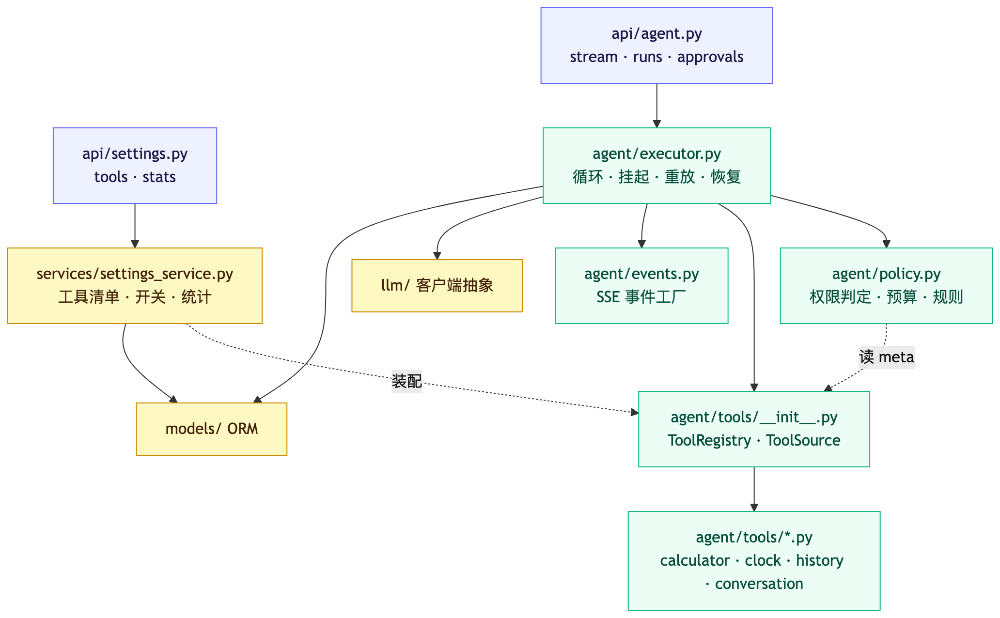
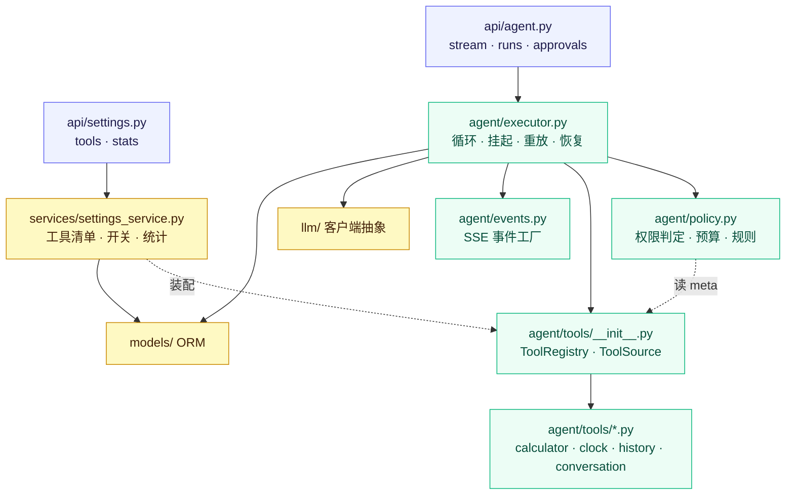
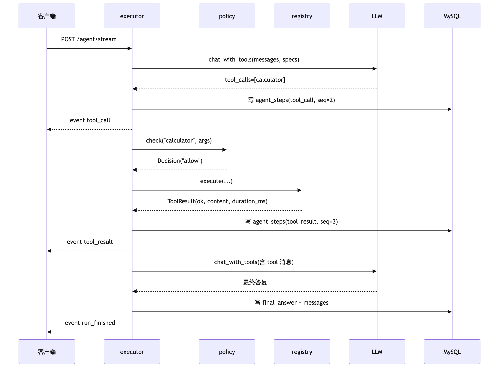
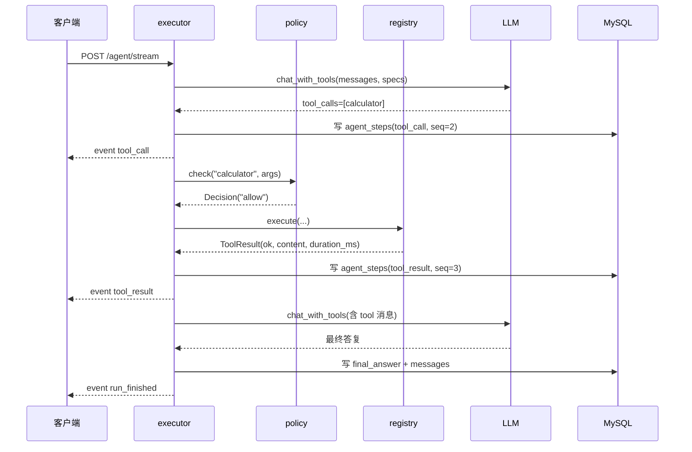
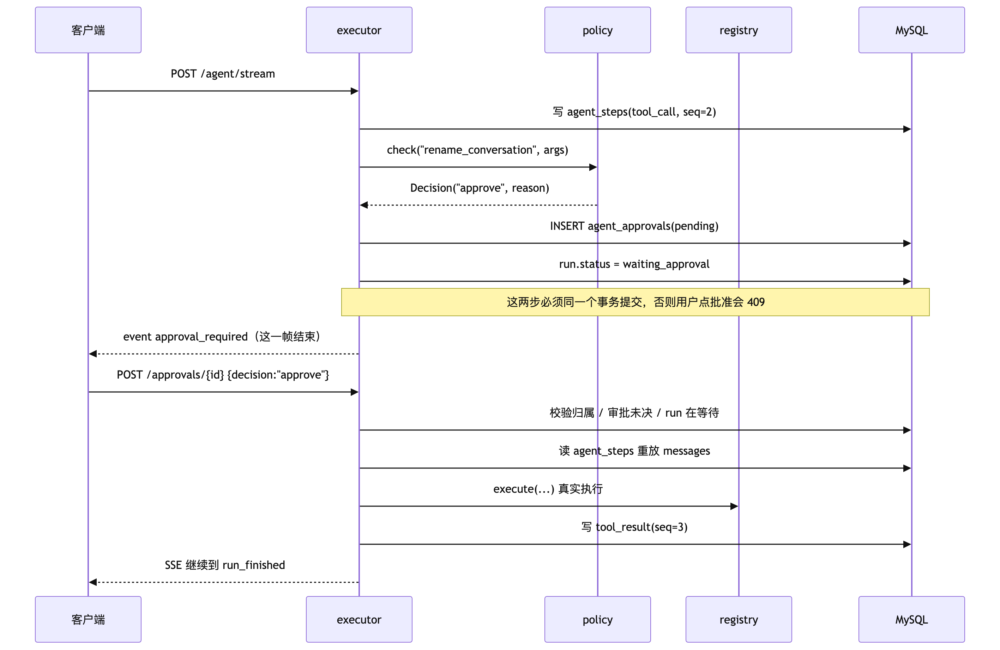
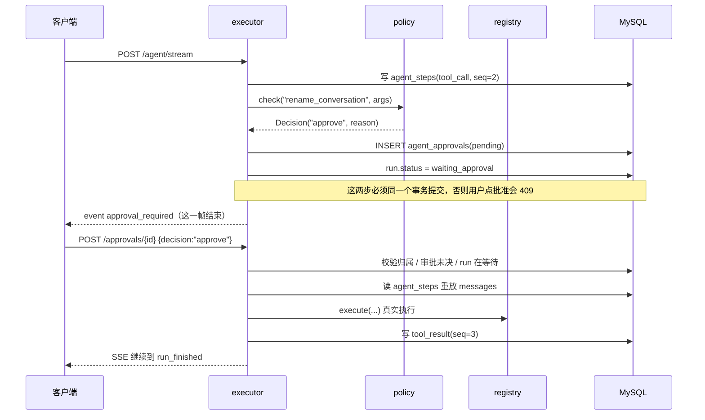

# 阶段 6 Agent 技术架构（读代码用手册）

> 面向「读懂 + 自己动手改」。这份文档只讲**现在的代码实际长什么样**，不讲理想架构。
> 设计动机见 [`tools.md`](tools.md) 与 [ADR-0011](adr/0011-tool-permissions-and-approvals.md)；接口细节见 [`api.md`](api.md) §6。

## 0. 三遍读法（约 90 分钟）

| 遍 | 目标 | 读什么 | 大概耗时 |
|---|---|---|---|
| 第一遍 | 知道每个文件负责什么 | §1 分层图 + §2 代码地图 | 15 min |
| 第二遍 | 把三条主流程在脑子里跑通 | §3 数据结构 + §4 时序 | 40 min |
| 第三遍 | 能改得动 | §6 扩展点 + §7 练习（边读边跑测试） | 35 min |

读代码时建议一直开着两个终端：

```bash
cd backend && make run                      # 或 ./scripts/dev.sh 起前后端
cd backend && .venv/bin/python -m pytest tests/test_agent_policy.py -q     # 改一处跑一处
```

## 1. 分层与依赖方向



<details>
<summary>mermaid 源码（改图时用）</summary>



</details>

**依赖只向下**：`api` → `agent` → `models`/`llm`。`policy.py` 认识 `ToolMeta`，但**不认识数据库**——审批次数是执行器算好传进去的，这一点很重要（§6.2 会用到）。

## 2. 代码地图

### 2.1 后端（`backend/`，共约 2300 行）

| 文件 | 行数 | 职责 | 关键符号（行号） |
|---|---|---|---|
| `app/agent/executor.py` | 697 | 循环本体、挂起/恢复、策略装配、审批决策 | `LoopState`(61) · `prepare_run`(70) · `stream_run`(112) · `resume_run`(143) · `_run_loop`(230) · `registry_for`(412) · `build_policy`(419) · `decide_approval`(465) · `_open_approval`(499) · `_replay_messages`(525) · `_execute`(574) |
| `app/agent/policy.py` | 149 | 工具权限判定、参数规则、预算与次数上限 | `Decision`(30) · `ParamRule`(48) · `ToolPolicy`(77) · `check`(89) · `_match_rule`(118) · `_approval_reason`(143) |
| `app/agent/tools/base.py` | 189 | 工具协议与元数据 | `ToolLevel`(19) · `ToolMeta`(41) · `Tool`(78) · `meta_of`(96) · `run_tool`(151) |
| `app/agent/tools/__init__.py` | 163 | 注册表与来源 | `ToolSource`(54) · `BuiltinSource`(62) · `build_registry`(81) · `ToolRegistry`(93) · `execute`(144) |
| `app/agent/tools/conversation.py` | 66 | 唯一的写工具 `rename_conversation` | `RenameArgs` · `RenameConversationTool` |
| `app/agent/events.py` | 72 | 八个事件工厂 | `tool_call`(26) · `approval_required`(41) · `run_finished`(61) |
| `app/api/agent.py` | 165 | 流式接口 + 审批接口 | `stream_agent` / `decide` / `list_approvals` |
| `app/models/agent_approval.py` | 83 | 审批行 | `AgentApproval` |
| `app/services/settings_service.py` | 337 | 工具清单/开关/统计 | `read_tool_settings` / `update_tool_settings` / `read_tool_stats` |

### 2.2 前端（`frontend/src/`）

| 文件 | 职责 | 关键符号（行号） |
|---|---|---|
| `api/agent.ts` | SSE 解析 + 四个请求 | `consume`(55) · `sendAgentStream`(106) · `decideApprovalStream`(122) · `listApprovals`(140) · `listAgentRuns`(152) |
| `stores/chat.ts` | 按会话隔离的运行时状态 | `PendingApproval`(53) · `pendingApproval`(129) · `applyAgentEvent`(348) · `appendAssistantMessage`(399) · `loadAgentRuns`(479) · `decideApproval`(504) |
| `components/chat/ApprovalCard.vue` | 审批卡片 | props `{approval, busy?}`(7) |
| `components/settings/ToolsPanel.vue` | 工具开关/预算/统计 | — |

### 2.3 测试地图（改代码时先知道去哪改测试）

| 测试文件 | 覆盖 |
|---|---|
| `tests/test_agent_registry.py` | 注册表：假工具即插即用、重名报错、禁用过滤、未知工具不抛异常 |
| `tests/test_agent_policy.py` | 策略：只读直通、写/外网挂起、参数规则、预算、次数上限 |
| `tests/test_agent_executor.py` | 循环：挂起事件序列、批准继续、拒绝回灌、`build_policy`、`registry_for` |
| `tests/test_agent_tools.py` | 工具本身（含 `rename_conversation` 的归属校验） |
| `tests/test_agent_api.py` | 接口：401/404/409、SSE 内容 |
| `tests/test_settings_api.py` | 工具设置与统计 |

## 3. 五个核心数据结构

### 3.1 `ToolLevel` + `ToolMeta`（`tools/base.py:19,41`）

```python
class ToolLevel(StrEnum):
    READ = "read"        # 只读，直接执行
    WRITE = "write"      # 改动用户数据，必须批准
    EXTERNAL = "external"# 请求外部服务，必须批准

@dataclass(frozen=True)
class ToolMeta:
    name: str
    description: str
    level: ToolLevel = ToolLevel.READ
    timeout_seconds: float = 2.0
    source: str = "builtin"
    requires_approval: bool = False   # 可由工具自己覆盖 level 的默认值
```

**不变量**：`meta_of()`(96) 是唯一推导入口——工具没声明 `level` 就当 `READ`，`requires_approval` 取 `DEFAULT_APPROVAL[level]`（`base.py:34`，READ=False、WRITE/EXTERNAL=True），工具也可以自己显式覆盖。所以「加一个写工具只要写一行 `level = ToolLevel.WRITE`」，不用改执行器。

⚠️ 注意 `ToolMeta.timeout_seconds` 目前**没有被使用**：`_execute`(574) 用的是模块级常量 `TOOL_TIMEOUT_SECONDS = 2.0`（`executor.py:53`）。这是练习 5 的题材。

### 3.2 `ToolRegistry`（`tools/__init__.py:93`）

存 `dict[str, Tool]` + `disabled: set[str]`。三个用法要分清：

```python
registry.specs()          # 给模型看的 schema —— 已过滤禁用
registry.execute(...)     # 真正执行 —— 禁用/未知都返回 ok=False
registry.meta(name)       # 给策略层看
```

`from_sources(...)`(108) 让 MCP/插件将来只是一份新的 `ToolSource`（`list() -> list[Tool]`）。

### 3.3 `Decision`（`policy.py:30`）

```python
@dataclass
class Decision:
    action: Literal["allow", "deny", "approve"]
    reason: str = ""
    fatal: bool = False      # deny 时：True=中止整个 run，False=回灌给模型换条路
```

`fatal` 是阶段 6 里最容易被忽略的字段：**「工具参数违规」和「本次运行审批次数用尽」都返回 deny，但前者应该让模型改参数重试，后者必须停**（否则模型会无限重试）。

### 3.4 `LoopState`（`executor.py:61`）

```python
@dataclass
class LoopState:
    seq: int = 0                 # 已写入 agent_steps 的最大序号
    failures: dict[str, int] = field(default_factory=dict)
    suspended: bool = False      # 挂起等审批
    finished: bool = False       # 正常收尾
```

`finally` 块靠这两个布尔决定要不要把 run 标成「运行被中断」（`executor.py:400-410`）。加新退出路径时**必须**设其中之一，否则会被误判成中断。

### 3.5 `AgentApproval`（`models/agent_approval.py`）

一行 = 一次待决定的写调用：`run_id / user_id / seq / tool_name / tool_args(JSON) / status / note / decided_time`。

**刻意不存 `reject_count`**：同一工具的拒绝次数是「查 `status='rejected'` 的行数」算出来的（`build_policy` 里做）。这样拒绝记录本身是审计日志，统计只是视图。

## 4. 三条主流程

### 4.1 A：只读工具（`calculator`）



<details>
<summary>mermaid 源码（改图时用）</summary>



</details>

要点：**每次工具往返各占一个 seq**（tool_call 一个、tool_result 一个），前端时间线就是按 seq 排的。

### 4.2 B：写工具挂起 → 审批 → 恢复



<details>
<summary>mermaid 源码（改图时用）</summary>



</details>

**为什么要「重放」而不是把 messages 存起来？**
`messages` 是 LLM 上下文，随时可以改格式；`agent_steps` 是事实记录，永久不变。重放 = 用事实重建上下文，避免两套真相。

`_replay_messages`(525) 的配对规则：
- `user_message` / `assistant_text` / `final_answer` → 原样映射
- `tool_call` + 紧随其后的 `tool_result` → 配成 `assistant(tool_calls=[call_{seq}])` + `tool(tool_call_id=call_{seq})`
- 最后那个**没有 result 的 `tool_call`** 就是挂起的那次 → 返回成 `pending`

⚠️ `tool_call_id` 是合成出来的 `call_{seq}`，不是模型原始 id——因为 `agent_steps` 没存原始 id，也不该为它加列（模型 id 只在那一次请求里有效）。

### 4.3 C：前端怎么把事件变成界面

```
AgentStreamEvent ──applyAgentEvent(thread, event)──▶ ChatThread.steps / approval
run_finished ─────appendAssistantMessage(thread)──▶ ChatThread.messages
```

`applyAgentEvent`（`stores/chat.ts:348`）四种分支：`tool_call`/`tool_result` 追加到 `steps`、`assistant_text` 追加、`approval_required` 写 `thread.approval`。

⚠️ 所有写入都针对**传进来的那个 thread**，不是「当前会话」——这是上一轮串台 bug 的修复方式，别改回去。

## 5. run 状态机

```
running ──正常完成──▶ completed
   │
   ├──需要审批──▶ waiting_approval ──批准/拒绝──▶ running ──▶ completed
   │                     │
   │                     └──30 天未决──▶ expired（清理任务）
   │
   ├──模型报错/超步/工具连续失败/审批次数用尽──▶ failed
   └──客户端断开（generator 关闭）──▶ failed("运行被中断")
```

只有一个 ingress 会写 `waiting_approval`：`_open_approval`(499)。只有两个 ingress 会从它出来：`decide_approval`(465) 的两条分支。

## 6. 六个扩展点（按「最常用 → 最进阶」）

### 6.1 加一个只读工具（10 分钟）

```python
# app/agent/tools/weather.py
class WeatherTool:
    name = "weather"
    description = "查某个城市今天的天气"
    level = ToolLevel.READ          # 不写也行，默认 READ
    Args = WeatherArgs              # pydantic BaseModel

    def run(self, args, *, user_id): ...
    def spec(self): ...             # 或者继承现有基类
```

然后在 `BuiltinSource.list()`（`tools/__init__.py:72`）里 `append` 一下。**执行器、策略层、前端都不用改**——这就是 T1 的目标。

### 6.2 加一条参数规则（5 分钟）

`policy.py:48` 的 `ParamRule(tool, path, deny_pattern=..., max_value=..., reason=...)`，加进 `DEFAULT_RULES`。

注意：规则的 deny 是**非 fatal** 的（`_match_rule` 返回原因字符串 → `Decision("deny", reason)`），模型会看到原因并换参数重试。想让某类调用直接终止，得显式 `fatal=True`。

### 6.3 加一个新等级（比如 `dangerous`）

三处联动，缺一不可：
1. `ToolLevel` 加枚举值；
2. `DEFAULT_APPROVAL` / `meta_of` 的默认审批判断（`base.py:96`）；
3. `_approval_reason`（`policy.py:143`）的字典——**KeyError 会直接 500**，因为那里是 `dict[meta.level]`。

`tests/test_agent_policy.py::test_write_and_external_tools_need_approval` 是最好的抄写模板；`DEFAULT_APPROVAL`（`base.py:34`）是那张字典本身，加等级时这里也要加一行。

### 6.4 换一套审批策略（比如「只允许白天执行写操作」）

`build_policy`(419) 负责把 DB 里的事实（今日调用数、本 run 审批数、各工具被拒次数）塞进 `ToolPolicy` 的构造参数。想加新维度就：
1. `ToolPolicy.__init__` 加字段；
2. `check()` 里在合适位置插入判断（顺序见 §8.1）；
3. `build_policy` 里查询并传入。

策略层保持「纯函数、不碰 DB」是刻意的：这样 `test_agent_policy.py` 能直接构造，不需要数据库。

### 6.5 接 MCP（阶段 7 的入口）

写一个 `McpSource`，实现 `list() -> list[Tool]`，每个远端工具包一层适配器，`meta_of(tool, source="mcp")`，`level` 默认给 `EXTERNAL`（外部服务一律要批准）。然后 `ToolRegistry.from_sources([BuiltinSource(...), McpSource(...)])`。

唯一需要小心的是：远端工具名可能和内置撞车 → `ToolRegistry.__init__` 会抛 `ValueError("工具名重复：…")`，加前缀（`mcp__filesystem__read`）是常见做法。

### 6.6 前端加一种事件

1. `api/agent.ts` 的 `AgentStreamEvent` 联合类型加一支（`consume` 不用改，它是通用 JSON 解析）；
2. `applyAgentEvent`(348) 加分支；
3. `ChatThread` 加字段（记得 `emptyThread()` 里初始化，否则新会话是 `undefined`）。

## 7. 手改练习（难度递增，每题都能用测试验证）

> 每题给出「改哪里 / 预期 / 怎么验证 / 容易踩的坑」。建议先自己改，卡住再看提示。

### 练习 1（★）：让 `now` 工具支持自定义格式

- 改：`app/agent/tools/clock.py` 的 `Args` 加 `fmt: str = "%Y-%m-%d %H:%M"`，`run()` 里用它格式化。
- 验证：`pytest tests/test_agent_tools.py -q`；再真跑一次「现在几点，用 ISO 格式」。
- 提示：`Args` 是 pydantic 模型，加字段后模型会自动看到新参数（`spec_of` 从模型生成 schema）。

### 练习 2（★★）：给 `search_conversations` 加「只搜最近 N 天」

- 改：`Args` 加 `days: int = Field(default=30, ge=1, le=365)`，SQL 加时间条件；再在 `DEFAULT_RULES` 里加一条 `days` 上限。
- 验证：`tests/test_agent_tools.py` + `tests/test_agent_policy.py`。
- 坑：`search_conversations` 是只读工具，参数违规走 deny（非 fatal），模型会自己把 `days` 调小——这正是设计意图。

### 练习 3（★★）：加一个写工具 `delete_conversation`

- 改：仿 `conversation.py`，`level = ToolLevel.WRITE`，`Args` 用 `conversation_id: int`，SQL 必须带 `user_id`（越权要 404 而不是删掉别人的）。
- 验证：`test_agent_tools.py` 加「别人的会话删不掉」；真跑一次，确认卡片出现、拒绝后没删。
- 坑：写工具的 `run()` 里**不要自己 commit 之外的副作用**（比如再发通知）——审批只管「执行/不执行」，不保证原子性。

### 练习 4（★★★）：把「审批次数用尽」的文案改成人话并带上剩余次数

- 改：`policy.py:108-114` 附近，deny 的 reason 加上 `f"（本次运行已用 {MAX_APPROVALS_PER_RUN} 次审批）"`。
- 验证：`tests/test_agent_executor.py::test_two_rejections_of_the_same_tool_block_further_calls` 与 `tests/test_agent_policy.py::test_approval_count_and_reject_limits`（两条都断言了关键字）——你会需要同时改断言，体验「改文案要顺手改断言」。
- 坑：这个 deny 是 `fatal=True`，文案会进 `run.error_message`，前端会显示在时间线上。

### 练习 5（★★★）：让每个工具自己的 `timeout_seconds` 生效

现状：超时已经有了（`_execute`(574) 用 `ThreadPoolExecutor` + `future.result(timeout=…)`），但用的是写死的 `TOOL_TIMEOUT_SECONDS = 2.0`，`ToolMeta.timeout_seconds` 形同虚设。

- 改：`_execute` 里先 `meta = tools.meta(call["name"])`，用 `meta.timeout_seconds` 替换常量；超时文案里的秒数也要跟着变。
- 验证：写一个 `sleep(3)` 的假工具（`timeout_seconds=0.1`），断言约 0.1s 返回 `ok=False`；再加一个 `timeout_seconds=5` 的慢工具，断言它能跑完（说明常量真的被换掉了）。
- 坑：`run_tool` 是同步函数，`_pool` 只有 4 个 worker；超时后 `future.cancel()` 对**已在执行**的任务无效——线程还在跑，只是结果被丢弃。想真正打断得换 `multiprocessing` 或把工具改 async，这是阶段 7 的议题。

### 练习 6（★★★★）：审批卡片支持「本次运行都批准这个工具」

- 改：前端 `ApprovalCard` 加第三个按钮；`decideApprovalStream` 的 body 加 `scope: "run"`；后端 `ApprovalDecisionRequest` 加字段，`decide_approval` 里把同 run 内该工具的后续 `pending` 一起置为 approved，并让 `build_policy` 的 `approvals_used` 相应扣减。
- 验证：`acceptance:tools` 加一项；`test_agent_api.py` 加「批量批准后不再挂起」。
- 坑：这是唯一会**改写多条审批行**的操作，注意事务边界（要么全批要么全不批）。

## 8. 设计与坑

### 8.1 `check()` 的判断顺序是有讲究的（`policy.py:89-115`）

```
未知工具 → 禁用 → 日预算 → 参数规则 → 需审批（次数上限 / 拒绝上限） → allow
```

- 未知工具放最前：模型幻觉出来的名字不该消耗预算；
- 预算在规则前：先确认「还能不能调」，再看「这次调得对不对」；
- 次数上限在最后：只有真的要挂起时才需要检查，少两次查询。

### 8.2 几个刻意的取舍

| 取舍 | 原因 |
|---|---|
| 审批不设过期时间 | 用户可能去开会，回来还能点；真正约束是次数上限 |
| 30 天未决标 `expired` 而不是删 | 审计需要「曾经挂起但没人管」这条事实 |
| `tool_call_id` 用 `call_{seq}` 合成 | 模型原始 id 只在单次请求内有效，存进库没有意义 |
| 拒绝写 `ok=false` 的 tool_result 回灌 | 让模型知道「用户不让做」，它才能换个说法完成任务，而不是报错退出 |
| 禁用的工具仍出现在设置清单 | 用户得能把它再打开；「看不见」和「关掉了」是两件事 |

### 8.3 踩过的真坑（改这块代码时大概率会再遇到）

1. **`run.status = RUN_RUNNING` 必须在 `_run_loop` 开头 commit**——`resume_run` 进来时状态还是 `waiting_approval`，不改回去 `prepare_run` 会一直 409。
2. **挂起前必须 commit**：`_open_approval` 里建行 + 改状态 + commit 是一组，少一个 commit，前端拿到 `approval_required` 后点批准就是 409。
3. **`finally` 里不要无脑 `_fail`**：`suspended=True` 时 run 是正常的，标 failed 会把待审批的 run 弄坏。
4. **`_replay_messages` 对 `final_answer` 也要处理**：历史 run 的最终答复在 `agent_steps` 里是 `final_answer`，漏掉会让上下文少一轮。
5. **MySQL DDL 非事务**：迁移里 downgrade 顺序错了会留下半套 schema，见 `docs/tools.md` 的排错记录。
6. **前端 `applyAgentEvent` 只写传入的 thread**：写 `activeThread` 就会重现「切会话串台」。

## 9. 十分钟自检清单

读完这份文档，你应该能回答：

- [ ] `ToolMeta` 和 `ToolSpec` 分别给谁看？（策略层 / 模型）
- [ ] 写工具挂起时，`agent_steps` 里最后一行是什么？`agent_approvals` 里多了一行什么？
- [ ] `resume_run` 为什么不能直接把 `messages` 存库？
- [ ] `Decision.fatal` 为 True 和 False 时，模型分别看到什么？
- [ ] 加一个新工具，最少要改几个文件？
- [ ] 如果审批 5 次上限写在 `check()` 最前面会发生什么？

答不上来的那一条，就是下一次该读的代码。
