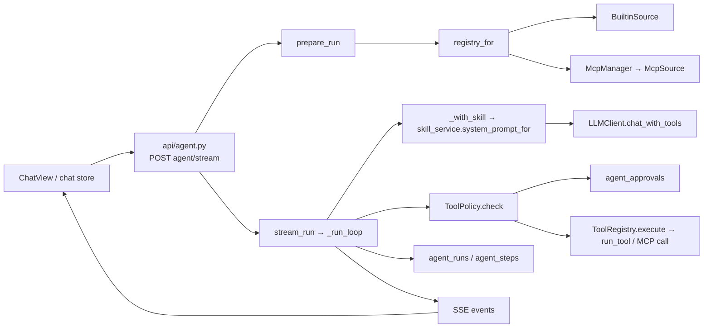
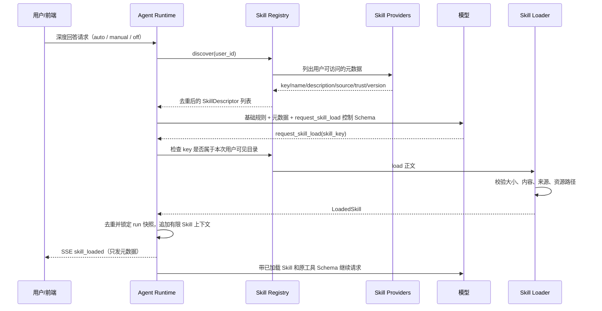
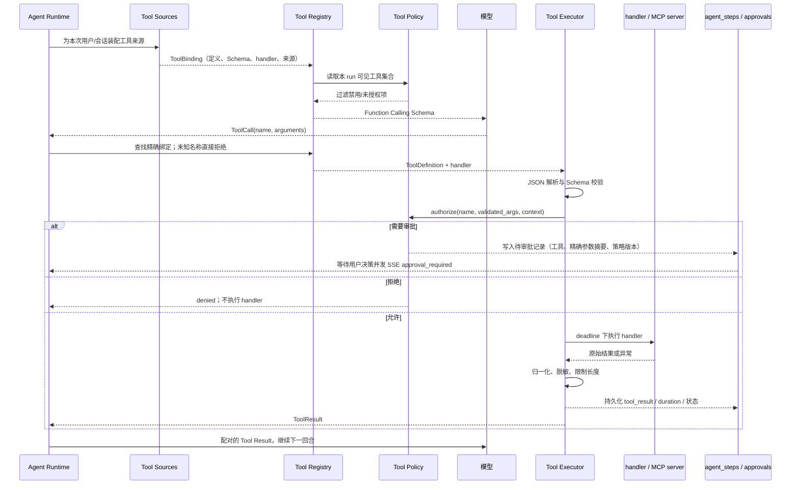
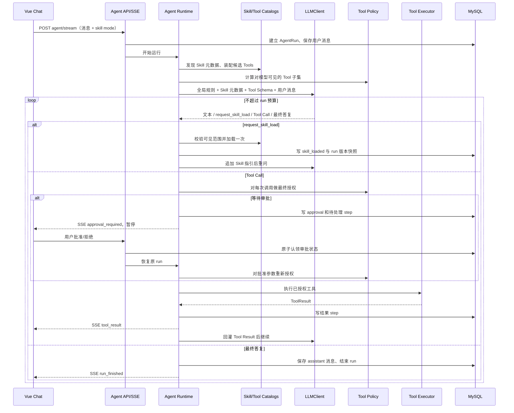

# My Agent Skill 与 Tool System 架构方案

> **状态：已确认，按阶段实施** · 2026-11-14
>
> 用户已确认按本文阶段计划实施。阶段 1–4 的代码与自动化验证已完成，本地迁移已完成且无漂移；真实模型验收因 DeepSeek 余额不足未完成；接口按实施中验证的最小契约落地并同步维护本文。

## 结论摘要

保留当前自研的单 Agent 循环、`LLMClient`、Tool Policy、审批持久化、MCP SDK 适配和 SSE 时间线，不引入 LangChain、LangGraph 等编排框架。主要演进方向是：

1. **Skill 渐进式发现与加载**：启动/运行时只向模型提供 Skill 元数据；模型通过 Runtime 的受控加载动作请求正文和资源。该动作是控制面请求，不注册成可执行 Tool。
2. **Tool 执行链显式分层**：Provider 提供工具，Registry 管名称与 Schema，Policy 决定是否可见/可执行，Executor 做本地校验、审批、限时执行和结果归一化。模型拿到 Schema 不等于拿到授权。
3. **保留两种 Skill 来源**：内置 Skill 继续用仓库文件；现有用户自定义 Skill 暂时继续从 `skills` 表读取。以后要支持用户上传目录时，再增加受控的文件包 Provider，不把用户给出的任意服务器路径当来源。
4. **先修执行边界，再增加自动能力**：恢复审批时重新校验授权；MCP 工具 Schema 在本地校验；MCP 风险级别由本地配置决定；Skill 内容不再作为可信系统政策注入。

## 1. 当前 Agent Runtime 架构分析

当前深度回答链路是：



| 部分 | 当前实现 | 代码位置 | 结论 |
|---|---|---|---|
| Agent 入口与运行 | `stream_agent_run` 准备运行、构造 registry/policy，再交给 `stream_run`；`_run_loop` 调 `LLMClient.chat_with_tools`，最多 8 轮 | `backend/app/api/agent.py`、`backend/app/agent/executor.py` | 已有轻量 Harness 和可回放步骤；循环本身承担了较多编排工作 |
| Tool 契约与注册 | `Tool`、`ToolMeta`、`ToolSpec`、`ToolResult`；`ToolSource`、`BuiltinSource`、`ToolRegistry` | `backend/app/agent/tools/base.py`、`backend/app/agent/tools/__init__.py` | 已有统一入口、JSON Schema 暴露、Pydantic 参数校验、禁用过滤、异常归一化；Registry 目前也直接负责执行 |
| 权限与审批 | `ToolPolicy.check()` 检查禁用、预算、规则、审批；审批写 `agent_approvals`，执行过程写 `agent_steps` | `backend/app/agent/policy.py`、`backend/app/agent/executor.py` | 已有“模型提议、服务端决策、人类审批”的基础结构；恢复执行的授权重检需要补齐 |
| MCP/工具市场 | `McpManager` 按服务器维护连接和工具缓存；`McpSource` 把远端工具包装成 `Tool`；设置页管理服务器 | `backend/app/mcp/`、`backend/app/api/mcp.py`、`frontend/src/components/settings/MarketPanel.vue` | 已有 MCP 接入市场，不是 Skills 市场，也不等同于有审核/签名/版本管理的公共插件商店 |
| Skill 发现与挂载 | 内置 `SKILL.md` 在模块加载时扫描并缓存；用户自定义 Skill 存数据库；一个会话保存一个 `skill_slug`，由用户手动选择 | `backend/app/skills/loader.py`、`backend/app/services/skill_service.py`、`backend/app/models/skill.py` | 已有文件格式和来源合并，但还不是运行期动态发现，也没有模型按需加载 |
| Skill 上下文 | `_with_skill()` 每次 run/resume 都读完整正文，`build_system_prompt()` 拼成 system 消息；Skill 的 `tools` 可收窄 Registry | `backend/app/agent/executor.py`、`backend/app/skills/models.py` | 没有渐进加载、引用资源、版本快照；用户内容与系统政策的信任层级需要分开 |
| 前端过程 | 深度回答走 Agent SSE；Pinia store 更新消息、执行时间线与审批卡；普通对话走独立的消息 SSE | `frontend/src/api/agent.ts`、`frontend/src/stores/chat.ts`、`frontend/src/components/chat/AgentTimeline.vue`、`ApprovalCard.vue` | 可以增量增加 Skill 事件；普通对话现阶段不自动进入 Agent Loop |

### 当前缺口与需要优先处理的风险

- `resume_run()` 对已批准调用直接走 `_execute()`，没有在恢复时再次调用 `ToolPolicy.check()`；授权应绑定具体工具、参数摘要和审批状态，并在实际执行前重检。
- `McpTool` 用 MCP `readOnlyHint` 将工具降为 `READ`。MCP 规范要求把工具注解视为不可信，除非来源服务器本身可信；外部读操作也可能发送用户数据，因此不能只靠远端提示跳过审批。
- MCP 参数模型 `McpArgs` 接受任意字段，当前主要依赖远端服务器校验；建议以原始 `inputSchema` 做本地校验，再由服务端二次校验。
- `_execute()` 用线程池等待超时并调用 `future.cancel()`；这不能保证已经运行的同步函数或子进程停止。MCP/外部操作需要可终止的进程/请求边界。
- 内置 Skill 的文件扫描发生在导入时；用户 Skill 走数据库。当前没有运行时目录刷新、完整 Skill 按需加载、`references/` 读取或脚本沙箱。
- 自定义 Skill 正文被拼进 system 消息。正文可能由用户编辑，应视为不可信的工作指引，不能与不可变的系统规则混为一层。

## 2. 设计原则与职责边界

| 概念 | 负责什么 | 不负责什么 |
|---|---|---|
| **Skill** | 可复用工作流程、领域知识、检查步骤、输出格式、资源索引 | 不执行代码/API，不授予权限，不改变 Policy |
| **Tool** | 明确输入 Schema、执行能力、风险与运行限制 | 不负责规划多步流程，不自行判断用户授权 |
| **Tool Provider** | 提供本地工具或 MCP 工具的定义和 handler | 不绕开 Runtime 执行，不决定模型是否应该调用 |
| **Registry** | 汇总、命名、去重、查找定义；形成一次 run 的候选工具集合 | 不代替授权判断，不持有跨请求的可变用户权限 |
| **Runtime** | 组织模型回合、Skill 加载、Tool Call、审批暂停/恢复、事件和步数限制 | 不把 Prompt 中的声明当权限依据 |
| **Policy** | 最终执行授权：用户设置、来源信任、角色、工具风险、参数规则、预算、审批状态 | 不接受模型或 Skill 对权限的覆盖 |

约束不变量：**Skill 只能补充指引，不能扩大 Tool Policy 的能力集合；模型可见的工具只是候选集；真正执行前每次都由后端 Policy 判定。**

## 3. 推荐模块划分与目录

尽量在现有边界上演进。`ToolSource`、MCP 适配目录和 Agent Runtime 都已存在；Provider 是边界协议，不再叠加插件管理框架或通用依赖注入容器。

```text
backend/app/
├── agent/
│   ├── executor.py             # 现有 Runtime：模型回合、Skill 控制动作、SSE/恢复编排
│   ├── policy.py                # 现有最终授权入口；审批决策也归此处复核
│   └── tools/
│       ├── base.py              # ToolDefinition、ToolContext、ToolResult、Tool 协议
│       ├── __init__.py          # 先保留现有 Registry 导出；稳定后可拆 registry.py
│       ├── builtin/             # 现有内置工具，按需整理，不为目录拆分而搬迁
│       └── executor.py          # 后续从 Registry 拆出参数校验、授权后执行、结果归一化
├── skills/
│   ├── models.py                # SkillDescriptor、LoadedSkill、SkillKey
│   ├── loader.py                # frontmatter、内容限制、资源安全读取
│   ├── registry.py              # 聚合来源、冲突检查、按 key 查找
│   └── providers/
│       ├── filesystem.py         # 仓库内置 Skill；将来受控用户 Skill 包
│       └── database.py           # 现有按 user_id 隔离的自定义 Skill
└── mcp/                         # 现有 SDK/manager/source 保持为 Tool Provider 适配层
```

`providers/` 仅在需要第二种来源时引入：第一阶段实际只需文件系统和现有数据库两种 Skill Provider，以及现有 `BuiltinSource`/`McpSource` 两种 Tool Source。不要提前实现远端 Skill 市场、任意插件加载或多 Agent Provider。

## 4. 核心数据结构与模块接口（架构级草案）

以下是模块责任的草案，不是最终 Python 类型或 HTTP 契约；确认后再做精确接口设计。

```python
@dataclass(frozen=True)
class SkillDescriptor:
    key: str                 # source + owner/scope + slug，稳定且无歧义
    name: str
    description: str         # 自动选择的主要信号
    source: str              # builtin | user | organization | future package
    trust: str               # trusted | user_authored | third_party
    version: str | None

@dataclass(frozen=True)
class LoadedSkill:
    descriptor: SkillDescriptor
    instructions: str
    content_hash: str
    resources: tuple[str, ...] # 相对 Skill 根目录的资源清单，不直接暴露绝对路径

class SkillProvider(Protocol):
    def discover(self, *, user_id: int) -> Sequence[SkillDescriptor]: ...
    def load(self, key: str) -> LoadedSkill: ...
    def read_resource(self, key: str, relative_path: str) -> bytes: ...

class ToolSource(Protocol):
    def list_tools(self, context: "ToolContext") -> Sequence["ToolBinding"]: ...

@dataclass(frozen=True)
class ToolDefinition:
    name: str
    description: str
    input_schema: dict[str, Any]       # 唯一规范 Schema，MCP 保留原始 JSON Schema
    source: str
    risk: str                          # read | write | external | privileged
    timeout_seconds: float
    output_schema: dict[str, Any] | None = None

@dataclass(frozen=True)
class ToolContext:
    user_id: int
    conversation_id: int
    run_id: int
    deadline: float
    request_id: str

@dataclass(frozen=True)
class ToolResult:
    status: str                        # succeeded | failed | timed_out | denied
    content: list[dict[str, Any]]      # 内部统一的文本/结构化内容块
    error_code: str | None
    duration_ms: int
    structured_content: dict[str, Any] | None = None

class ToolPolicy(Protocol):
    def visible_tools(self, context: ToolContext) -> set[str]: ...
    def authorize(self, name: str, args: dict[str, Any], context: ToolContext) -> "Decision": ...
```

要点：

- 内置 Pydantic 模型仍可生成 JSON Schema；MCP `inputSchema` 原样作为规范输入 Schema，并在本地验证。发给模型时由现有 `LLMClient` 适配成目标服务商的 Function Calling 格式。
- `ToolRegistry` 保存 `ToolDefinition + handler` 绑定；`ToolExecutor` 在调用前校验、授权、审批/执行、超时和结果归一化。现有 `ToolRegistry.execute()` 可以暂时委托给 Executor，逐步拆分。
- 工具风险等级来自代码或管理员/用户明确配置。MCP annotation、Tool 描述和模型 arguments 都是输入数据，不能直接设置风险等级或授权状态。
- 将 MCP 的文本、`structuredContent`、错误标志映射为 `ToolResult`；供模型和 UI 的内容分别做长度限制与脱敏，不能把任意二进制结果塞进提示词。
- 若启用 DeepSeek Thinking Mode 等有续接元数据要求的模型，提供商适配器负责原样保留其协议必需字段；推理元数据不进入聊天时间线。工具循环本身只依赖统一的 `ToolCallReply`。

## 5. Skill 从发现到加载

### 5.1 来源和优先级

初期保留两类来源：

1. **应用内置**：`backend/app/skills/<slug>/SKILL.md`，只读、随发布版本更新。
2. **用户自定义**：沿用 `skills` 表及 `user_id` 隔离。以后如果要上传 `references/`、`assets/`，存进应用管理的专属目录并由 DB 记录包标识；不接受客户端任意文件路径。

Registry 以 `source + owner scope + slug` 作为内部 key。相同来源/作用域内 slug 必须唯一；当前“内置优先、保留内置 slug”的规则继续有效。未来组织/用户来源冲突按 **平台内置 > 管理员发布 > 用户自建** 处理，隐藏被遮蔽项并提示冲突，不静默替换正在运行的 Skill。

现有 frontmatter 采用 `slug/name/description/tools`，字段长度也窄于 Agent Skills 开放规范。建议做兼容解析：新文件优先接受标准 `name`/`description` 与可选 `license`/`compatibility`/`metadata`；旧内置和数据库 Skill 暂时按旧格式读取。标准中的 `allowed-tools` 是实验字段，不能被当作免审批名单；本项目可保留旧 `tools` 为**只缩小候选范围**的兼容字段，后续逐步改为 `preferred_tools`（推荐工具提示），最终权限仍由 Policy 决定。

### 5.2 动态发现与渐进加载



加载规则：

- **启动/每次 run 只暴露元数据**。内置文件可按目录缓存，但要支持显式刷新或发布版本失效；数据库来源按用户查询。不要在 Web 服务启动时把用户 Skill 内容载入全局缓存。
- **自动选择**：模型通过 `request_skill_load` 控制动作请求；Runtime 校验用户范围和 Skill key，再按需读正文。这样不额外跑独立的“选 Skill”模型调用。
- **显式使用**：保留当前会话工具条手动选择。选中的 Skill 在第一次模型请求前加载；手动选择的 Skill 优先于自动发现，并在该 run 上固定版本。
- `request_skill_load` 是 Function Calling 协议承载的 Runtime 控制动作，不是 `ToolDefinition`，不进入 Tool Registry、不执行外部副作用，也不能放宽 Policy。
- 每个 run 对同一 `key + version` 只加载一次。建议初值：每 run 最多加载 3 个 Skill、Skill 总正文 12,000 字符；请求超限时回传可恢复错误并让模型继续，不无限重试。
- 被激活的 Skill 可再声明/引用 `references/`。后续增加单独的 `read_skill_resource` 控制动作，只能读取已加载 Skill 根目录下的相对路径。资源仍按不可信指引处理；不允许路径穿越、符号链接逃逸或任意绝对路径。
- 首期不在后端直接执行 Skill 的 `scripts/`。如果将来需要脚本，必须把它视为可执行 Tool，经沙箱、Policy、超时与审批，而不是由 Skill Loader `exec`。

## 6. Tool 注册、授权与执行



### Policy 的决策顺序

1. 确认调用名在本 run Registry 中存在，且用户/会话/服务器都启用；没有显示给模型的能力也不能被执行。
2. 用工具声明的本地 Schema 校验 arguments；校验失败不请求 MCP/handler。
3. 校验账户角色、工具来源信任、用户开关、参数规则、日/每 run 预算和外部目标策略。
4. 根据本地风险配置判定 `allow`、`approval_required` 或 `deny`。审批须绑定参数摘要、用户、run、tool/source 版本，并以数据库原子状态转换防止重放。
5. 执行前再次校验授权和审批仍有效；工具关闭、用户角色变化、服务器定义变化后不能沿用旧审批。

### Schema、结果和超时

- 内部只保留一种 JSON Schema；Pydantic 生成内置工具 Schema，MCP 保留 `inputSchema`。通过 `LLMClient` adapter 生成 OpenAI-compatible `tools[].function` 或目标模型方言。
- Schema 是模型生成 arguments 的约束，不是安全边界；服务端仍要本地验证。未知字段默认拒绝（个别工具有明确的自由对象 Schema 时例外）。
- 统一结果为 `succeeded/failed/timed_out/denied`，包含可供模型使用的内容块、稳定错误码、耗时和可选结构化内容。外部错误保留内部诊断 ID，不把远端堆栈、Token 或环境变量回灌给模型/浏览器。
- 保留当前初期串行执行。模型若给出多个 Tool Call，Runtime 按次序逐一过 Policy；遇审批即暂停，未执行调用保留或要求模型重新规划，不能丢掉未处理调用。只有明确无副作用且彼此独立的工具才考虑并行。
- 超时不等同于取消：HTTP 调用用请求超时和取消信号；stdio 工具在隔离子进程中按 deadline 终止；内置同步工具必须有可检查的 deadline 或明确承认软超时。

## 7. Skill、Tool 与 Agent Loop 的协同



Skill 加载和 Tool 调用都消耗统一的 run step/turn budget；另外分别设置 Skill 加载次数、Tool 调用次数和总 Token/上下文限制。重复 Skill 请求、未知 Skill、不可见 Tool、畸形参数、连续失败和预算耗尽均以结构化结果回到模型或终止 run，不用异常吞掉错误。

## 8. 前端 SSE 事件与交互

保留当前 Agent SSE endpoint 和既有事件：`run_started`、`assistant_text`、`tool_call`、`approval_required`、`tool_result`、`run_finished`、`error`。只增加字段和 Skill 事件，避免破坏现有 Pinia store/时间线。

| 建议事件 | 建议负载 | 前端处理 |
|---|---|---|
| `run_started` | `run_id`、`conversation_id`、本次模式 | 关联当前会话的忙碌状态 |
| `skill_loaded` | `seq`、`skill_key`、`name`、`source`、`version` | 时间线显示“已采用某 Skill”；不发送正文 |
| `skill_load_failed` | `seq`、`skill_key`、稳定 `error_code`、短原因 | 显示可恢复失败，不把文件路径或内部异常暴露给用户 |
| `tool_call` | `seq`、`tool_name`、`source`、`risk`、脱敏 args | 时间线显示调用意图与来源 |
| `approval_required` | `run_id`、`approval_id`、tool、args 摘要、原因、到期/策略信息 | 使用现有 `ApprovalCard`；批准/拒绝始终请求后端 |
| `tool_result` | `seq`、状态、摘要、耗时、错误码 | 更新时间线；内容长度受限 |
| `run_finished` / `error` | 现有字段 + 最终状态 | 结束该会话运行并更新回复 |

界面保留当前 Skill 选择器并增加运行模式概念：`auto`（模型可按需发现）、`manual`（加载用户选定项）、`off`。交互上默认行为要在确认设计时决定；建议先让用户显式打开 `auto`，避免自定义 Skill 在旧对话里突然开始介入。第一阶段只让**深度回答 Agent 路径**使用自动 Skill/Tool；普通 `/messages/stream` 不悄悄改语义。

工具市场继续管理 MCP server 的添加、试连、启停和来源展示；Tool Settings 管本地工具的开关/预算；Skill Settings 管用户自建 Skill。三个设置面板共享同一组运行状态事实，但概念不合并。

## 9. 数据持久化

| 数据 | 现状 | 建议 |
|---|---|---|
| 用户 Skill | `skills` 表存正文、tools 和用户归属 | 保留现表作为现有 DB Provider；增加单调递增 `revision` 和 `content_hash`。新包资源另由受控目录保存，不把资源内容塞入模型元数据 |
| 内置 Skill | 仓库 `SKILL.md`，进程导入时缓存 | 继续文件存储；以发布版本/hash 标识内容，缓存可失效 |
| Skill 加载记录 | 当前不单独记录加载版本 | `agent_steps` 增加 `skill_loaded` 元数据；`agent_runs` 保存用于恢复的有限 Skill 上下文快照（key/version/hash/正文/已读资源摘要），确保等待审批期间 Skill 更新也不改写当前 run |
| Tool 调用 | `agent_runs`/`agent_steps` 保存调用和结果 | 复用现有表，不新增独立调用表；补来源、风险、稳定错误码和策略决策摘要。参数按 Schema 标注敏感字段后脱敏 |
| 人工审批 | `agent_approvals` 持久化状态 | 保留；增加参数摘要/工具版本/原子认领信息，确保只批准一次且不能换参数 |
| MCP 服务器 | `mcp_servers` 保存配置、密文、启停和状态；连接/工具清单由 manager 缓存 | 保留；把“试连”与实际 Agent run 使用的凭据解析、网络策略和运行环境统一为同一 resolver |

上下文快照会含用户提供的指引，按会话数据级别隔离和保留；不要把正文重复写到每个时间线事件。Skill 删除后可以隐藏目录项，但当前仍在运行/等待审批的 run 需能从快照恢复。

## 10. 异常与安全设计

### Skill

- Provider 隔离错误：某个目录格式错误只将该 Skill 标记为不可用，不让整个 FastAPI 进程因用户 Skill 内容损坏而启动失败。
- frontmatter 解析使用安全 YAML；限制正文和资源大小、编码、目录深度；`resolve()` 后验证资源仍在 Skill 根目录内，拒绝 `..`、绝对路径和逃逸符号链接。
- 所有用户自建/第三方 Skill 都是**不可信指引**。UI 标记来源；提示组装中与固定系统策略分层；模型要求不能覆盖 Policy、安全规则或用户授权。不能用 Skill frontmatter 设白名单豁免审批。
- 用户内容不得放入共享全局缓存；Cache Key 含 source/owner/version；跨用户发现、加载和资源读取都按 `user_id` 再校验。

### Tool / MCP

- 对模型只暴露 Policy 当前允许探索的候选集合；执行时仍按完全相同的 user/run 上下文授权，拒绝模型伪造工具名或参数。
- MCP 描述、Schema、annotation、结果都按第三方数据处理。默认将外部工具看作 `EXTERNAL` 并要求审批；只有服务器管理员/用户在本地显式信任配置中认定后，才能降低特定调用的提示频率。`readOnlyHint` 仅是显示/辅助信息。
- stdio 会在后端主机启动程序。单机个人模式可继续使用；共享 Web 部署中应关闭普通用户 stdio，或把服务放入 CPU/内存/文件系统/网络均受限的容器。仅校验命令名不足以隔离可执行包。
- Streamable HTTP 要防 SSRF：域名解析、重定向、私有/链路本地地址和 DNS 重绑定都要在连接时限制；不能只检查输入字符串是否像公网 URL。
- 超时、连接失败、远端 `isError`、Schema 不符、无效 UTF-8、返回过大均有稳定错误码；服务端记录诊断 ID，回模型的错误不包含密钥或堆栈。
- `resume_run` 必须原子地把审批从 pending 改成 approved/rejected，再对同一工具版本和参数 hash 重新 authorize；Policy 变化或工具不可用时安全拒绝，不执行旧授权。
- 限制每 run 的工具调用、Skill 加载、审批数、并发、返回内容和上下文规模；所有限制在后端执行，不能由前端开关代替。

## 11. 单元测试与集成测试方案

阶段 1 已运行后端针对性验收：Agent 审批/执行器、Policy、MCP Source 共 39 项通过。完整后端与前端验收待后续阶段完成后执行。

### Skill 单元测试

- 标准和旧 frontmatter 解析、必填字段/slug/重复名/大小限制；错误 Skill 隔离，不影响其他来源。
- 文件发现刷新、DB 用户隔离、来源优先级、版本变更与 hash；同一 Skill 同 run 只加载一次。
- `request_skill_load` 只能加载本 run catalog 内的 key；引用资源拒绝路径穿越、绝对路径和 symlink escape；总上下文与加载次数超限。
- 用户 Skill 不会影响固定 system policy，不会改变 Policy/审批级别；Skill 的旧 `tools` 字段只能做 capability intersection。

### Tool / Policy 单元测试

- Builtin Pydantic 与 MCP JSON Schema 对象、必填、枚举、嵌套、oneOf 等输入校验；无效/未知调用从不触发 handler。
- 可见 Schema 与可执行集合一致；用户禁用、权限不足、参数规则违规、预算超限、未知工具各自正确拒绝。
- read/write/external/privileged 审批矩阵；远端 annotation 不能降低本地风险；审批参数 hash 不匹配、审批重放、策略变更、并发批准均拒绝。
- timeout 与进程/网络取消、异常映射、超大/结构化 MCP 输出、敏感字段脱敏、MCP `isError`。

### Runtime、API 与前端集成

- `FakeLLMClient` 剧本覆盖：不加载 Skill 的回答、加载一次、连续加载、重复加载、Skill 加载失败后继续、Skill 后再调用 Tool、多轮 Tool Call、预算终止。
- 运行中审批后恢复：Skill snapshot 不变、批准工具重新授权一次、拒绝结果回到模型、SSE 和 DB 步骤顺序一致、浏览器断流能记录最终状态。
- FastAPI SSE 契约测试覆盖新增 Skill 事件且保留旧事件；每个 run 和审批仍按用户隔离。
- Vue store/时间线测试 Skill 加载状态、工具来源/风险、审批卡和切换会话；`acceptance:agent`、`acceptance:skills`、`acceptance:mcp` 覆盖端到端。

## 12. 分阶段实施计划

| 阶段 | 范围 | 成本 | 验收出口 |
|---|---|---|---|
| 0. 决策确认 | 确认 auto 默认值、Skill 信任范围、MCP read-only 信任规则、共享部署是否允许 stdio | 低 | ✅ 用户已确认本文方案；auto 初期由用户显式开启，MCP 远端提示不具备授权效力 |
| 1. 执行安全边界 | 审批恢复重检与原子认领；本地 MCP Schema 校验；MCP 风险本地配置；统一试连/运行凭据解析；明确真实 timeout/取消语义 | 中 | ✅ 40 项针对性后端测试通过；数据库迁移新增审批工具定义指纹 |
| 2. Skill Registry 与 Loader | 抽取 Skill descriptor/provider/registry；保留内置文件 + 用户 DB 两来源；兼容旧格式并支持标准元数据；目录只给元数据、正文按需加载 | 中 | ✅ 完成：发现/优先级/版本/按需加载/用户隔离；`tests/test_skills.py` 24 项通过 |
| 3. Agent Loop 与 SSE | 增加 Runtime `request_skill_load` 控制动作，计入 step budget；加入 `skill_loaded`/失败事件；把 Skill 选择模式接入深度回答 UI | 中 | ✅ 代码与自动化验收完成；Fake LLM、SSE、页面/组件测试通过，真实服务联调待验收 |
| 4. Skill Resources 与 run 恢复 | 安全读取 `references/`/`assets/`；版本快照用于审批恢复；脚本先保持不可执行 | 中 | ✅ 文本资源安全读取、首次读取快照、恢复一致性与前端状态完成；实现限制见 docs/skills.md |
| 5. 扩展治理 | 有明确需求后再做用户上传包、管理员审核/组织级来源、MCP OAuth、限权容器、指标与运行保留策略 | 高，按需 | 以部署环境和风险验收，不阻塞当前单机/内置生态 |

**阶段顺序建议**：阶段 1 先于自动 Skill 加载，阶段 2–4 再形成渐进式 Skill 闭环。现在不需要引入新 Agent 框架；只有需要跨进程 worker/检查点、复杂分支图、多人协作或大规模并行后，才重新评估编排框架。

## 13. 方案比较与取舍

| 选择点 | 方案 | 取舍 | 推荐 |
|---|---|---|---|
| 自动 Skill 选择 | 独立模型规划调用 / 每次靠关键词规则 / 在现有 Loop 中请求 Runtime 加载 | 独立调用多一次成本且多一套流程；关键词不可泛化；Loop 内按需加载仅在命中时多一轮 | **Loop 内控制动作**，显式选择则直接加载 |
| Skill 来源 | 全改文件系统 / 全保留数据库 / 文件系统 + 现有 DB Provider | 全文件系统难做 Web 多租户与用户编辑；全 DB 不便携带 references/scripts；迁移会打断现有功能 | **两来源并存**，统一成 `SkillDescriptor`，用户 DB 不迁走 |
| Skill 工具字段 | 当权限白名单 / 纯推荐 / 仅作为可选收窄项 | 当权限容易误把 Skill 当授权；纯推荐灵活但兼容当前旧白名单需要迁移 | **只允许与 Policy 能力集合求交集**，后续重命名为推荐工具提示；绝不扩权/免审批 |
| Tool 执行框架 | 继续内置最小 Runtime / 引入 LangGraph 等 | 当前线性单 Agent、持久步骤和审批已在自研 Loop 中；换框架意味着双重状态与改写 API | **继续现有 Loop**，先拆清 ToolExecutor 边界 |
| 外部工具调用 | 模型一返回多个就并行 / 所有工具串行 / 按副作用和依赖分类 | 并行提高吞吐但审批和取消复杂；全串行简单且已有时间线 | **首期串行**，只对显式无副作用、互不依赖的调用开放并行 |
| Skill 脚本 | Loader 直接执行 / 包成普通 Tool / 首期不执行 | 直接执行绕过审批与隔离；Tool 执行需要沙箱与安全策略 | **首期不执行**；未来必须经过 Tool Policy 和独立沙箱 |

## 14. 参考资料与依据

- 项目当前实现与既有取舍：[`docs/agent.md`](agent.md)、[`docs/tools.md`](tools.md)、[`docs/mcp.md`](mcp.md)、[`docs/skills.md`](skills.md)、[ADR-0010](adr/0010-agent-execution-loop.md)、[ADR-0011](adr/0011-tool-permissions-and-approvals.md)、[ADR-0012](adr/0012-mcp-client-uses-official-sdk.md)、[ADR-0013](adr/0013-skills-as-method-packages.md)。
- 本次 CodeGraph MCP 实际使用：`mcp__codegraph__codegraph_explore`（设计阶段 12 次查询；实施阶段继续使用同一工具），覆盖 Agent Runtime/执行器、Tool Registry/Policy、Skill Loader/Service、MCP Manager/Source、Agent API/SSE 与前端状态更新；没有调用其他 CodeGraph 工具。
- Agent Skills 开放规范：目录/`SKILL.md`、元数据校验、可选 `references/`/`scripts/`/`assets/` 与 progressive disclosure，见 [Agent Skills Specification](https://agentskills.io/specification)。
- Claude Code Skills：自动或显式启用、正文按需加载、Skill 与底层工具/权限分层，见 [Extend Claude with skills](https://code.claude.com/docs/en/skills)。
- OpenAI Skills 与 MCP：Skill 描述可先发现再加载正文；Skill 提供工作流，MCP 提供实时数据/认证/受控动作，见 [Skills](https://developers.openai.com/api/docs/guides/tools-skills) 与 [Skills for Plugins](https://developers.openai.com/plugins/concepts/skills)。
- MCP Tool 规范：工具 Schema、调用/结果格式、客户端 UI 与人工拒绝能力，以及 annotation 对不可信服务器的限制，见 [MCP Tools](https://modelcontextprotocol.io/specification/2025-11-25/server/tools)。
- DeepSeek Tool Calling：Function Calling 是模型提出调用、应用侧执行并把结果回灌的多轮协议；Thinking Mode 的续接元数据属于模型适配层，见 [Tool Calls](https://api-docs.deepseek.com/guides/tool_calls/) 与 [Thinking Mode](https://api-docs.deepseek.com/guides/thinking_mode/)。
