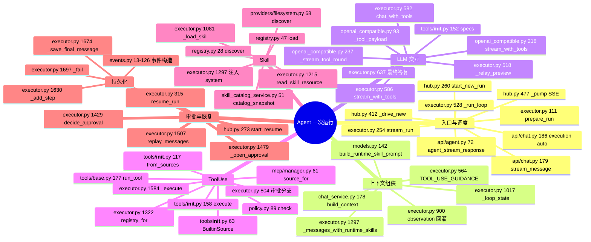

# Agent 全链路追踪图（断点版）

> 代码基准：主工作树 `codex/skill-tool-system` @ `13b5701`，行号于 2026-11-20 对照源码核对。
> `.agents/worktrees/dsh-*` 里的快照停在旧提交（executor 784 行、没有 `hub.py` / `skills/registry.py`），**不要用那份代码对行号**。
> 可视化版本：[`agent-trace-map.html`](agent-trace-map.html)（浏览器打开，可折叠/搜索）。

---

## 0. 一张图看懂

```text
frontend/src/api/agent.ts:211   POST /api/conversations/{id}/messages/stream  (execution=auto)
  └─ backend/app/api/chat.py:179  stream_message
       └─ api/chat.py:186          execution == "auto" ? ──否──> 普通流式（chat_service.stream_reply）
            └─ api/agent.py:72    agent_stream_response
                 ├─ executor.py:111  prepare_run         ← 同步：校验、落库、历史上下文
                 │    └─ chat_service.py:178  build_context
                 └─ hub.py:260       run_hub.start_new_run ← 执行转到守护线程
                      └─ hub.py:412  _drive_new
                           └─ executor.py:254  stream_run
                                └─ executor.py:528  _run_loop（最多 8 轮）
                                     ├─ 组上下文：历史消息 + Skill 目录/指引 + TOOL_USE_GUIDANCE
                                     ├─ executor.py:582/586  llm.chat_with_tools / stream_with_tools
                                     ├─ 没有 tool_calls ──> 最终答复 ──> SSE run_finished
                                     └─ 有 tool_calls
                                          ├─ Skill 控制调用 ──> _load_skill / _read_skill_resource
                                          └─ 普通工具 ──> policy.check ──> (需审批?) ──> _execute
                                                            └─ observation 回灌 messages，进入下一轮
  ← SSE：hub.py:477 _pump 把 run 频道里的事件推给浏览器
```

两条容易混淆的路径：

| 路径 | 入口 | 是否走 Agent 循环 |
|---|---|---|
| 普通流式对话 | `POST /conversations/{id}/messages/stream`（`execution` 缺省） | 否，`chat_service.stream_reply` 单次 `llm.stream` |
| Agent 循环 | 同上但 `execution=auto`，或 `POST /conversations/{id}/agent/stream` | 是，`prepare_run → RunHub → _run_loop` |

---

## 1. 五个万能断点

先在这五处各下一个断点，90% 的问题能定位到环节：

| # | 断点 | 看什么 |
|---|---|---|
| 1 | `backend/app/agent/executor.py:582` | 每轮发给模型的完整 `round_messages`、`specs`（工具声明）、`state.loaded_skills` |
| 2 | `backend/app/agent/executor.py:606` | 模型这一轮返回了哪些 `calls`、`finish_reason`、`content` 长度 |
| 3 | `backend/app/agent/executor.py:775` | 工具调用落库前：`call["name"]`、`call["arguments"]` 原始 JSON |
| 4 | `backend/app/agent/policy.py:89` | 为什么 allow / deny / approve：`decision.action`、`decision.reason` |
| 5 | `backend/app/skills/models.py:142` | Skill 指引与目录是怎么拼成 system prompt 的 |

---

## 2. 思维导图



---

## 3. 分段链路与断点表

### 3.1 入口与运行调度

| 环节 | 位置 | 断点 | 观察 | trace / 事件 |
|---|---|---|---|---|
| 前端发起 | `frontend/src/api/agent.ts:211`、`:216` | 211 | `execution: 'auto'`、`skill_mode` | — |
| HTTP 入口（兼容路由） | `backend/app/api/chat.py:179` | 179 | `payload.execution`、`skill_keys` | — |
| 分支到 Agent | `backend/app/api/chat.py:186` | 186 | `payload.execution == "auto"` | — |
| Agent 专用路由 | `backend/app/api/agent.py:60` | 60 | `payload.skill_mode` | — |
| 同步准备 | `backend/app/api/agent.py:72` | 72 | `prepare_run` 的返回值 | — |
| 校验/落库/建 run | `backend/app/agent/executor.py:111` | 111、131、134、187、211、219 | `is_first_message`、`run.id`、`snapshot` | `agent.prepare`（`trace_context`） |
| 历史上下文 | `backend/app/services/chat_service.py:178` | 178、193 | `context` 条数与角色顺序 | `chat.context.history` |
| 启动守护线程 | `backend/app/agent/hub.py:260` | 260、358、367、389 | `run_id`、`thread.name` | — |
| 线程内执行 | `backend/app/agent/hub.py:398`、`:412` | 412 | `registry`、`policy` | — |
| 进入循环 | `backend/app/agent/executor.py:254` | 254、278、298 | `state`、`tools.names()` | `agent.start` |
| SSE 推送 | `backend/app/agent/hub.py:477` | 477、201 | 事件类型、`stop_requested`、草稿写入 | — |

关键点：

- `prepare_run` 是**同步**的，404/400/409 走普通 JSON；只有开始循环后才是 SSE。
- 执行不在请求线程里，`hub.py:367` 会 `threading.Thread(name="agent-run-{id}")`；断点要挂在**子线程**上（IDEA/PyCharm 勾选 Suspend: All，VS Code 默认全挂起）。
- 同一进程里 `MAX_CONCURRENT_RUNS=4`，超过会排队；`hub.py:67` 有单进程断言。

### 3.2 上下文组装（历史 / ToolUse / Skill）

| 环节 | 位置 | 断点 | 观察 |
|---|---|---|---|
| 历史消息裁剪 | `backend/app/services/chat_service.py:178` | 178 | `CONTEXT_LIMIT=20` 之后保留的条数 |
| 循环状态恢复 | `backend/app/agent/executor.py:1017` | 1017 | `state.rounds`、`state.loaded_skills`、`state.skill_catalog` |
| 拼本轮消息 | `backend/app/agent/executor.py:1297` | 1297、1311 | `round_messages[0]` 是否 Skill system |
| Skill 提示词 | `backend/app/skills/models.py:142` | 142 | `catalog` 条数、`instructions` 截断 |
| 推理模式提示 | `backend/app/agent/executor.py:564` | 564 | `TOOL_USE_GUIDANCE`（常量在 `:84`）是否插入 |
| 工具 observation 回灌 | `backend/app/agent/executor.py:900` | 900、908 | 追加的 `role="tool"` 消息、`tool_call_id` |
| assistant 工具请求回灌 | `backend/app/agent/executor.py:667`、`:681` | 681 | `tool_calls` 是否原样带回 |

上下文实际由四层拼成：

1. `chat_service.build_context`：system 消息全带 + 最近 20 条非 system（正序）。
2. `_messages_with_runtime_skills`：auto 模式下，把**未加载**的 Skill 目录 + 使用说明插到最前面（只在还有未加载 Skill 时）。
3. `TOOL_USE_GUIDANCE`：`reasoning_effort` 非空时再前置一条 system，要求先说明再调工具。
4. 循环内追加：assistant `tool_calls` 消息、tool observation 消息、Skill 加载结果消息。

### 3.3 LLM 交互

| 环节 | 位置 | 断点 | 观察 |
|---|---|---|---|
| 选模型 | `backend/app/llm/__init__.py:96`、`:126` | 96 | 走 `FakeLLM` 还是 `OpenAICompatibleClient`，`base_url`/`model` |
| 工具声明 | `backend/app/agent/tools/__init__.py:152` | 152 | `specs` 只含 enabled，Skill 控制工具是否在列 |
| 组装请求 | `backend/app/agent/executor.py:569` | 569 | `trace_context` 里的工具名列表、轮次 |
| 非流式调用 | `backend/app/agent/executor.py:582` | 582 | 请求前最后一刻的 `round_messages` |
| 流式调用 | `backend/app/agent/executor.py:586` | 586 | `stream_with_tools` 生成器 |
| 流式转发 | `backend/app/agent/executor.py:518` | 518 | `assistant_delta` 分片 |
| HTTP 载荷 | `backend/app/llm/openai_compatible.py:93` | 93 | `tools`、`tool_choice`、`reasoning_content` 是否带上 |
| 上游 SSE 解析 | `backend/app/llm/openai_compatible.py:148`、`:237` | 237 | `delta.content` / `delta.tool_calls` 帧 |
| 工具调用合并 | `backend/app/llm/openai_compatible.py:407` | 407 | `index`、`id`、`name`、`arguments` 分片拼接 |
| 返回落库 | `backend/app/agent/executor.py:601`、`:606` | 606 | `reply["model"]`、`calls` 的 `argument_chars` |
| 最终答复 | `backend/app/agent/executor.py:637` | 637、662 | `append_web_sources`、`run.status` |

两类客户端的差别：`FakeLLM` 按剧本返回 `tool_reply()/final_reply()`（`backend/app/llm/fake.py:88`），真实模型走 `stream_with_tools`（DeepSeek 带 `reasoning_content`）。排查「模型不调工具」时先看 `:152` 的 `specs`，再看 `:93` 的载荷。

### 3.4 ToolUse：发现 → 注册 → 使用

#### 发现与注册

| 环节 | 位置 | 断点 | 观察 |
|---|---|---|---|
| 注册表总入口 | `backend/app/agent/executor.py:1322` | 1322 | `tools_disabled`、MCP 服务器列表 |
| 内置工具 | `backend/app/agent/tools/__init__.py:63` | 63 | 四个内置工具是否都返回 |
| MCP 工具 | `backend/app/mcp/manager.py:61` | 61、85、94 | 连接复用、`list_tools` 结果、schema 校验 |
| 合并去重 | `backend/app/agent/tools/__init__.py:117` | 117 | 重名 `ValueError('工具名重复：...')` |
| 注册表快照 | `backend/app/agent/executor.py:1374` | 1374 | `trace('agent.tools.registry')` 里的数量 |

#### 使用与审批

| 环节 | 位置 | 断点 | 观察 |
|---|---|---|---|
| 模型请求工具 | `backend/app/agent/executor.py:775`、`:787` | 775 | `STEP_TOOL_CALL` 落库前的 `tool_args` |
| 策略判定 | `backend/app/agent/policy.py:89` | 89 | `decision.action` / `reason` / `fatal` |
| 审批挂起 | `backend/app/agent/executor.py:804`、`:815` | 804 | `run.approval_context`、`deferred_ids` |
| 审批落库 | `backend/app/agent/executor.py:1479` | 1479 | `AgentApproval`、`RUN_WAITING_APPROVAL` |
| 用户决定 | `backend/app/agent/executor.py:1429` | 1429 | 条件 UPDATE 的 `rowcount` |
| 恢复执行 | `backend/app/agent/hub.py:273` → `executor.py:315` | 315、346 | `messages`、`pending` |
| 重放步骤 | `backend/app/agent/executor.py:1507` | 1507 | 合成的 `call_id`、`pending` |
| 真正执行 | `backend/app/agent/executor.py:1584` | 1584 | 线程池 `agent-tool`、`timeout_seconds` |
| 工具内部 | `backend/app/agent/tools/__init__.py:158` → `base.py:177` | 177 | 参数校验失败原因、`ToolResult.ok` |
| MCP 工具内部 | `backend/app/mcp/source.py:78` | 78 | `tool.mcp.validate/call/result` |
| 结果回灌 | `backend/app/agent/executor.py:858`、`:900` | 858 | 截断到 2000 的展示文本 vs 完整 `content` |

工具执行在 `ThreadPoolExecutor(max_workers=4, thread_name_prefix="agent-tool")` 里（`executor.py:1584` 附近），超时默认 2 秒；超时后如果是「可能已产生副作用」会标 `timeout_uncertain` 并中止。

### 3.5 Skill：发现 → 注册 → 使用

#### 发现与注册

| 环节 | 位置 | 断点 | 观察 |
|---|---|---|---|
| 目录根 | `backend/app/services/skill_catalog_service.py:23` | 23 | builtin / shared / user 三类根 |
| 扫描与缓存 | `backend/app/services/skill_catalog_service.py:51` | 51、81 | `rescan`、`_signature` 是否变化、缓存命中 |
| 文件系统发现 | `backend/app/skills/providers/filesystem.py:68` | 68 | 每个 `SKILL.md` 的 key/version |
| 注册表合并 | `backend/app/skills/registry.py:28` | 28 | provider 顺序、同 slug 遮蔽 |
| 解析 SKILL.md | `backend/app/skills/loader.py:77`、`:99` | 99 | frontmatter、正文、`content_hash` |
| 版本校验 | `backend/app/services/skill_catalog_service.py:38` | 38 | 前端传来的 `skill_catalog_version` 是否过期（409） |

#### 使用

| 环节 | 位置 | 断点 | 观察 |
|---|---|---|---|
| 会话挂载 | `backend/app/services/skill_service.py:33` | 33 | `conversation.skill_slug` |
| 准备阶段带上目录 | `backend/app/agent/executor.py:156`、`:187` | 187 | `skill_snapshot` 里的 `catalog` |
| 自动注入目录 | `backend/app/agent/executor.py:1297` | 1297、1311 | `build_runtime_skill_prompt` 的入参 |
| 模型请求加载 | `backend/app/agent/executor.py:683`、`:719` | 719 | `agent.skill.dispatch` / `agent.skill.load` |
| 校验并加载 | `backend/app/agent/executor.py:1081` | 1081 | 失败原因：`unknown_skill`/`already_loaded`/`skill_limit`/`unavailable`/`version_changed`/`context_limit` |
| 真正读取 | `backend/app/skills/registry.py:47` → `filesystem.py:126` | 47 | `LoadedSkill.instructions`、`resources` |
| 加载失败 | `backend/app/agent/executor.py:1055` | 1055 | `STEP_SKILL_LOAD_FAILED` |
| 读取资源 | `backend/app/agent/executor.py:1215` | 1215 | 8 个资源、32KB 上限 |
| 资源工具声明 | `backend/app/agent/executor.py:1199`、`:1282` | 1282 | 内部工具名 `__runtime_read_skill_resource` |

Skill 的三种上下文形态要分清：

1. **目录（catalog）**：只有名称/描述/版本，随 `build_runtime_skill_prompt` 进 system。
2. **指引（instructions）**：模型调用 `__runtime_request_skill_load` 后，作为 tool observation 回灌，并写入 `run.skill_snapshot`。
3. **资源（resources）**：`references/`、`assets/` 下的文件，按需用 `__runtime_read_skill_resource` 读，计入 32KB 预算。

### 3.6 事件、步骤与失败

| 环节 | 位置 | 断点 | 观察 |
|---|---|---|---|
| 步骤落库 | `backend/app/agent/executor.py:1630` | 1630 | `seq`、`kind` |
| 事件构造 | `backend/app/agent/events.py:13`–`:126` | 各构造器 | 事件 payload 字段 |
| 最终消息 | `backend/app/agent/executor.py:1674` | 1674 | `messages` 表写入 |
| 失败收尾 | `backend/app/agent/executor.py:1697` | 1697 | 错误码 500/502/504、`RUN_FAILED` |
| 中断收尾 | `backend/app/agent/executor.py:933` | 933 | 客户端断开 / 停止请求 |

---

## 4. 端到端调试配方

### 配方 A：普通提问，确认上下文对不对

1. `executor.py:111`（prepare_run）——确认 `is_first_message` 与会话正确。
2. `chat_service.py:178`（build_context）——看返回的消息条数与顺序。
3. `executor.py:563`（round_messages）——看 Skill system 是否被插入。
4. `executor.py:582`（chat_with_tools）——完整请求。
5. `executor.py:606`——返回内容。
6. `executor.py:637`——最终答复落库。

### 配方 B：工具调用 → 审批 → 恢复

1. `executor.py:775`：确认 `name`/`arguments` 是模型真实输出。
2. `policy.py:89`：`action=approve` 且 `requires_approval=True`。
3. `executor.py:815`：`approval_context` 已写、状态变 `waiting_approval`。
4. 前端审批后：`hub.py:273` → `executor.py:315`。
5. `executor.py:346`：`_replay_messages` 的 `pending` 是否就是要审批的那一条。
6. `executor.py:401`–`:422`：批准后 `policy.check(approval_granted=True)`、`_execute`。
7. `executor.py:900`：observation 是否以 `role="tool"`、正确 `tool_call_id` 追加。

### 配方 C：Skill 自动加载没生效

1. `skill_catalog_service.py:51`：catalog 里有没有目标 Skill（看 `rescan`）。
2. `executor.py:1322`：`registry_for` 是否拿到同一个 catalog。
3. `executor.py:553`：`skill_control_enabled` 是否为 True（auto + 还有未加载项）。
4. `executor.py:1297`：system 里是否出现 `<skill-instructions>` 或目录 JSON。
5. `executor.py:683`：模型是否真的请求了内部工具。
6. `executor.py:1081`：加载失败原因。

### 配方 D：MCP 工具没出现

1. `mcp/manager.py:61`：`source_for` 是否连接成功（`last_status`）。
2. `mcp/manager.py:85`：`list_tools` 与 schema 校验。
3. `executor.py:1374`：注册表最终数量。
4. `tools/__init__.py:117`：是否重名被跳过。

---

## 5. 不开断点：直接看 trace 日志

`backend/app/common/dev_trace.py` 在 **development** 环境把关键节点写成一行一条的 JSON：

```bash
APP_ENV=development uvicorn app.main:app --reload
```

日志名 `uvicorn.error.my_agent.trace`，格式：

```text
[my-agent] <event> {"...": ...}
```

可过滤的事件（`trace` / `trace_context`）：

- `agent.prepare`、`agent.start`、`agent.model.request`、`agent.model.response`、`agent.finish`
- `agent.prompt.compose`、`agent.context.tool_added`、`agent.tools.registry`
- `agent.tool.policy`、`agent.tool.execute`、`agent.tool.result`、`agent.approval.*`
- `agent.skill.dispatch`、`agent.skill.load`、`agent.skill.resource`
- `llm.exchange.request`、`llm.exchange.response`、`llm.exchange.error`、`llm.function.request`、`llm.function.parsed`
- `tool.mcp.connection`、`tool.mcp.discover`、`tool.mcp.validate`、`tool.mcp.call`、`tool.mcp.result`
- `skill.catalog.scan`、`skill.registry.discover`、`skill.provider.discover`

`llm.exchange.request` / `.response` 默认只记结构（角色、字符数、工具调用数）；要记录完整 body，需在设置里打开 `llm_log_payloads`（注意日志里会有用户内容）。

---

## 6. 排错提示

- **断点不命中**：确认执行在 `agent-run-*` 子线程，IDE 要挂起全部线程。
- **同一次请求两套代码**：确认跑的是主工作树，不是 `.agents/worktrees/dsh-*` 的旧快照。
- **看到重复的 system 消息**：`build_context` 保留全部 system，`_messages_with_runtime_skills` 又插一条，属预期。
- **模型一直不调工具**：先看 `executor.py:551` 的 `specs` 是否为空，再看 `supports_tool_calls`（`llm/base.py:101`）。
- **审批后不继续**：`resume_run` 会对 `seq`/`tool_name`/`tool_args`/`fingerprint` 做一致性校验（`executor.py:360`–`:375`），不一致会 409。
