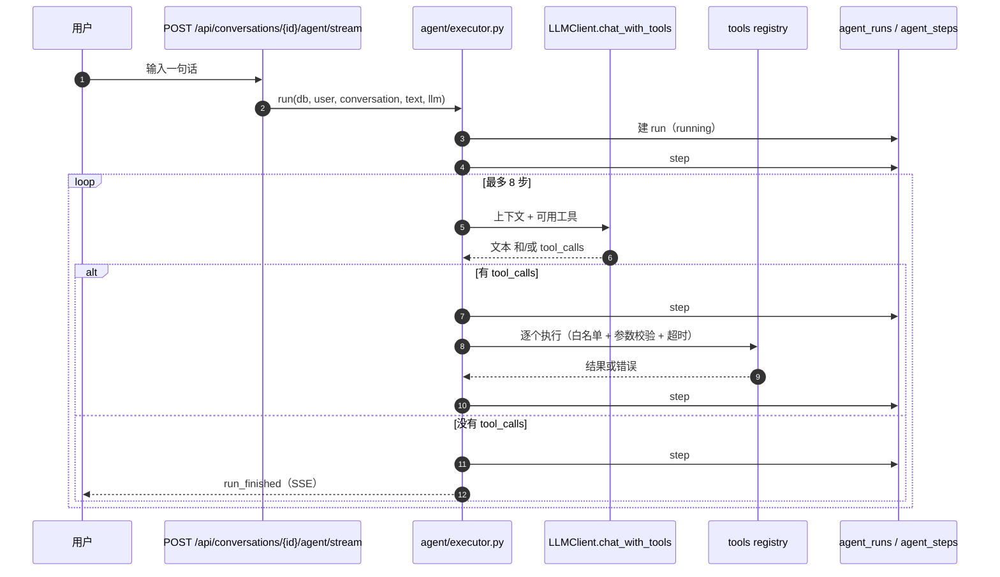
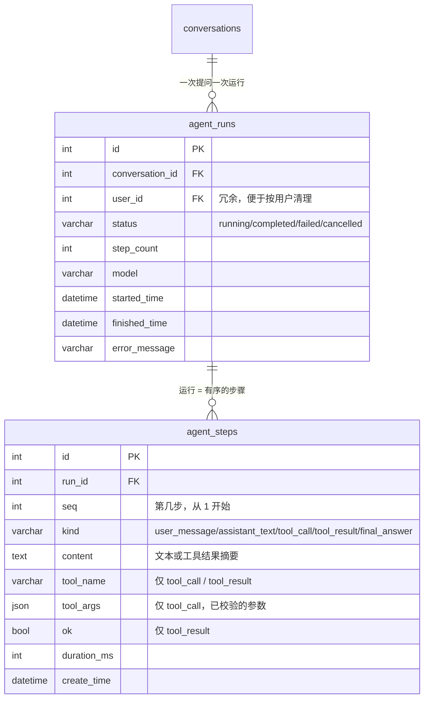

# 阶段 5：Agent 基础执行循环

> 状态：**设计待确认**（尚未写实现代码）。决策记录见 [`adr/0010-agent-execution-loop.md`](adr/0010-agent-execution-loop.md)。
> 前置：阶段 1–4 已完成（工程基建、前后端骨架、对话与账号、按账号模型配置）。

## 1. 要解决的问题

现在的对话是**一问一答**：用户说一句，模型答一句。真实助手至少要能「先查、再算、最后回答」——
模型自己决定要不要用工具、用几次、什么时候收尾。这一阶段就是把这条**执行循环**做出来。

范围只到「单 agent、单会话、无人工审批的自动循环」。多 agent 协作、MCP、长期记忆都不在本阶段。

## 2. 调研：ReAct 与现在应用最广的四种运行架构

| **ReAct（提示词范式）** | [Yao et al., 2022《ReAct: Synergizing Reasoning and Acting》](https://arxiv.org/abs/2210.03629) | 在**提示词**里交替生成 `Thought → Action → Observation` 文本，Action 由正则解析后执行 | 模型输出 `Finish[...]` 或达到提示词里的步数上限 | 靠对话上下文累积（人工拼接） | 无（纯提示工程，无运行时钩子） |
| 架构 | 代表实现 | 循环原语 | 终止条件 | 状态与持久化 | 人类介入 |
|---|---|---|---|---|---|
| **单 agent 工具循环** | [Anthropic「Building effective agents」](https://www.anthropic.com/research/building-effective-agents)、[Claude Agent SDK 的 agent loop](https://code.claude.com/docs/en/agent-sdk/agent-loop) | 请求 → 模型返回 `tool_use` 或最终文本 → 执行工具 → 结果作为 `tool_result` 回灌 → 再请求 | 模型不再请求工具 | SDK 内部消息列表 + 会话文件 | `canUseTool` 回调 / 权限模式 |
| **图状状态机** | [LangGraph](https://langchain-ai.github.io/langgraph/) | 显式建图：`agent` 节点 → 条件边 → `tools` 节点 → 回 `agent` | 条件边走向 `END` | checkpointer 逐步落库，可回放 | `interrupt()` 挂起等人 |
| **SDK Runner** | [OpenAI Agents SDK](https://openai.github.io/openai-agents-python/)、Claude Agent SDK | SDK 内部跑循环，暴露一次 `run()` | `max_turns` 或模型收尾 | `RunResult.new_items` 事件流 | guardrails + 审批钩子 |
| **多 agent 编排** | CrewAI / AutoGen / Agents SDK 的 handoff | 一个 agent 把控制权交给另一个 | 最后一位给出最终答复 | 各自会话 | 同上 |

### 2.1 为什么不直接「用 ReAct」

**因为 ReAct 是一套提示词范式，不是运行时；而它要解决的问题，现在由原生工具调用协议承担了。**

ReAct 论文（[arXiv:2210.03629](https://arxiv.org/abs/2210.03629)）的核心贡献是让模型**交替生成推理轨迹与动作**：
`Thought` 帮模型规划与纠错，`Action` 让它去查外部资料，`Observation` 把结果带回上下文——
在 HotpotQA / FEVER 上，这种交替比纯 chain-of-thought 更少幻觉，在 ALFWorld / WebShop 上成功率分别高出 34% / 10%。

但那篇论文写作时（2022）模型还没有原生函数调用，所以 Action 是一段**文本**，需要程序用正则从生成内容里抠出来。
今天的模型协议已经把这个环节标准化了：

| 维度 | ReAct（文本 Action） | 原生工具调用（本设计采用） |
|---|---|---|
| 动作来源 | 模型输出的自由文本，正则解析 | API 返回结构化 `tool_calls` / `tool_use` 块 |
| 参数校验 | 自己解析、自己容错 | JSON Schema 由模型侧遵守，服务端再校验 |
| 错误回灌 | 拼一句「Observation: error…」 | 专门的错误通道（如 `is_error: true` 的 `tool_result`） |
| 并行调用 | 基本做不到 | 一次响应多个 `tool_calls`，可并发执行 |
| 终止判定 | 靠约定字符串（`Finish[...]`） | 看 `finish_reason` / `stop_reason` 是否还请求工具 |
| 可审计性 | 解析结果不稳定，日志难对齐 | 每次调用有 `id`，请求与结果可精确配对 |

Anthropic 官方教程里那五段「单工具单轮 → 多工具并行 → 错误处理」的演进，本质上就是**同一个循环**：
`while stop_reason == "tool_use": 执行工具 → 把 tool_result 塞回对话 → 再请求`——
它保留了 ReAct 的「思考-行动-观察」结构，只是把 Action/Observation 换成了结构化消息块。

**所以本设计不是「抛弃 ReAct」，而是用生产级协议实现 ReAct 的循环**：

- ReAct 的 `Thought` → 我们的 `assistant_text` 步骤 + `assistant_delta` 流式事件（用户能看见模型在想什么）。
- ReAct 的 `Action` → 结构化 `tool_calls`，参数走 JSON Schema，执行前再过一遍 pydantic 校验。
- ReAct 的 `Observation` → `tool_result`，失败时带 `ok=false` 与错误信息回灌，让模型自己纠错。
- ReAct 的「步数上限」→ 我们写死在执行器里（8 步），不依赖提示词自觉。

反过来，**什么时候该用纯 ReAct 提示词**：模型不支持工具调用协议、需要在一次补全里看到完整推理链、或做论文级对照实验。
我们两者都不需要，所以选结构化协议。

顺带说明：**不用 LangChain 的 `ReActAgent` 之类现成实现**，原因是它们同样停留在「文本解析」或引入一整套框架抽象，
而我们的模型层（`LLMClient`）已经自建，工具也只有三个——自己写 250 行循环比适配框架更可控。详见 [ADR-0010](adr/0010-agent-execution-loop.md)。

四条共同的底层原语，也是我们要实现的东西：

1. **循环**：模型 ↔ 工具之间反复往返，而不是单次补全。
2. **工具调用协议**：模型输出的不是纯文本，而是结构化的「调用哪个工具、参数是什么」。
3. **终止与预算**：没有工具调用即收尾；步数/时间/工具失败次数必须有上限，否则会死循环烧钱。
4. **状态与事件**：每一步都要能落库、能回放、能实时推给前端，否则用户只能盯着转圈。

**结论：这一阶段实现「单 agent 工具循环」这一种，用显式的步数与预算护栏，把「图」和「多 agent」留到需要时再上。**
理由与代价写在 ADR-0010。

## 3. 设计

### 3.1 一次运行的形状

### 3.2 数据模型

- **为什么不复用 `messages`**：`messages` 是「用户看到的内容」，`agent_steps` 是「运行过程」。两者粒度不同；
  把工具调用塞进 `messages` 会让导出、Markdown 渲染、上下文裁剪全部变复杂。
- **只落一条 assistant 消息**：`run_finished` 时才把最终答复写进 `messages`，中间的思考/工具结果不污染对话历史
  （但 `agent_steps` 保留，供「展开执行过程」查看）。
- 外键全部 `ondelete CASCADE`，删会话/删用户一并清掉。

### 3.3 工具的最小集（v1）

| 工具 | 作用 | 为什么选它 |
|---|---|---|
| `calculator` | 计算四则、括号与幂（`ast` 白名单解析，不用 `eval`；`^` 视作幂） | 最经典、结果可断言、无外部依赖 |
| `now` | 返回当前时间（带时区） | 验证「模型需要外部事实」这条路径 |
| `search_conversations` | 在自己账号的会话标题里检索 | 验证「工具只能读当前用户的数据」这条隔离原则 |

> 实测记录（T1 冒烟）：DeepSeek 会把 `3 的 5 次方` 写成 `3^5` 而不是 `3**5`。所以 `calculator`
> 必须把 `^` 映射为幂，否则会算出 `3 XOR 5 = 6`——模型自己发现了这个错，但用户看到的是一个错的中间结果。

工具定义（给模型看的 schema）用 JSON Schema；执行前统一做：**白名单校验 → 参数校验（pydantic）→ 超时（2s）→ 异常转 `tool_result(ok=false)`**。
工具不抛业务异常给用户，错误信息回灌给模型，让它自己决定重试还是换路。

### 3.4 循环的护栏

| 护栏 | 值 | 目的 |
|---|---|---|
| 最大步数 | 8 | 防死循环；超限 → `failed`，`error_message="超过最大步数"` |
| 单次工具超时 | 2s | 工具卡住不能拖垮整个请求 |
| 连续同类失败 | 3 次 | 模型反复调同一个坏工具时提前中止 |
| 模型调用超时 | 沿用 `LLM_TIMEOUT_SECONDS`（默认 30s） | 上游不可用时给 504 |
| 上下文裁剪 | 只带最近 20 条消息 + 本次运行的步骤摘要 | 控制 token |

### 3.5 事件协议（SSE）

沿用对话接口的做法（`POST` + `text/event-stream`，前端用 `fetch` 读流）：

| 事件 | 负载 | 前端用途 |
|---|---|---|
| `run_started` | `run_id` | 建时间线容器 |
| `step_started` | `seq`、`kind` | 显示「第 2 步：查历史」 |
| `assistant_delta` | `content` | 逐字渲染思考文本 |
| `tool_call` | `seq`、`tool`、`args` | 展示「调用了什么」 |
| `tool_result` | `seq`、`ok`、`summary` | 展示结果/错误 |
| `run_finished` | `final_text`、`steps` | 落最终消息 |
| `error` | `code`、`message` | 失败提示，run 标 failed |

约定与对话接口一致：**开流前的校验错误仍是普通 JSON**（404 会话不存在、400 空内容、409 已有运行中）；
开流后一律 200，错误走 `error` 事件。

### 3.6 与现有对话的关系

- 保留 `POST /messages`（同步）与 `/messages/stream`（流式）**不动**——它们是「快速问答」，不跑工具。
- 新增 `POST /api/conversations/{id}/agent/stream`：走执行循环。
- 前端在输入框旁加一个「深度回答」开关（默认关），开启即走 agent 端点；时间线可折叠，不打扰只想聊天的人。

## 4. 任务拆分

| # | 任务 | 涉及文件 | 验收 |
|---|---|---|---|
| T1 | 协议扩展：`chat_with_tools`（原生 `tool_calls`，非文本解析） | `backend/app/llm/{base,fake,openai_compatible}.py` | Fake 能按脚本返回 `tool_calls`；OpenAI 兼容实现能发 `tools` 并解析 `tool_calls`；单测覆盖无工具/单工具/并行工具/畸形响应 |
| T2 | 数据模型与迁移 | `backend/app/models/{agent_run,agent_step}.py`、`migrations/versions/*` | 迁移可 upgrade/downgrade；`alembic check` 无漂移；级联删除生效 |
| T3 | 工具层 | `backend/app/agent/tools/{base,calculator,now,search_conversations,registry}.py` | 每个工具的 happy path + 参数错误 + 超时；`calculator` 拒绝 `__import__`、`os`、超长表达式 |
| T4 | 执行器与事件 | `backend/app/agent/{executor,events}.py` | 事件序列断言（含工具往返）；步数超限、工具失败重试、模型失败回滚 |
| T5 | 接口与 SSE | `backend/app/api/agent.py` | 未登录 401、会话不存在 404、空输入 400、并发运行 409；SSE 逐帧可读 |
| T6 | 前端时间线与开关 | `frontend/src/{api/agent.ts,stores/chat.ts,components/chat/AgentTimeline.vue,ChatView.vue}` | 开关可切换；时间线逐条出现、可折叠；失败有可读提示；刷新后能回看（读 `agent_steps`） |
| T7 | 文档与验收脚本 | `docs/api.md`、`docs/how-it-works.md`、`frontend/scripts/agent-acceptance.mjs` | E2E 至少 8 项：单工具、双工具、无工具、步数超限、工具报错、断流、刷新回看、越权 |

## 5. 验收标准（本阶段）

1. 问「3 的 5 次方是多少」→ 模型调用 `calculator`，最终答复里数字正确，时间线可见 2 步以上。
2. 问「现在几点」→ 调用 `now`，答复带时区。
3. 问「我之前问过哪些关于部署的问题」→ 调用 `search_conversations`，**只返回当前账号的会话**。
4. 构造死循环脚本（Fake 一直返回同一个 tool_call）→ 第 8 步中止，run 标 `failed`，前端有明确提示。
5. 工具抛异常 → 错误回灌模型，run 仍能正常收尾；连续 3 次同类失败 → 中止。
6. 刷新页面 → 时间线完整重现（来自 `agent_steps`）。
7. A 用户看不到 B 用户的 run（越权 404）。
8. `make check` 全绿、覆盖率不低于 90%；前端 `lint`/`test`/`build` 全绿；`pnpm acceptance:agent` 全过。

## 6. 风险与未决

| 风险 | 处理 |
|---|---|
| **死循环烧钱** | 步数上限 8 + 单工具 2s 超时 + 连续失败 3 次中止；上线前用 Fake 脚本压测 |
| **工具越权** | 工具签名强制带 `user_id`，只能读自己的数据；`search_conversations` 的 SQL 带 `user_id` 过滤 |
| **上下文爆炸** | 只带最近 20 条消息；工具结果超过 2000 字截断并标注「已截断」 |
| **流中断留下半条消息** | 最终答复只在 `run_finished` 时落库；断流则 run 标 `failed`，`messages` 不新增 |
| 是否要「可恢复的断点续跑」 | v1 不做；`agent_steps` 已落库，后续可基于它做「从第 N 步继续」 |
| 是否要人类审批（写操作类工具） | v1 无写工具；加写工具时必须先做审批，见 ADR-0010 的复评触发 |

## 7. 明确不做（本阶段）

- 多 agent 协作 / handoff / supervisor。
- MCP / 外部工具市场（阶段 7）。
- 长期记忆与 RAG（阶段 8）。
- 断点续跑、跨会话的 agent 状态。
- 人工审批与工具权限分级。
