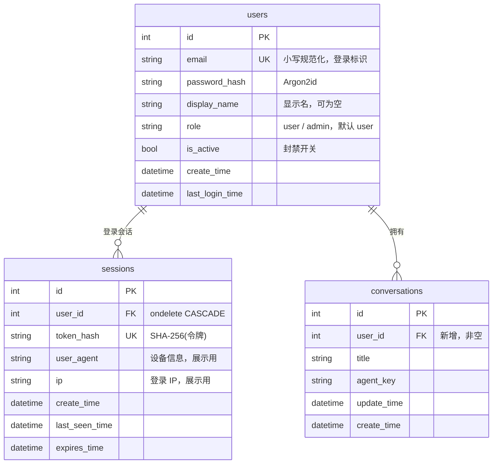

# 账号体系设计（登录 / 注册 / 鉴权）

> 人读文档。回答三件事：个人助手类 Agent 的账号一般绑哪些数据、我们这一版怎么做、为什么这么做。
> 决策记录见 [ADR-0008](adr/0008-auth-and-session.md)。当前代码状态见 [PROJECT_STATUS.md](PROJECT_STATUS.md)。

## 1. 结论摘要

- **形态**：单用户单账号的个人助手。没有工作空间、团队、成员邀请，也没有角色矩阵——一个账号就是一个人，看到的只有自己的数据。
- **鉴权**：服务端会话 + HttpOnly Cookie（不用 localStorage 里的 JWT）。理由：同源部署（Vite proxy / nginx）、XSS 拿不到令牌、撤销即失效、不需要 refresh token 那套复杂度。
- **隔离**：`conversations.user_id` 非空外键，**所有**查询在 service 层强制带 `user_id` 过滤；越权一律返回 404 而不是 403（不泄露资源是否存在）。
- **拦截**：后端除 `/api/auth/register`、`/api/auth/login`、`/healthz`、`/readyz` 外全部要求登录；前端 `router.beforeEach` 校验会话，401 自动跳登录页。
- **扩展预留**：会话表天然支持多设备登录与单独撤销；`agent_key` 已存在，将来可升级为多 Agent；API Token、OAuth 登录都作为「新增一种凭证类型」接入，不改核心表。

## 2. 调研：个人助手类 Agent 怎么处理账号

只调研**个人助手**形态（一人一号），不参考工作空间/团队模式。

| 产品 | 账号标识 | 与账号绑定的数据（公开资料归纳） | 形态 |
|---|---|---|---|
| ChatGPT | 邮箱/手机号 + 密码或第三方登录 | 聊天历史、**长期记忆**（saved memories）、custom instructions、库里的文件（Library）、已连接 app 的授权、订阅与用量 | 个人（另有 Team/Enterprise 版，不在讨论范围） |
| Claude | 邮箱 + 验证码/第三方 | 会话历史、项目（Projects）知识、账号级记忆、上传文件、连接器授权 | 个人（另有 Team 版） |
| Gemini | Google 账号 | 对话历史、**Saved info**（可编辑的个人偏好事实）、连接的 Google 应用数据、活动记录 | 个人（Workspace 域由管理员控制） |
| dots（OpenAI） | ChatGPT 账号 | 继承 ChatGPT 记忆、自行形成的记忆、每个任务各自的对话、连接的 app | 个人 |
| Muse（Meta） | 账号 + 设备 | 用户级状态、Active Memory、`hatch-authd` 托管的 OAuth 凭证、授权范围（一次性/会话级/任务级/限时/长期） | 个人 |

共性可以归纳成四条，这四条决定了我们的表结构：

1. **账号是数据隔离的唯一维度**：所有业务数据都能追溯到一个 user，没有任何「全局共享」的业务表。
2. **记忆与对话分开存**：删对话不等于删记忆，两者生命周期不同（ChatGPT 明确把 memory 与 chat history 分库存）。
3. **凭证与授权独立托管**：第三方 OAuth token 不进业务表，Agent 本身看不到明文（Muse 的凭证代理）；授权有范围与有效期。
4. **会话级状态 vs 用户级状态**：会话上下文随对话走，用户偏好/长期事实跨会话复用（Google ADK 已把这两类状态分开）。

## 3. 哪些数据与账号绑定（我们的取舍）

| 数据项 | 是否绑账号 | 跨会话复用 | 本版（v1） |
|---|---|---|---|
| 对话（conversations）与消息（messages） | 是 | 否（按会话） | ✅ 做 |
| 会话标题自动命名 | 是 | — | ✅ 已有 |
| 用户偏好（默认模型、语言、界面主题） | 是 | 是 | ⏳ 预留字段，v1 不做界面 |
| 长期记忆 / 自定义指令 | 是 | 是 | ❌ 阶段 8（RAG 与 Memory） |
| 上传文件 / 资料库 | 是 | 是 | ❌ 后续 |
| 第三方连接（OAuth 凭证、授权范围） | 是 | 是 | ❌ 阶段 7（MCP）之后 |
| 登录会话（设备、IP、最后活跃） | 是 | — | ✅ 做（可查看、可撤销） |
| API Token | 是 | — | ⏳ 预留表结构说明，v1 不发 |
| 用量与配额（token 消耗） | 是 | — | ❌ 后续（现在无计费） |
| 定时任务 / 自动化 | 是 | — | ❌ 阶段 9 |
| 账号安全事件（登录失败、改密） | 是 | — | ⏳ v1 只记结构化日志，不建表 |
| 模型服务本身、公告、字典 | 否 | — | 全局，不绑账号 |

结论：v1 只需要「users + sessions + conversations.user_id」三处改动就能满足当前功能，其余项按上表逐步加表，不提前设计。

## 4. 边界（v1 明确不做）

- 不做工作空间、团队、成员邀请、共享会话。
- 不做邮箱验证与找回密码的邮件链路（没有邮件服务）；密码重置留到接入邮件后，v1 用「已登录状态下改密」。
- 不做第三方登录（GitHub/Google）、不做 MFA、不做 API Token 签发。
- 不做细粒度权限（角色只有 `user` / `admin` 两种，`admin` 目前无额外接口）。

## 5. 鉴权方案对比

| 方案 | 令牌存放 | 撤销 | 前端复杂度 | 风险 | 结论 |
|---|---|---|---|---|---|
| JWT 放 localStorage | 前端 JS 可读 | 需黑名单 | 低 | XSS 直接偷走长期令牌 | 否 |
| JWT 短效 + refresh Cookie | 内存 + Cookie | refresh 需表 | 高（静默续期、并发刷新） | 实现错更容易出洞 | 否 |
| **服务端会话 + HttpOnly Cookie** | Cookie（`HttpOnly; SameSite=Lax; Path=/`） | 删一行即失效 | 低（浏览器自动带） | 需 CSRF 防护（SameSite=Lax + 仅 JSON 写操作已足够） | **采用** |
| OAuth only（第三方登录） | — | — | 中 | 依赖外部服务，个人自建场景不合适 | 否 |

实现方式：**自研轻量模块**，不引 `fastapi-users`。理由：它自带的路由/响应格式与本项目统一的 `Response{code,message,data}` 不一致，DB adapter 与 UserManager 也要改造；而我们需要的能力只有「注册、登录、登出、当前用户、会话列表、撤销会话」六个接口。被否方案与代价记录在 ADR-0008。

密码哈希：**Argon2id**（`argon2-cffi`），OWASP 首选；参数用库默认（time_cost=3, memory_cost=64MiB, parallelism=4），登录时 `verify` 自动按哈希前缀兼容将来换算法。

Cookie 细节：

- 名称 `my_agent_session`，值为 32 字节随机 URL-safe 字符串；**数据库只存 SHA-256 摘要**，泄库也无法直接冒用。
- `HttpOnly=true`、`SameSite=lax`、`Secure=仅生产（`APP_ENV=production` 时）`、`Max-Age=30 天`、`Path=/`。
- 登出删除该会话行并清 Cookie；改密时删除该用户其他所有会话。

## 6. 数据模型

`messages` 表不加 `user_id`：它只能通过 `conversation_id` 访问，会话已经隔离；多余冗余反而要和会话保持一致。所有读写都从「先取到属于当前用户的会话」开始。

## 7. 接口契约（前缀 `/api/auth`）

| 方法 | 路径 | 说明 | 失败 |
|---|---|---|---|
| POST | `/api/auth/register` | 邮箱 + 密码注册，成功即自动登录（返回当前用户 + Set-Cookie） | 409 邮箱已注册；400 密码过短 |
| POST | `/api/auth/login` | 登录，失败文案统一「邮箱或密码不正确」 | 401 |
| POST | `/api/auth/logout` | 删当前会话并清 Cookie | 200 幂等 |
| GET | `/api/auth/me` | 当前用户信息（前端守卫用它判断） | 401 |
| GET | `/api/auth/sessions` | 我的登录设备列表 | 401 |
| DELETE | `/api/auth/sessions/{id}` | 撤销指定设备（不能撤别人的） | 404 |
| POST | `/api/auth/password` | 已登录状态下改密，成功后踢掉其他会话 | 400 旧密码不对 |

响应仍走统一包裹 `{"code":200,"message":"请求成功","data":{...}}`；401 由全局异常处理返回 `{"code":401,"message":"请先登录"}`。

## 8. 隔离与权限：三条硬规则

1. **依赖注入拿用户**：`current_user = Depends(get_current_user)`，所有业务路由都挂它；未登录在这里 401。
2. **service 层强制过滤**：`list_conversations(db, user_id, ...)`、`get_conversation(db, user_id, id)` 等签名里必须有 `user_id`，SQL 里必须 `where(Conversation.user_id == user_id)`。不允许出现「先按 id 取再判断」的写法。
3. **越权等于不存在**：访问别人的会话/消息/设备一律 404「会话不存在」，不返回 403，避免探测。

回归测试必须覆盖：A 用户看不到 B 的会话列表、拿 B 的会话 id 取详情/发消息/改名/删除全部 404、B 的会话不计入 A 的分页 total。

## 9. 前端

- 新增 `/login`、`/register` 两个页面（不套用后台布局，居中卡片）。
- `router.beforeEach`：目标路由需要登录且 `store.user` 为空时请求 `/api/auth/me`；401 → `redirect=/login?redirect=<原路径>`；已登录访问 `/login` 直接跳 `/chat`。
- `client.ts` 拦截器：任意请求 401 且不在登录页 → 清用户态并跳登录；登录接口本身的 401 不跳转，只提示。
- 顶栏显示邮箱首字母头像 + 下拉「退出登录」；删掉现在写死的「运营小张」。
- 401 与网络异常要区分：401 跳登录，网络异常只 toast。

## 10. 可扩展性

| 场景 | 需要加什么 | 影响现有表 |
|---|---|---|
| 多设备登录 | 已有 `sessions`，加一个「设备列表」页面即可 | 无 |
| 多 Agent（每个 Agent 独立人格/技能） | `agents` 表；`conversations.agent_key` 升级为 `agent_id` | 加列 |
| API Token（脚本/桌面端调用） | `api_tokens`（user_id, name, token_hash, scopes, expires_time） | 新表 |
| 第三方登录 | `identities`（user_id, provider, subject） | 新表 |
| 团队/共享 | 引入 `workspace_id` 到各业务表 | 大改，明确不做 |

Cookie 会话与「API Token 走 `Authorization: Bearer`」可以并存：`get_current_user` 先看 Bearer，再看 Cookie，两条路径复用同一套 user 解析。

## 11. 迁移策略

数据已确认不保留（`my_agent` 只有 3 张表、2 条会话），迁移分三步、可回滚：

1. 建 `users`、`sessions` 表；
2. `conversations` 加 `user_id`（先 nullable）→ 由于不保留历史数据，直接 `DELETE FROM conversations`，再把列改成 `NOT NULL` 并加外键与索引；
3. 提供一个 `python -m app.create_admin` 脚本，按环境变量创建首个账号，避免注册接口被陌生人抢先使用（部署时用）。

## 12. 任务拆分

| 任务 | 内容 | 验收 |
|---|---|---|
| T1 | `users` / `sessions` 模型 + 迁移（含 conversations.user_id 非空化） | `alembic upgrade head` 幂等；`downgrade -1` 可回滚；`alembic check` 无漂移 |
| T2 | `app/auth/` 模块（哈希、令牌、依赖、service） | 单测覆盖 Argon2 校验、令牌摘要、过期与停用账号 |
| T3 | 6 个接口 + 统一 401 | `curl` 实测 401/409/400；OpenAPI 有 `my_agent_session` 安全方案 |
| T4 | 全部对话接口改为按当前用户过滤 | 越权用例全 404；分页 total 只算自己的 |
| T5 | 前端登录/注册页 + 守卫 + 401 拦截 + 退出 | 未登录访问 `/chat` 跳登录；登录后回原页；退出后回登录 |
| T6 | 测试与门禁 | 后端覆盖 ≥ 88%；前端单测 + 新增 E2E：注册→登录→建会话→退出→再登录仍在 |
| T7 | 文档 | `docs/api.md` 增 §5 账号接口；`how-it-works` 加鉴权一节与图；`PROJECT_STATUS` 更新 |

## 13. 已确认的口径

2026-11-09 已确认（用户逐条选择）：

- **Q-01 账号标识**：邮箱（唯一、小写规范化）。v1 只做格式校验，**不发验证邮件**。
- **Q-02 注册开放度**：默认开放；环境变量 `ALLOW_REGISTRATION=false` 可关闭注册（关闭时注册接口返回 403「注册已关闭」）。
- **Q-03 会话有效期**：30 天滑动续期（每次请求刷新 `last_seen_time`，超过 30 天未使用失效）。
- **Q-04 密码强度**：最小 8 位、最大 72 位，不强制字符种类（长度是主要防线，符合 NIST SP 800-63B 的取向）。
- **Q-05 首号创建**：`python -m app.create_admin` 脚本 + 环境变量（`ADMIN_EMAIL` / `ADMIN_PASSWORD`），公网首部署用它，避免被抢注。
