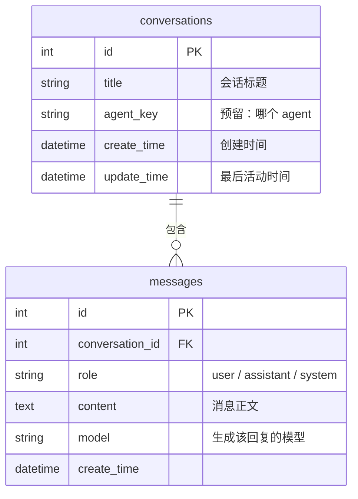
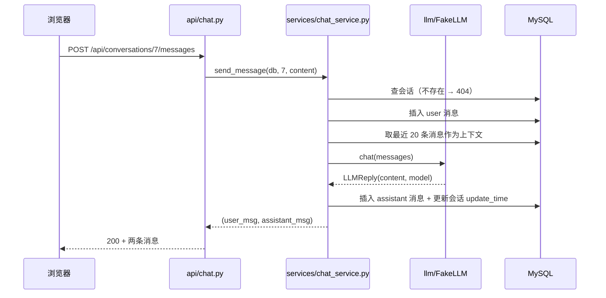

# 对话功能设计（阶段 4 · LLM 接入与基础对话）

> 阶段 4 的实施方案。**先设计、后实施**（AGENTS.md §2.3）；确认后按第 8 节的任务顺序逐个交付。
> 阶段依据：[`playbooks/05-development-plan-and-mvp-tasks.md`](playbooks/05-development-plan-and-mvp-tasks.md) 阶段 4。
> 相关决策：[ADR-0006](adr/0006-llm-client-and-chat-storage.md)（落库 + 模型抽象）。

## 1. 目标与边界

**这一阶段要拿到的东西**：用户能在页面上新建会话、发一条消息、收到模型回复；刷新页面后对话还在；会话可以重命名和删除。

**接入方式**（已定，见 PROJECT_STATUS §3.2）：先 `FakeLLM` 打底把链路跑通，再接 OpenAI 兼容 API。默认 `LLM_PROVIDER=fake`，**CI 与本地开发都不需要 key**。

**不做的**（留给后续阶段）：

| 不做 | 留给 |
|---|---|
| 流式 SSE 输出 | 阶段 4 的第二批（T4b）：`POST /messages/stream` 逐块返回 |
| Tool Calling / function calling | 阶段 6 |
| Agent 执行循环、多轮规划 | 阶段 5 |
| RAG / Memory / 向量库 | 阶段 8 |
| 多 Agent 协作 | 阶段 9；但表结构预留 `agent_key` |
| 鉴权与用户体系 | 暂无排期（当前单用户） |

## 2. 数据模型



| 表 | 字段 | 类型 | 说明 |
|---|---|---|---|
| `conversations` | `title` | `String(100)`，非空，默认「新会话」 | 首次发消息时若仍是默认值，用首条消息前 30 字自动命名 |
| | `agent_key` | `String(50)`，非空，默认 `default` | 现在只有一个 agent；阶段 9 多 Agent 时用来区分 |
| | `update_time` | `DateTime`，非空，`onupdate` | 列表按它倒序，就是「最近聊过」 |
| `messages` | `conversation_id` | 外键 → `conversations.id`，级联删除 | 删会话即删消息 |
| | `role` | `String(16)`，非空 | 只允许 `user` / `assistant` / `system`，服务层校验 |
| | `content` | `Text`，非空 | 用户消息去首尾空白后不能为空（与商品/分类同规则） |
| | `model` | `String(64)`，可空 | 用户消息为 `NULL`；`fake` 时写 `fake` |

- 公共列 `id` / `create_time` 来自 `app/database.py` 的 `Base`，不重复定义。
- 迁移：`alembic revision --autogenerate`，与现有 categories/products 同一套（ADR-0003）。**不用 `create_all`**。
- 索引：`messages.conversation_id`（查询必用）；`conversations.update_time`（列表排序）。

## 3. 接口

全部挂在 `/api` 下，响应仍是统一信封 `{"code":200,"message":"请求成功","data":...}`。

| 方法 | 路径 | 作用 | 主要错误 |
|---|---|---|---|
| `POST` | `/api/conversations` | 新建会话（可带 `title`） | — |
| `GET` | `/api/conversations` | 会话列表，`page` / `page_size`，按 `update_time` 倒序 | 分页参数 422 |
| `GET` | `/api/conversations/{id}` | 会话详情 + 全部消息（按 `id` 升序） | 404「会话不存在」 |
| `PATCH` | `/api/conversations/{id}` | 重命名（`title` 去空白后不能为空） | 404、400「会话标题不能只包含空白」 |
| `DELETE` | `/api/conversations/{id}` | 删除会话及其消息 | 404「会话不存在」 |
| `POST` | `/api/conversations/{id}/messages` | 发一条用户消息，同步返回助手回复 | 404、400「消息内容不能只包含空白」、502/504（模型侧失败） |

发消息的时序（首版同步）：



**上下文策略**：最近 20 条（`system` 始终带上）。超过就截断，不在这里做摘要——摘要属于阶段 8 的 Memory。

## 4. 模型抽象（`app/llm/`）

```python
class LLMReply(TypedDict):
    content: str
    model: str

class LLMClient(Protocol):
    def chat(self, messages: list[dict[str, str]]) -> LLMReply: ...
```

| 文件 | 职责 |
|---|---|
| `app/llm/base.py` | `LLMClient` 协议 + `LLMReply` + `LLMError`（继承 `BusinessError`） |
| `app/llm/fake.py` | `FakeLLM`：固定前缀回显最后一条用户消息；可注入延迟/异常用于测错误分支 |
| `app/llm/openai_compatible.py` | `httpx` 打 `POST {base_url}/chat/completions`，超时映射 504、鉴权/限流映射 502 |
| `app/llm/__init__.py` | `get_llm()` 工厂：按 `settings.llm_provider` 返回实例，作为 FastAPI 依赖注入，测试里 `dependency_overrides` 直接换 |

新增配置（`app/config.py` + `.env.example`）：

| 变量 | 默认 | 说明 |
|---|---|---|
| `LLM_PROVIDER` | `fake` | `fake` / `openai` |
| `LLM_BASE_URL` | 空 | 例：`https://api.deepseek.com/v1` |
| `LLM_API_KEY` | 空 | **只从环境注入，不入库、不进镜像** |
| `LLM_MODEL` | 空 | 例：`deepseek-chat` |
| `LLM_TIMEOUT_SECONDS` | `30` | 超时即 504 |

## 5. 错误与状态码

| 情况 | 返回 |
|---|---|
| 会话不存在 | 404 `{"code":404,"message":"会话不存在"}` |
| 消息/标题纯空白 | 400 `{"code":400,"message":"消息内容不能只包含空白"}` |
| 模型鉴权失败、上游 4xx/5xx | 502 `{"code":502,"message":"模型服务不可用"}`（不透传上游原文，避免泄漏 key 与内部信息） |
| 模型超时 | 504 `{"code":504,"message":"模型服务超时"}` |
| 未配置 `LLM_API_KEY` 而 `LLM_PROVIDER=openai` | 启动即失败（`Settings` 校验），不等到第一次请求 |

## 6. 前端页面

新增一个页面 `/chat`，路由与侧边栏同现有三个页面：

```
┌ 会话列表（280px） ┬ 消息区 ─────────────────────┐
│ [+ 新建会话]      │  用户：你好                    │
│ 商品怎么定价      │  助手：我是 fake 模型，收到…    │
│ 昨天的对话        │                               │
│                   ├───────────────────────────────┤
│                   │ [输入框                     ][发送] │
└───────────────────┴───────────────────────────────┘
```

- 进入页面：拉会话列表；有会话则打开最近一条，否则显示空态「开始一个新对话」
- 发送中：输入框与按钮禁用，消息区尾部显示「正在回复…」
- 失败：`ElMessage.error` 显示后端 `message`，用户消息保留、不写入假回复
- 复用现有样式 token 与统计卡之外的表格体系，不新增视觉规范
- **助手消息按 Markdown 渲染**（`utils/markdown.ts`：`markdown-it` 渲染 + `DOMPurify` 消毒，`html: false` 让原文里的 HTML 只当文本、外链自动 `target=_blank` + `rel=noopener`）；用户消息保持纯文本并保留换行
- 这两个依赖约 57KB gzip，`/chat` 改成路由级懒加载（`() => import('@/views/ChatView.vue')`），商品/分类/概览页首屏不受影响

## 7. 测试口径

| 层 | 覆盖 |
|---|---|
| 后端服务层（内存 SQLite） | 会话 CRUD、级联删除、`role` 校验、空白内容、上下文取最近 20 条、`FakeLLM` 正常/抛错两条路径 |
| 后端接口层（TestClient + `dependency_overrides`） | 6 个端点的成功与 4 类失败（404/400/502/504） |
| 前端 Vitest | `api/chat.ts` 的 6 个函数（URL、参数、错误透传） |
| E2E（可选） | 新建会话 → 发消息 → 刷新仍在 → 重命名 → 删除 |

门槛不变：后端覆盖率 ≥80%，`make check` 与 `pnpm lint && pnpm test && pnpm build` 全绿。

## 8. 任务拆分（每个都能独立验证）

| # | 任务 | 交付 | 验证 |
|---|---|---|---|
| T1 ✅ | 数据模型 + 迁移 | `models/conversation.py`、`models/message.py`、`models/__init__.py`、一个 alembic revision | `make migrate` 后新表存在、`alembic check` 无漂移 |
| T2 ✅ | 模型抽象层 | `app/llm/*`、`config.py` 5 个字段、`.env.example` | 单测：`FakeLLM` 正常/异常；`openai` 用 `httpx.MockTransport` 验 4 种错误映射 |
| T3 ✅ | 会话 CRUD | `schemas/chat.py`、`services/chat_service.py`、`api/chat.py` 的 5 个端点 | 服务层 + 接口层单测、`docs/api.md` 新增一节 |
| T4 ✅ | 发消息（同步） | `POST /messages`、上下文截断、自动命名 | 用 `FakeLLM` 端到端：发 2 条，库里 4 条记录 |
| T4b ✅ | 流式输出（SSE） | `POST /api/conversations/{id}/messages/stream` + 前端 `fetch` 流式渲染 | 服务/接口单测 + `scripts/chat-acceptance.mjs` |
| T5 ✅ | 前端 `/chat` 页面 | `api/chat.ts`、`views/ChatView.vue`、路由与侧边栏 | `pnpm lint/test/build` + 手工三流程 |
| T6 ✅ | 文档 | `docs/api.md` §4（含 4.6 发消息）、`docs/how-it-works.md` 架构图补 chat、PROJECT_STATUS 打勾 | 链接检查 0 失效 |

**验收标准**（阶段 4 完成）：本地 `make run` + `pnpm dev` 后，能新建会话、发消息（`FakeLLM` 回复）、刷新后仍在、重命名与删除生效；切 `LLM_PROVIDER=openai` 并配 key 后同流程返回真实模型输出；`make check` 与前端三件套全绿；CI 双 job 绿。

## 9. 风险与取舍

| 风险 | 处理 |
|---|---|
| 同步等待模型，慢时体验差 | 首版设置 30s 超时并明确提示；T4b 已换 SSE（仍保留 4.6 同步接口） |
| 上下文无限增长撑爆上下文窗口 | 只取最近 20 条；真正方案在阶段 8 |
| `openai` 兼容层各家字段不同（如 `reasoning_content`） | 只依赖 `choices[0].message.content`；解析失败按 502 处理 |
| 开发机没 key 就无法联调 | 默认 `fake`，CI 永远不依赖外部网络 |
| 消息表增长快 | 现在不分区不归档；数据量成为问题在阶段 11 处理 |

## 7. 前端「新会话」是草稿态（2026-11-11 补充）

后端接口不变，但前端不再「点新建就落库」：

- 点「新建会话」只把界面切到**空白草稿态**（`chat.startNew()`），不发请求、不产生 `conversations` 记录；用户在输入框里写、改、清空都不影响数据库。
- 第一条消息发出去时才 `POST /api/conversations` 建会话，紧接着走原来的 `/messages/stream`（或 `/agent/stream`）。
- 删掉当前正在看的会话、或刷新后没有任何会话，都回到这个草稿态，而不是「空页面」。
- 因此「有一个打开的会话」不再等于「后端有一行记录」：判断界面状态看 `chat.draft` / `chat.activeId`（`draft` 为真时 `activeId` 必为 null）。

## 8. 会话运行时状态按会话隔离（2026-11-11 修订）

### 8.1 修复的 bug

「发出一条问题后立刻切到别的会话，切过去的新会话会被上一个会话的回答占据」。

根因不是后端：SSE 按 `conversation_id` 各跑各的，服务端一直是对的。问题在**前端把运行时状态放在了 store 单例上**：

```ts
// 修复前：一份全局状态，谁都能写
const messages = ref<ChatMessage[]>([])
const streamingText = ref('')
```

`send()` 的回调（`onDelta` / `onDone`）闭包里拿的是 `conversationId`，但写的是**全局** `messages` / `streamingText`；`openConversation()` 只是把这两份数据换成另一个会话的。于是：

1. 旧流还在跑 → `onDelta` 把内容追加到「当前会话」的流式气泡里（此时当前会话已经是别人）；
2. `onDone` 把 assistant 消息 push 进新会话的消息数组；
3. `sendWithAgent()` 收尾的 `await getConversation(id)` 更彻底，直接把全局 `messages` 覆盖成旧会话的详情。

所以是**架构问题**：会话状态是单例，而「一次请求」的生命周期可以比「当前选中的会话」更长。

### 8.2 方案：per-thread state + run 绑定

参考 ChatGPT/Claude 的 Web 端、Vercel AI SDK 的 `useChat`、assistant-ui 的 runtime 设计，共识是两条：

- **消息按 thread 存**（`threadId → messages`），视图只读当前 thread；
- **流（run）绑定它自己的 thread**，回调只写那一份，切走不打断、也不串台。

本项目落地为 `frontend/src/stores/chat.ts` 里的 `threads`：

```ts
interface ChatThread {
  messages: ChatMessage[]
  draftText: string       // 输入框草稿，切走再切回来还在
  streamingText: string   // 流式已收文本
  steps: AgentStep[]      // 深度回答的工具时间线
  sending: boolean        // 普通/深度回答都算
  runningAgent: boolean
  loaded: boolean         // 是否已从服务端拉过
}
const threads = reactive(new Map<number, ChatThread>())  // 草稿态用 key 0
const activeKey = computed(() => activeId.value ?? 0)
```

- `messages` / `streamingText` / `agentSteps` / `sending` / `agentRunning` 全部改成由 `activeKey` 派生的 `computed`，视图代码不变；
- `send()` 与 `sendWithAgent()` 入口处 `const thread = threadOf(conversationId)`，**整段流程（包括 `onDone` 收尾的 `getConversation`）只写这个 thread**；
- 切会话只是改 `activeId`，旧流继续跑完并落到它自己的 thread，切回去能看到完整回答（不需要重拉）；
- **输入框也属于会话状态**：`draftText` 放进 `ChatThread`，视图用 `v-model="chat.composerText"`
  （writable computed）读写，切会话就是切草稿；发送成功后由 store 清掉自己那一份，不再需要
  「点新建时清空输入框」的补丁；
- 侧栏可用 `chat.isBusy(id)` 显示「生成中」，不再依赖全局 `sending`。

### 8.3 两条容易踩的实现细节

1. **reactive Map 的代理**：`threads.set(key, obj)` 存的是原始对象，`get()` 才拿到代理。`threadOf()` 必须把 `get()` 的结果返回，直接改原始对象不会触发视图更新。
2. **不要用「当前会话」推断回调归属**：回调里一律用入口处捕获的 `conversationId`，禁止读 `activeId`。

### 8.4 回归测试

`frontend/src/stores/chat.test.ts`（3 例，`sendMessageStream` 用可控 deferred 模拟未完成的流）：

- 切走后旧会话的 `onDelta` / `onDone` 不写进新会话，切回去数据还在；
- 两个会话的 `sending` 互相独立（切到空闲会话按钮可用，`isBusy(旧会话)` 为真）；
- 输入框草稿按会话隔离（写一半切走再切回，文字还在；另一个会话仍是空的）；
- 删掉当前会话回到草稿态并清掉缓存。
