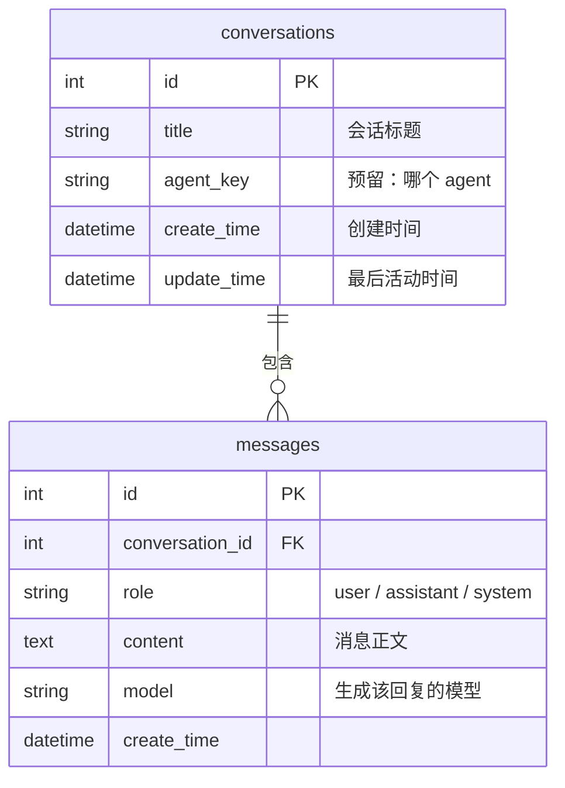
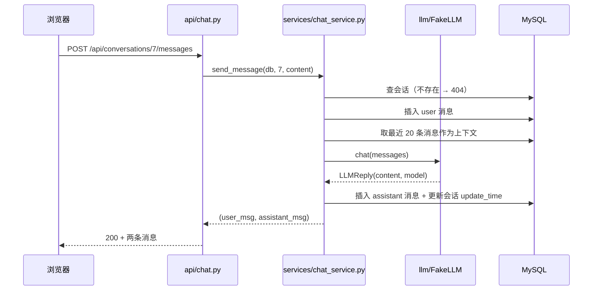
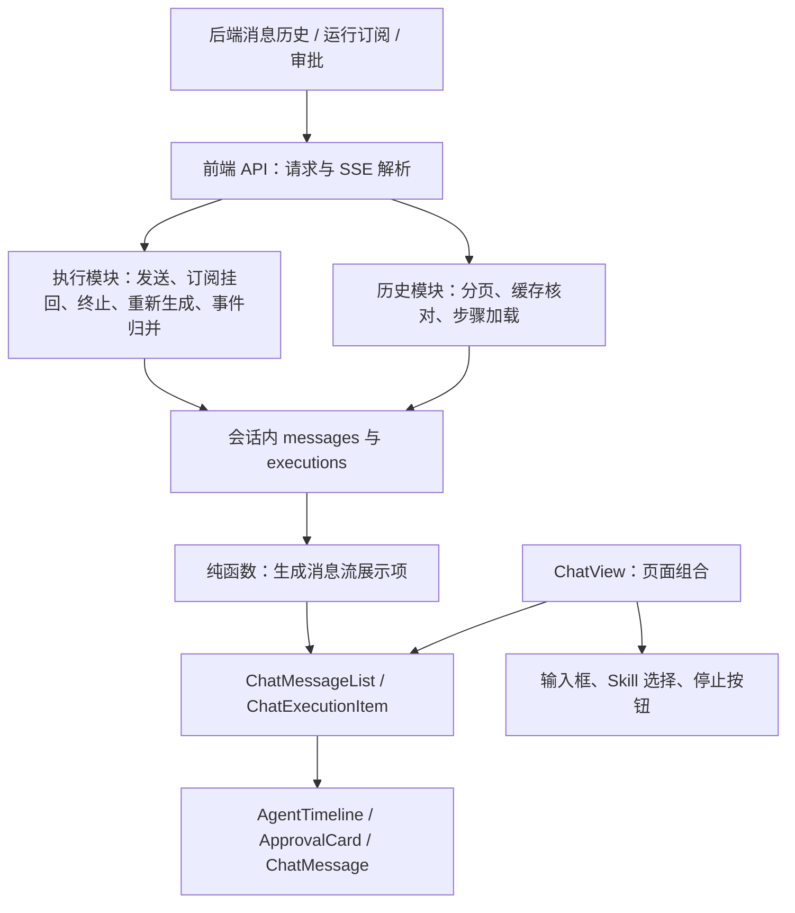

# 对话功能设计（阶段 4 · LLM 接入与基础对话）

> 聊天状态与展示的来龙去脉见[第 9 节](#9-聊天状态与展示一条时间线2026-11-18--11-19)：六步的时间线、已被推翻或没采纳的方案、当前边界与验收口径；最终形态是「执行与连接解耦」（[ADR-0019](adr/0019-execution-decoupled-from-connection.md)）。前面各节保留阶段实施背景，第 1–6 节仍是阶段 4 的原始设计。

> 阶段 4 的实施方案。**先设计、后实施**（AGENTS.md §2.3）；确认后按第 8 节的任务顺序逐个交付。
> 阶段依据：[`playbooks/05-development-plan-and-mvp-tasks.md`](playbooks/05-development-plan-and-mvp-tasks.md) 阶段 4。
> 相关决策：[ADR-0006](adr/0006-llm-client-and-chat-storage.md)（落库 + 模型抽象）。

## 1. 目标与边界

**这一阶段要拿到的东西**：用户能在页面上新建会话、发一条消息、收到模型回复；刷新页面后对话还在；会话可以重命名和删除。

**接入方式**（已定，见 PROJECT_STATUS §3.2）：先 `FakeLLM` 打底把链路跑通，再接 OpenAI 兼容 API。默认 `LLM_PROVIDER=fake`，**CI 与本地开发都不需要 key**。

**不做的**（留给后续阶段）：

| 不做 | 留给 |
|---|---|
| 流式 SSE 输出 | 阶段 4 的第二批（T4b）：`POST /messages/stream` 逐块返回 |
| Tool Calling / function calling | 阶段 6 |
| Agent 执行循环、多轮规划 | 阶段 5 |
| RAG / Memory / 向量库 | 阶段 8 |
| 多 Agent 协作 | 阶段 9；但表结构预留 `agent_key` |
| 鉴权与用户体系 | 暂无排期（当前单用户） |

## 2. 数据模型



| 表 | 字段 | 类型 | 说明 |
|---|---|---|---|
| `conversations` | `title` | `String(100)`，非空，默认「新会话」 | 首次发消息时若仍是默认值，用首条消息前 30 字自动命名 |
| | `agent_key` | `String(50)`，非空，默认 `default` | 现在只有一个 agent；阶段 9 多 Agent 时用来区分 |
| | `update_time` | `DateTime`，非空，`onupdate` | 列表按它倒序，就是「最近聊过」 |
| `messages` | `conversation_id` | 外键 → `conversations.id`，级联删除 | 删会话即删消息 |
| | `role` | `String(16)`，非空 | 只允许 `user` / `assistant` / `system`，服务层校验 |
| | `content` | `Text`，非空 | 用户消息去首尾空白后不能为空（与商品/分类同规则） |
| | `model` | `String(64)`，可空 | 用户消息为 `NULL`；`fake` 时写 `fake` |

- 公共列 `id` / `create_time` 来自 `app/database.py` 的 `Base`，不重复定义。
- 迁移：`alembic revision --autogenerate`，与现有 categories/products 同一套（ADR-0003）。**不用 `create_all`**。
- 索引：`messages.conversation_id`（查询必用）；`conversations.update_time`（列表排序）。

## 3. 接口

全部挂在 `/api` 下，响应仍是统一信封 `{"code":200,"message":"请求成功","data":...}`。

| 方法 | 路径 | 作用 | 主要错误 |
|---|---|---|---|
| `POST` | `/api/conversations` | 新建会话（可带 `title`） | — |
| `GET` | `/api/conversations` | 会话列表，`page` / `page_size`，按 `update_time` 倒序 | 分页参数 422 |
| `GET` | `/api/conversations/{id}` | 会话详情 + 全部消息（按 `id` 升序） | 404「会话不存在」 |
| `PATCH` | `/api/conversations/{id}` | 重命名（`title` 去空白后不能为空） | 404、400「会话标题不能只包含空白」 |
| `DELETE` | `/api/conversations/{id}` | 删除会话及其消息 | 404「会话不存在」 |
| `POST` | `/api/conversations/{id}/messages` | 发一条用户消息，同步返回助手回复 | 404、400「消息内容不能只包含空白」、502/504（模型侧失败） |

发消息的时序（首版同步）：



**上下文策略**：最近 20 条（`system` 始终带上）。超过就截断，不在这里做摘要——摘要属于阶段 8 的 Memory。

## 4. 模型抽象（`app/llm/`）

```python
class LLMReply(TypedDict):
    content: str
    model: str

class LLMClient(Protocol):
    def chat(self, messages: list[dict[str, str]]) -> LLMReply: ...
```

| 文件 | 职责 |
|---|---|
| `app/llm/base.py` | `LLMClient` 协议 + `LLMReply` + `LLMError`（继承 `BusinessError`） |
| `app/llm/fake.py` | `FakeLLM`：固定前缀回显最后一条用户消息；可注入延迟/异常用于测错误分支 |
| `app/llm/openai_compatible.py` | `httpx` 打 `POST {base_url}/chat/completions`，超时映射 504、鉴权/限流映射 502 |
| `app/llm/__init__.py` | `get_llm()` 工厂：按 `settings.llm_provider` 返回实例，作为 FastAPI 依赖注入，测试里 `dependency_overrides` 直接换 |

新增配置（`app/config.py` + `.env.example`）：

| 变量 | 默认 | 说明 |
|---|---|---|
| `LLM_PROVIDER` | `fake` | `fake` / `openai` |
| `LLM_BASE_URL` | 空 | 例：`https://api.deepseek.com/v1` |
| `LLM_API_KEY` | 空 | **只从环境注入，不入库、不进镜像** |
| `LLM_MODEL` | 空 | 例：`deepseek-chat` |
| `LLM_TIMEOUT_SECONDS` | `30` | 超时即 504 |

## 5. 错误与状态码

| 情况 | 返回 |
|---|---|
| 会话不存在 | 404 `{"code":404,"message":"会话不存在"}` |
| 消息/标题纯空白 | 400 `{"code":400,"message":"消息内容不能只包含空白"}` |
| 模型鉴权失败、上游 4xx/5xx | 502 `{"code":502,"message":"模型服务不可用"}`（不透传上游原文，避免泄漏 key 与内部信息） |
| 模型超时 | 504 `{"code":504,"message":"模型服务超时"}` |
| 未配置 `LLM_API_KEY` 而 `LLM_PROVIDER=openai` | 启动即失败（`Settings` 校验），不等到第一次请求 |

## 6. 前端页面

新增一个页面 `/chat`，路由与侧边栏同现有三个页面：

```
┌ 会话列表（280px） ┬ 消息区 ─────────────────────┐
│ [+ 新建会话]      │  用户：你好                    │
│ 商品怎么定价      │  助手：我是 fake 模型，收到…    │
│ 昨天的对话        │                               │
│                   ├───────────────────────────────┤
│                   │ [输入框                     ][发送] │
└───────────────────┴───────────────────────────────┘
```

- 进入页面：拉会话列表；有会话则打开最近一条，否则显示空态「开始一个新对话」
- 发送中：输入框与按钮禁用，消息区尾部显示「正在回复…」
- 失败：`ElMessage.error` 显示后端 `message`，用户消息保留、不写入假回复
- 复用现有样式 token 与统计卡之外的表格体系，不新增视觉规范
- **助手消息按 Markdown 渲染**（`utils/markdown.ts`：`markdown-it` 渲染 + `DOMPurify` 消毒，`html: false` 让原文里的 HTML 只当文本、外链自动 `target=_blank` + `rel=noopener`）；用户消息保持纯文本并保留换行
- 这两个依赖约 57KB gzip，`/chat` 改成路由级懒加载（`() => import('@/views/ChatView.vue')`），商品/分类/概览页首屏不受影响

## 7. 测试口径

| 层 | 覆盖 |
|---|---|
| 后端服务层（内存 SQLite） | 会话 CRUD、级联删除、`role` 校验、空白内容、上下文取最近 20 条、`FakeLLM` 正常/抛错两条路径 |
| 后端接口层（TestClient + `dependency_overrides`） | 6 个端点的成功与 4 类失败（404/400/502/504） |
| 前端 Vitest | `api/chat.ts` 的 6 个函数（URL、参数、错误透传） |
| E2E（可选） | 新建会话 → 发消息 → 刷新仍在 → 重命名 → 删除 |

门槛不变：后端覆盖率 ≥80%，`make check` 与 `pnpm lint && pnpm test && pnpm build` 全绿。

## 8. 任务拆分（每个都能独立验证）

| # | 任务 | 交付 | 验证 |
|---|---|---|---|
| T1 ✅ | 数据模型 + 迁移 | `models/conversation.py`、`models/message.py`、`models/__init__.py`、一个 alembic revision | `make migrate` 后新表存在、`alembic check` 无漂移 |
| T2 ✅ | 模型抽象层 | `app/llm/*`、`config.py` 5 个字段、`.env.example` | 单测：`FakeLLM` 正常/异常；`openai` 用 `httpx.MockTransport` 验 4 种错误映射 |
| T3 ✅ | 会话 CRUD | `schemas/chat.py`、`services/chat_service.py`、`api/chat.py` 的 5 个端点 | 服务层 + 接口层单测、`docs/api.md` 新增一节 |
| T4 ✅ | 发消息（同步） | `POST /messages`、上下文截断、自动命名 | 用 `FakeLLM` 端到端：发 2 条，库里 4 条记录 |
| T4b ✅ | 流式输出（SSE） | `POST /api/conversations/{id}/messages/stream` + 前端 `fetch` 流式渲染 | 服务/接口单测 + `scripts/chat-acceptance.mjs` |
| T5 ✅ | 前端 `/chat` 页面 | `api/chat.ts`、`views/ChatView.vue`、路由与侧边栏 | `pnpm lint/test/build` + 手工三流程 |
| T6 ✅ | 文档 | `docs/api.md` §4（含 4.6 发消息）、`docs/how-it-works.md` 架构图补 chat、PROJECT_STATUS 打勾 | 链接检查 0 失效 |

**验收标准**（阶段 4 完成）：本地 `make run` + `pnpm dev` 后，能新建会话、发消息（`FakeLLM` 回复）、刷新后仍在、重命名与删除生效；切 `LLM_PROVIDER=openai` 并配 key 后同流程返回真实模型输出；`make check` 与前端三件套全绿；CI 双 job 绿。

## 附录 A. 阶段 4 的风险与取舍（历史）

| 风险 | 处理 |
|---|---|
| 同步等待模型，慢时体验差 | 首版设置 30s 超时并明确提示；T4b 已换 SSE（仍保留 4.6 同步接口） |
| 上下文无限增长撑爆上下文窗口 | 只取最近 20 条；真正方案在阶段 8 |
| `openai` 兼容层各家字段不同（如 `reasoning_content`） | 只依赖 `choices[0].message.content`；解析失败按 502 处理 |
| 开发机没 key 就无法联调 | 默认 `fake`，CI 永远不依赖外部网络 |
| 消息表增长快 | 现在不分区不归档；数据量成为问题在阶段 11 处理 |

## 附录 B. 前端「新会话」是草稿态（2026-11-11）

后端接口不变，但前端不再「点新建就落库」：

- 点「新建会话」只把界面切到**空白草稿态**（`chat.startNew()`），不发请求、不产生 `conversations` 记录；用户在输入框里写、改、清空都不影响数据库。
- 第一条消息发出去时才 `POST /api/conversations` 建会话，紧接着走原来的 `/messages/stream`（或 `/agent/stream`）。
- 删掉当前正在看的会话、或刷新后没有任何会话，都回到这个草稿态，而不是「空页面」。
- 因此「有一个打开的会话」不再等于「后端有一行记录」：判断界面状态看 `chat.draft` / `chat.activeId`（`draft` 为真时 `activeId` 必为 null）。

## 附录 C. 会话运行时状态按会话隔离（2026-11-11）

### C.1 修复的 bug

「发出一条问题后立刻切到别的会话，切过去的新会话会被上一个会话的回答占据」。

根因不是后端：SSE 按 `conversation_id` 各跑各的，服务端一直是对的。问题在**前端把运行时状态放在了 store 单例上**：

```ts
// 修复前：一份全局状态，谁都能写
const messages = ref<ChatMessage[]>([])
const streamingText = ref('')
```

`send()` 的回调（`onDelta` / `onDone`）闭包里拿的是 `conversationId`，但写的是**全局** `messages` / `streamingText`；`openConversation()` 只是把这两份数据换成另一个会话的。于是：

1. 旧流还在跑 → `onDelta` 把内容追加到「当前会话」的流式气泡里（此时当前会话已经是别人）；
2. `onDone` 把 assistant 消息 push 进新会话的消息数组；
3. `sendWithAgent()` 收尾的 `await getConversation(id)` 更彻底，直接把全局 `messages` 覆盖成旧会话的详情。

所以是**架构问题**：会话状态是单例，而「一次请求」的生命周期可以比「当前选中的会话」更长。

### C.2 方案：per-thread state + run 绑定

参考 ChatGPT/Claude 的 Web 端、Vercel AI SDK 的 `useChat`、assistant-ui 的 runtime 设计，共识是两条：

- **消息按 thread 存**（`threadId → messages`），视图只读当前 thread；
- **流（run）绑定它自己的 thread**，回调只写那一份，切走不打断、也不串台。

本项目落地为 `frontend/src/stores/chat.ts` 里的 `threads`：

```ts
interface ChatThread {
  messages: ChatMessage[]
  draftText: string       // 输入框草稿，切走再切回来还在
  streamingText: string   // 流式已收文本
  steps: AgentStep[]      // 深度回答的工具时间线
  sending: boolean        // 普通/深度回答都算
  runningAgent: boolean
  loaded: boolean         // 是否已从服务端拉过
}
const threads = reactive(new Map<number, ChatThread>())  // 草稿态用 key 0
const activeKey = computed(() => activeId.value ?? 0)
```

> 2026-11-19 注：上面的接口是当时的样子，`streamingText` / `steps` / `sending` / `runningAgent` 后来搬进了单个 `Execution`（一次运行一份），`ChatThread` 只留 `messages`、`executions`、`draftText`、分页游标与加载状态。原因是一次会话可以有多条运行，运行态跟着会话走就会串。

- `messages` / `streamingText` / `agentSteps` / `sending` / `agentRunning` 全部改成由 `activeKey` 派生的 `computed`，视图代码不变；
- `send()` 与 `sendWithAgent()` 入口处 `const thread = threadOf(conversationId)`，**整段流程（包括 `onDone` 收尾的 `getConversation`）只写这个 thread**；
- 切会话只是改 `activeId`，旧流继续跑完并落到它自己的 thread，切回去能看到完整回答（不需要重拉）；
- **输入框也属于会话状态**：`draftText` 放进 `ChatThread`，视图用 `v-model="chat.composerText"`
  （writable computed）读写，切会话就是切草稿；发送成功后由 store 清掉自己那一份，不再需要
  「点新建时清空输入框」的补丁；
- 侧栏可用 `chat.isBusy(id)` 显示「生成中」，不再依赖全局 `sending`。

### C.3 两条容易踩的实现细节

1. **reactive Map 的代理**：`threads.set(key, obj)` 存的是原始对象，`get()` 才拿到代理。`threadOf()` 必须把 `get()` 的结果返回，直接改原始对象不会触发视图更新。
2. **不要用「当前会话」推断回调归属**：回调里一律用入口处捕获的 `conversationId`，禁止读 `activeId`。

### C.4 回归测试

`frontend/src/stores/chat.test.ts`（3 例，`sendMessageStream` 用可控 deferred 模拟未完成的流）：

- 切走后旧会话的 `onDelta` / `onDone` 不写进新会话，切回去数据还在；
- 两个会话的 `sending` 互相独立（切到空闲会话按钮可用，`isBusy(旧会话)` 为真）；
- 输入框草稿按会话隔离（写一半切走再切回，文字还在；另一个会话仍是空的）；
- 删掉当前会话回到草稿态并清掉缓存。

## 9. 聊天状态与展示：一条时间线（2026-11-18 → 11-19）

> 编号说明：本文件曾出现重复的 7/8/9 编号，已把三段历史记录移到文末「附录 A/B/C」。本节是唯一的第九节。
>
> 这一节按发生顺序记录「聊天状态与展示」怎么一路改成今天的样子。每段写明**触发问题 → 决定 → 落地 → 验收 → 后来被什么改写**；9.3 集中列出**已被推翻或没采纳的方案**，9.4 是**仍然成立的边界**。想直接照着做事，读 9.1 和 9.4 就够；想理解为什么变成这样，按 9.2 往下读。

### 9.1 今天的样子

执行和连接是两件事。运行跑在后端后台线程里（`backend/app/agent/hub.py` 的 `run_hub`），SSE 只是订阅它的一个读端：刷新、关标签页、断网都不改变运行状态，只有 `POST /api/agent/runs/{id}/stop` 会停它。正文每 200 字或 0.5 秒快照进 `agent_runs.draft_content`，所以任何时刻重新订阅，都能先补上已经生成的部分，再接实时分片。



| 边界 | 所有权 |
| --- | --- |
| chat Store（`stores/chat.ts`） | 只做组合根：选择当前会话、串发送/订阅/终止/重新生成、派生视图值。拥有模块实例生命周期，不重复创建 |
| 会话目录（`stores/chat/conversations.ts`） | 列表行、`activeId`/`draft`、账号代次、创建/改名/删除 |
| 会话状态容器（`stores/chat/threads.ts`） | `threads` Map、取消句柄、步骤与建会话的请求去重、释放 |
| 消息历史（`stores/chat/history.ts`） | 分页游标、刷新对齐、摘要合并、步骤懒加载与错误状态 |
| 执行流程（`stores/chat/execution.ts`） | 一次运行的状态机：发送、订阅、终止、重新生成、审批续跑、事件归并 |
| 展示投影（`stores/chat/feed.ts`） | 关联消息与运行、排序、临时正文交接；不发请求 |
| 消息区域 | `ChatMessageList.vue` 与 `ChatExecutionItem.vue`：空态、加载更多、运行展示与详情请求事件 |
| DOM 与滚动（`composables/useChatScroll.ts`） | 帧合并、贴底跟随、往上加载时的锚点补偿、卸载清理 |
| 路由（`composables/useChatRoute.ts`） | `/chat/:id` 与草稿态双向同步、建库后改写地址、删除或打不开时退回草稿 |

### 9.2 时间线

#### 11-18 · 第一步：修时间线跳位

**问题** 同一个运行，跑的时候显示在用户消息下面，跑完却跳到助手回复下面。根因不是 CSS：模板先输出消息、后输出时间线，完成时运行改挂到助手消息，锚点一变顺序就翻。

**决定** 固定顺序「用户消息 → 执行过程 → 审批卡片 → 助手正文」，已完成运行按 `assistant_message_id` 找，但过程渲染在该正文之前；无助手消息的运行留在用户消息之后。明确不采用「把所有历史运行改挂用户消息」——后端按助手消息所在页返回摘要，分页可能只拿到助手消息。

**验收** 运行、完成、刷新三种状态下过程都在正文前；只有助手消息的一页、无助手的失败/审批记录位置正确；零工具调用不显示空过程入口。

**后来被改写** 「在 ChatView 里就地调顺序」这段实现被第二步的投影整体替换，只留下顺序规则本身。

#### 11-18 · 第二步：消息流投影

**问题** 同一次执行有两套过程状态（`steps` 实时写、`replayDetails` 回放缓存），页面要自己判断实时/历史分支，组件重建就丢展开状态。

**决定** 把原始消息、运行、临时正文投影成有序的 `MessageItem` / `ExecutionItem`；被展示项消费的助手消息不再单独输出。投影是纯计算结果，不再保存可写副本。展示 key 在一次运行生命周期内保持稳定：发送前建立本地 key 与 `request_id`，`run_started` 后往同一个 Execution 上补 `runId`，收到助手消息 ID 只填正文、不换 key。

**落地** `stores/chat/feed.ts`、`ChatMessageList.vue`、`ChatExecutionItem.vue`。决策见 [ADR-0015](adr/0015-chat-feed-projection.md)。

**验收** 完成时不重复正文、不重置已展开过程；临时 ID 转正式 ID、分页、切会话、刷新后位置一致；同一输入多次运行按运行 ID 升序分别展示。

#### 11-18 · 第三步：统一执行状态

**问题** 「请求结束了」和「运行结束了」被混成一个布尔值：等待审批、断流、真正空闲看起来一样，于是出现重复提交窗口。

**决定** 服务端状态（`running` / `waiting_approval` / `completed` / `failed` / `cancelled`）与连接状态（`preparing` / `streaming` / `reconciling` / `disconnected` / `idle`）分开存，`canSend`、`isBusy` 由两者派生；发送前先锁、创建请求去重（`creations` WeakMap）；错误不再降级成空数组；步骤按 `seq` 去重、详情请求复用并按版本丢弃过期响应。

**落地** `stores/chat/execution.ts`、`stores/chat/events.ts`，`chat.ts` 重写成组合根。决策见 [ADR-0016](adr/0016-chat-execution-state-and-recovery.md)。

**验收** 双击首发只建一会话一运行；审批批准/拒绝/再审批、断流恢复、重复事件、旧历史响应、删除与退出后的回调都覆盖；前端 125 项测试。

**后续清理** 三个只在测试里用到的派生出口（`activeUserMessageId` / `runsByMessage` / `replayDetails`）同日删除，测试改为断言展示项。

#### 11-18 · 第四步：拆 Store、滚动与路由

**问题** `chat.ts` 830 行，会话目录、历史、执行、投影都挤在一处；`ChatView.vue` 同时管动画帧、滚动锚点、地址同步。

**决定** 按「谁拥有状态」拆模块，用 `createX(deps)` 工厂注入而不是各建一个 Pinia store；读函数显式接收 `(id, thread)`，不读「当前会话」。滚动与地址都从页面里拿出来，页面只留组合。

**落地** `stores/chat/threads.ts`、`conversations.ts`、`history.ts`（`chat.ts` 835 → 475 行，对外接口不变）；`composables/useChatScroll.ts` 与 `composables/useChatRoute.ts`（`ChatView.vue` 315 → 233 行）。决策见 [ADR-0017](adr/0017-chat-store-module-boundaries.md)。

**验收** 单测 142 项；浏览器验收滚动 10 项（帧合并、上翻不跟随、翻页锚点、卸载清理）、地址 11 项（深链、刷新、后退/前进、`/chat/abc` 回落、`?settings=1` 共存）。

#### 11-18 · 第五步：断线核对契约

**问题** 断线后前端只能猜：「我这条发出去了吗、为什么没答复」答不出来，409 也无从解释。

**决定** 补只读契约：摘要带 `request_id` / `error_message` / `finished_time`；新增 `GET /api/agent/runs/{id}`、按 `request_id` 认领的查询（查不到才 404 并提示可重发）、步骤接口 `?since_seq=` 增量读并带回运行状态。前端据此只读续查，绝不自动重发。

**落地** `backend/app/api/agent.py`、`schemas/agent.py`、`services/chat_service.py`。决策见 [ADR-0018](adr/0018-reconnect-contract-and-read-only-polling.md)。

**验收** 18 项后端用例；模拟浏览器验收 20 项（含「连 `run_started` 都没收到」的场景）。

**当天联调暴露两个真缺陷**

1. 断流后运行永远停在 `running`：请求依赖先把 Session 关了，生成器 `finally` 里 `_finish_interrupted_run` 读 `run.status` 抛 `DetachedInstanceError`，异常被静默吞掉，收尾整个跳过——会话被僵尸运行锁死（后续发消息 409）。修法是记下 `run_id`，回落到独立 Session 收尾；补了顺序正确的回归用例（先关 Session、再关流）。
2. 「只读续查」这条路本身是绕路：它默认「断线 = 运行也停了」，只能事后核对，回答早就没了。

#### 11-19 · 第六步：执行与连接解耦

**问题** 只要助手回复没加载完就刷新页面，这条回复直接消失，用户只能重发、token 白花。根因在执行模型：请求线程就是执行线程，`http.disconnect` → 生成器关闭 → `_fail("运行被中断")`；模型文本只活在局部变量里，中途没有任何 commit。

**决定**（[ADR-0019](adr/0019-execution-decoupled-from-connection.md)，取代 ADR-0018「不做真续跑」的结论）

- 执行搬到后台线程，用自己的 Session，与连接无关；
- 正文按快照落库（200 字或 0.5 秒一次），重新订阅先补快照再跟实时；
- SSE 降级为纯读端 `GET /api/agent/runs/{id}/stream?since_seq=`，可多处订阅、可中途加入；
- 断连不等于取消：只有 `POST /runs/{id}/stop` 才停，协作式在事件边界生效；
- 终止的正文落成正常助手消息 + `stop_reason=user_cancelled`，原位标「您终止了此次会话」并给「重新生成」（删旧回答、同一条提问重跑）；
- 无人订阅满 10 分钟自行停止（`stop_reason=abandoned`），靠 15 秒一行注释心跳 `: ping` 判断对面还在不在；
- 运行注册表在进程内存，部署必须 `--workers 1`（技术债 T-30）。

**落地** `backend/app/agent/hub.py`（`run_hub`、`Subscription`、`_Channel`、`_DraftWriter`、`cancel_run`）、`agent_runs` 三个新列（迁移 `c8f1a4d2e907`）、`GET /runs/{id}/stream`、`POST /runs/{id}/stop`、`POST /runs/{id}/regenerate`；前端 `subscribeAgentRun` / `stopAgentRun` / `regenerateAgentRun`、`attachRunning`、输入区停止按钮、终端页脚与「重新生成」。

**联调又暴露两个前端缺陷**

1. `openConversation` 只读历史、从不订阅——刷新后页面永远停在「执行尚未结束，连接已中断」，而后端其实已经答完。修法：打开会话时若服务端仍在跑，直接挂回（`attachRunning`）。
2. 终止后输入框还留着那句已经发出去的话，发送键已解锁，很容易再点一次。修法：把「确认落库就不留草稿」抽成 `consumeSentDraft`，核对与终止共用；内容被改过就不动。

**验收** 后端 `test_run_hub.py` 9 项、`test_agent_api.py` 23 项；前端 151 项 / 23 文件；模拟验收 recovery 32、scroll 10、route 11；真实模型验收 `pnpm acceptance:live` 23 项（真 Chrome + 真后端 + 真 DeepSeek）。

#### 11-19 · 期间的小修（不改变架构）

- 运行失败的原因写在「本该出现回复」的位置，取服务端 `error_message`；顶部横幅只表示**当前需要处理**的状态（断流、核对中、正在接收）。
- 恢复提示移到消息区与输入区之间，用 flex 挤压消息区而不遮挡，可点 `×` 收起；收起只影响显示，锁定与提示来源不变，内容变化会重新出现。
- 服务重启时把上一生命周期遗留的 `running` 运行标成「服务重启，这次运行已中断」（`lifespan` 里启动清理）。
- 上游 `{"error": {...}}` 错误帧不再被吞成「模型返回格式无法解析」，而是透出上游原话。
- 设置页列工具不再真连 MCP 服务器（`/api/settings/tools` 曾经因为对 exa 握手而 pending 数秒）。

### 9.3 已被推翻、替换或没采纳的方案

这一节是给读者的防误读清单：文档旧版本里出现过、但**现在不该照着做**的说法。

| 旧说法 / 旧方案 | 现在的做法 | 为什么改 |
| --- | --- | --- |
| 断流即运行失败（`_fail(db, run, "运行被中断")` 是唯一收尾） | 断连不改状态；只有停止、无人订阅超时、进程重启才结束运行 | 连接是读端不是生命线；断线就判死会让回答白丢（ADR-0019） |
| 「只读续查」：每 1.5 秒轮询 `/runs/{id}/steps`，最多 20 次 | 订阅 `/runs/{id}/stream`，先 `run_snapshot` 再跟实时 | 轮询只能看已落库的步骤，看不到正在生成的正文；`pollExecution` / `gaveUp` 已删除 |
| 等待过久 → 「不再等待」（`abandonExecution`，本地假装失败） | 「停止」：真的调服务端停，正文保留并可重新生成 | 本地改状态会让前后端不一致：服务端还在跑、还烧 token，界面却已解锁 |
| 仍运行则保持提示与锁定，用户可再次点「核对」 | 打开会话/刷新自动挂回，无需再点 | 「让用户点一下」是把系统该做的事推给人（002ff3f） |
| 「本轮不做自动断点续传」 | 连接断开不再中断执行；但进程重启后接着跑仍然不做 | 解耦解决的是「连接断了」，不是「进程没了」；后者需要任务队列（T-30） |
| 第一步：在 `ChatView` 里把过程挪到正文前 | 由 `feed.ts` 投影统一决定顺序 | 页面拼顺序会随数据来源分叉，规则只该有一处 |
| 保留 `activeUserMessageId` / `runsByMessage` / `replayDetails` 作为对外派生出口 | 已删除，测试改为断言展示项 | 只有测试引用、无组件使用，留着就是两套模型 |
| `ChatThread` 持有 `streamingText` / `steps` / `sending` / `runningAgent`（附录 C.2 的接口） | 这些都在单个 `Execution` 上，`ChatThread` 只留消息、运行数组与草稿等 | 同一次运行的状态必须跟着运行走，否则切会话、多运行就串 |
| 原「后端配合边界」建议 1：扩展 `run_finished` 返回完整 `MessageResponse` | **未采纳**：`run_finished` 仍只带 `content`/`model`/`steps`/`assistant_message_id`，正文与元信息由历史刷新补齐 | 快照 + 历史已经能给出正文；把完整消息塞进事件会让两条真相 |
| 原「后端配合边界」建议 2：为恢复提供一个聚合入口 | **部分采纳**：加了 `GET /runs/{id}` 与 `?request_id=` 认领，没做聚合 | 两个只读接口已经够用，聚合会让契约更难演进 |
| 原「后端配合边界」建议 3：工具步骤补 `tool_call_id` 稳定关联 | **未采纳**：`tool_call` / `tool_result` 仍按工具名配对 | 同名多调用交错时确实不够，但改动涉及持久字段与前端时间线，留给独立任务 |
| 原「后端配合边界」建议 4：`request_id` 由前端持有，并补「重复请求如何返回原运行」 | **已按此实现**：前端生成并持有，后端唯一约束去重，`?request_id=` 可认领原运行 | 这条是唯一被完整采纳的建议 |

### 9.4 仍然成立的边界

- 展示顺序固定「用户消息 → 执行过程 → 审批卡片 → 助手正文」；零工具调用的已完成回复不显示空过程入口；失败、终止、待审批仍保留所属运行与可见过程。
- 展示 key 在一次运行生命周期内稳定；同一输入多次运行按运行 ID 升序分别展示；刷新会重建组件，不承诺保存展开状态。
- 服务端状态与连接状态分开存，不合并成一个布尔值。`canSend` 由两者派生；断线不等于可控，仍在跑时输入区显示停止按钮。
- 每个 `Execution` 独立持有 `runId`、消息关联、服务端状态、步骤、详情加载状态、临时正文与待审批信息；实时步骤与回放共用同一份集合，按 `seq` 去重。
- 创建会话前锁本次发送，创建请求去重；切换会话继续写回原会话；删除会话或退出账号使旧回调失效并释放本地读取资源。
- 草稿只在「确认这条提问已经落库」时才清（核对成功、终止成功），结果未知时保留——否则用户会把它当没发出去再发一遍。
- 失败原因写在正文原位（一行 muted 文字），顶部横幅只表示当前需要处理的状态且可收起。
- 部署必须单进程（`--workers 1`）：运行注册表在 `run_hub` 进程内存里，跨进程要换任务队列（技术债 T-30）；进程重启会中断在途运行，启动清理会把它标成失败。

### 9.5 验收口径

| 层 | 命令 | 当前项数 |
| --- | --- | --- |
| 前端单测 | `cd frontend && pnpm test` | 151 项 / 23 文件 |
| 前端静态与构建 | `pnpm lint`、`pnpm type-check`、`pnpm build` | 全绿 |
| 断流与恢复（模拟 API/SSE） | `pnpm acceptance:recovery` | 32 项 |
| 滚动跟随与翻页锚点 | `pnpm acceptance:scroll` | 10 项 |
| 会话地址双向同步 | `pnpm acceptance:route` | 11 项 |
| 真实模型（需后端 8000 + DeepSeek 配置） | `pnpm acceptance:live` | 23 项 |
| 后端 | `cd backend && ./.venv/bin/pytest` | 全量除 MCP echo 子进程相关用例外全绿 |

模拟验收与真实模型联调分别报告，不把静态推断写成已验证行为；真实模型那一组是唯一能证明「刷新后回答继续生成」的验收。
