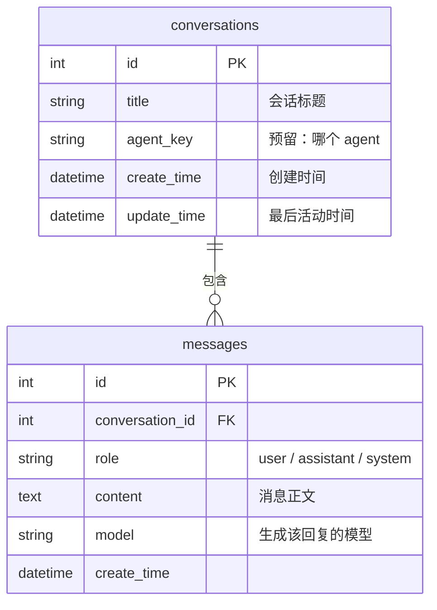
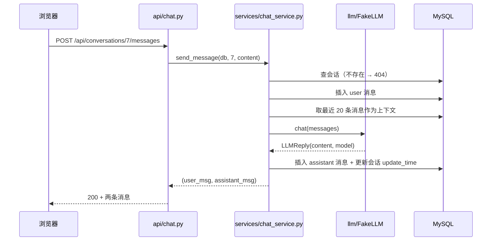
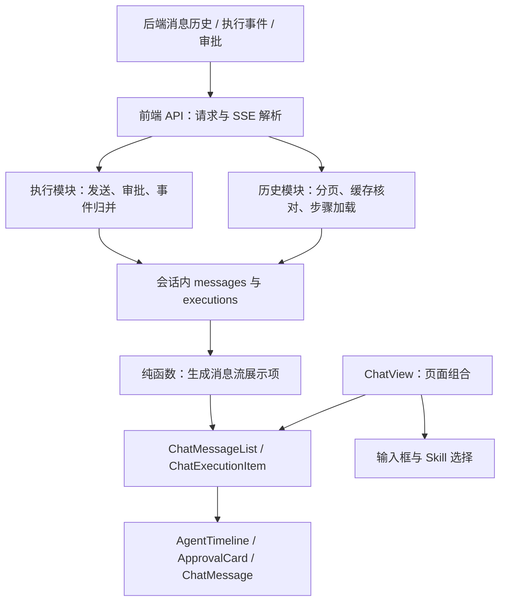

# 对话功能设计（阶段 4 · LLM 接入与基础对话）

> 当前聊天整理方案见第 9 节（2026-11-18，已确认，前三步已完成）；此前各节保留阶段实施背景。

> 阶段 4 的实施方案。**先设计、后实施**（AGENTS.md §2.3）；确认后按第 8 节的任务顺序逐个交付。
> 阶段依据：[`playbooks/05-development-plan-and-mvp-tasks.md`](playbooks/05-development-plan-and-mvp-tasks.md) 阶段 4。
> 相关决策：[ADR-0006](adr/0006-llm-client-and-chat-storage.md)（落库 + 模型抽象）。

## 1. 目标与边界

**这一阶段要拿到的东西**：用户能在页面上新建会话、发一条消息、收到模型回复；刷新页面后对话还在；会话可以重命名和删除。

**接入方式**（已定，见 PROJECT_STATUS §3.2）：先 `FakeLLM` 打底把链路跑通，再接 OpenAI 兼容 API。默认 `LLM_PROVIDER=fake`，**CI 与本地开发都不需要 key**。

**不做的**（留给后续阶段）：

| 不做 | 留给 |
|---|---|
| 流式 SSE 输出 | 阶段 4 的第二批（T4b）：`POST /messages/stream` 逐块返回 |
| Tool Calling / function calling | 阶段 6 |
| Agent 执行循环、多轮规划 | 阶段 5 |
| RAG / Memory / 向量库 | 阶段 8 |
| 多 Agent 协作 | 阶段 9；但表结构预留 `agent_key` |
| 鉴权与用户体系 | 暂无排期（当前单用户） |

## 2. 数据模型



| 表 | 字段 | 类型 | 说明 |
|---|---|---|---|
| `conversations` | `title` | `String(100)`，非空，默认「新会话」 | 首次发消息时若仍是默认值，用首条消息前 30 字自动命名 |
| | `agent_key` | `String(50)`，非空，默认 `default` | 现在只有一个 agent；阶段 9 多 Agent 时用来区分 |
| | `update_time` | `DateTime`，非空，`onupdate` | 列表按它倒序，就是「最近聊过」 |
| `messages` | `conversation_id` | 外键 → `conversations.id`，级联删除 | 删会话即删消息 |
| | `role` | `String(16)`，非空 | 只允许 `user` / `assistant` / `system`，服务层校验 |
| | `content` | `Text`，非空 | 用户消息去首尾空白后不能为空（与商品/分类同规则） |
| | `model` | `String(64)`，可空 | 用户消息为 `NULL`；`fake` 时写 `fake` |

- 公共列 `id` / `create_time` 来自 `app/database.py` 的 `Base`，不重复定义。
- 迁移：`alembic revision --autogenerate`，与现有 categories/products 同一套（ADR-0003）。**不用 `create_all`**。
- 索引：`messages.conversation_id`（查询必用）；`conversations.update_time`（列表排序）。

## 3. 接口

全部挂在 `/api` 下，响应仍是统一信封 `{"code":200,"message":"请求成功","data":...}`。

| 方法 | 路径 | 作用 | 主要错误 |
|---|---|---|---|
| `POST` | `/api/conversations` | 新建会话（可带 `title`） | — |
| `GET` | `/api/conversations` | 会话列表，`page` / `page_size`，按 `update_time` 倒序 | 分页参数 422 |
| `GET` | `/api/conversations/{id}` | 会话详情 + 全部消息（按 `id` 升序） | 404「会话不存在」 |
| `PATCH` | `/api/conversations/{id}` | 重命名（`title` 去空白后不能为空） | 404、400「会话标题不能只包含空白」 |
| `DELETE` | `/api/conversations/{id}` | 删除会话及其消息 | 404「会话不存在」 |
| `POST` | `/api/conversations/{id}/messages` | 发一条用户消息，同步返回助手回复 | 404、400「消息内容不能只包含空白」、502/504（模型侧失败） |

发消息的时序（首版同步）：



**上下文策略**：最近 20 条（`system` 始终带上）。超过就截断，不在这里做摘要——摘要属于阶段 8 的 Memory。

## 4. 模型抽象（`app/llm/`）

```python
class LLMReply(TypedDict):
    content: str
    model: str

class LLMClient(Protocol):
    def chat(self, messages: list[dict[str, str]]) -> LLMReply: ...
```

| 文件 | 职责 |
|---|---|
| `app/llm/base.py` | `LLMClient` 协议 + `LLMReply` + `LLMError`（继承 `BusinessError`） |
| `app/llm/fake.py` | `FakeLLM`：固定前缀回显最后一条用户消息；可注入延迟/异常用于测错误分支 |
| `app/llm/openai_compatible.py` | `httpx` 打 `POST {base_url}/chat/completions`，超时映射 504、鉴权/限流映射 502 |
| `app/llm/__init__.py` | `get_llm()` 工厂：按 `settings.llm_provider` 返回实例，作为 FastAPI 依赖注入，测试里 `dependency_overrides` 直接换 |

新增配置（`app/config.py` + `.env.example`）：

| 变量 | 默认 | 说明 |
|---|---|---|
| `LLM_PROVIDER` | `fake` | `fake` / `openai` |
| `LLM_BASE_URL` | 空 | 例：`https://api.deepseek.com/v1` |
| `LLM_API_KEY` | 空 | **只从环境注入，不入库、不进镜像** |
| `LLM_MODEL` | 空 | 例：`deepseek-chat` |
| `LLM_TIMEOUT_SECONDS` | `30` | 超时即 504 |

## 5. 错误与状态码

| 情况 | 返回 |
|---|---|
| 会话不存在 | 404 `{"code":404,"message":"会话不存在"}` |
| 消息/标题纯空白 | 400 `{"code":400,"message":"消息内容不能只包含空白"}` |
| 模型鉴权失败、上游 4xx/5xx | 502 `{"code":502,"message":"模型服务不可用"}`（不透传上游原文，避免泄漏 key 与内部信息） |
| 模型超时 | 504 `{"code":504,"message":"模型服务超时"}` |
| 未配置 `LLM_API_KEY` 而 `LLM_PROVIDER=openai` | 启动即失败（`Settings` 校验），不等到第一次请求 |

## 6. 前端页面

新增一个页面 `/chat`，路由与侧边栏同现有三个页面：

```
┌ 会话列表（280px） ┬ 消息区 ─────────────────────┐
│ [+ 新建会话]      │  用户：你好                    │
│ 商品怎么定价      │  助手：我是 fake 模型，收到…    │
│ 昨天的对话        │                               │
│                   ├───────────────────────────────┤
│                   │ [输入框                     ][发送] │
└───────────────────┴───────────────────────────────┘
```

- 进入页面：拉会话列表；有会话则打开最近一条，否则显示空态「开始一个新对话」
- 发送中：输入框与按钮禁用，消息区尾部显示「正在回复…」
- 失败：`ElMessage.error` 显示后端 `message`，用户消息保留、不写入假回复
- 复用现有样式 token 与统计卡之外的表格体系，不新增视觉规范
- **助手消息按 Markdown 渲染**（`utils/markdown.ts`：`markdown-it` 渲染 + `DOMPurify` 消毒，`html: false` 让原文里的 HTML 只当文本、外链自动 `target=_blank` + `rel=noopener`）；用户消息保持纯文本并保留换行
- 这两个依赖约 57KB gzip，`/chat` 改成路由级懒加载（`() => import('@/views/ChatView.vue')`），商品/分类/概览页首屏不受影响

## 7. 测试口径

| 层 | 覆盖 |
|---|---|
| 后端服务层（内存 SQLite） | 会话 CRUD、级联删除、`role` 校验、空白内容、上下文取最近 20 条、`FakeLLM` 正常/抛错两条路径 |
| 后端接口层（TestClient + `dependency_overrides`） | 6 个端点的成功与 4 类失败（404/400/502/504） |
| 前端 Vitest | `api/chat.ts` 的 6 个函数（URL、参数、错误透传） |
| E2E（可选） | 新建会话 → 发消息 → 刷新仍在 → 重命名 → 删除 |

门槛不变：后端覆盖率 ≥80%，`make check` 与 `pnpm lint && pnpm test && pnpm build` 全绿。

## 8. 任务拆分（每个都能独立验证）

| # | 任务 | 交付 | 验证 |
|---|---|---|---|
| T1 ✅ | 数据模型 + 迁移 | `models/conversation.py`、`models/message.py`、`models/__init__.py`、一个 alembic revision | `make migrate` 后新表存在、`alembic check` 无漂移 |
| T2 ✅ | 模型抽象层 | `app/llm/*`、`config.py` 5 个字段、`.env.example` | 单测：`FakeLLM` 正常/异常；`openai` 用 `httpx.MockTransport` 验 4 种错误映射 |
| T3 ✅ | 会话 CRUD | `schemas/chat.py`、`services/chat_service.py`、`api/chat.py` 的 5 个端点 | 服务层 + 接口层单测、`docs/api.md` 新增一节 |
| T4 ✅ | 发消息（同步） | `POST /messages`、上下文截断、自动命名 | 用 `FakeLLM` 端到端：发 2 条，库里 4 条记录 |
| T4b ✅ | 流式输出（SSE） | `POST /api/conversations/{id}/messages/stream` + 前端 `fetch` 流式渲染 | 服务/接口单测 + `scripts/chat-acceptance.mjs` |
| T5 ✅ | 前端 `/chat` 页面 | `api/chat.ts`、`views/ChatView.vue`、路由与侧边栏 | `pnpm lint/test/build` + 手工三流程 |
| T6 ✅ | 文档 | `docs/api.md` §4（含 4.6 发消息）、`docs/how-it-works.md` 架构图补 chat、PROJECT_STATUS 打勾 | 链接检查 0 失效 |

**验收标准**（阶段 4 完成）：本地 `make run` + `pnpm dev` 后，能新建会话、发消息（`FakeLLM` 回复）、刷新后仍在、重命名与删除生效；切 `LLM_PROVIDER=openai` 并配 key 后同流程返回真实模型输出；`make check` 与前端三件套全绿；CI 双 job 绿。

## 9. 风险与取舍

| 风险 | 处理 |
|---|---|
| 同步等待模型，慢时体验差 | 首版设置 30s 超时并明确提示；T4b 已换 SSE（仍保留 4.6 同步接口） |
| 上下文无限增长撑爆上下文窗口 | 只取最近 20 条；真正方案在阶段 8 |
| `openai` 兼容层各家字段不同（如 `reasoning_content`） | 只依赖 `choices[0].message.content`；解析失败按 502 处理 |
| 开发机没 key 就无法联调 | 默认 `fake`，CI 永远不依赖外部网络 |
| 消息表增长快 | 现在不分区不归档；数据量成为问题在阶段 11 处理 |

## 7. 前端「新会话」是草稿态（2026-11-11 补充）

后端接口不变，但前端不再「点新建就落库」：

- 点「新建会话」只把界面切到**空白草稿态**（`chat.startNew()`），不发请求、不产生 `conversations` 记录；用户在输入框里写、改、清空都不影响数据库。
- 第一条消息发出去时才 `POST /api/conversations` 建会话，紧接着走原来的 `/messages/stream`（或 `/agent/stream`）。
- 删掉当前正在看的会话、或刷新后没有任何会话，都回到这个草稿态，而不是「空页面」。
- 因此「有一个打开的会话」不再等于「后端有一行记录」：判断界面状态看 `chat.draft` / `chat.activeId`（`draft` 为真时 `activeId` 必为 null）。

## 8. 会话运行时状态按会话隔离（2026-11-11 修订）

### 8.1 修复的 bug

「发出一条问题后立刻切到别的会话，切过去的新会话会被上一个会话的回答占据」。

根因不是后端：SSE 按 `conversation_id` 各跑各的，服务端一直是对的。问题在**前端把运行时状态放在了 store 单例上**：

```ts
// 修复前：一份全局状态，谁都能写
const messages = ref<ChatMessage[]>([])
const streamingText = ref('')
```

`send()` 的回调（`onDelta` / `onDone`）闭包里拿的是 `conversationId`，但写的是**全局** `messages` / `streamingText`；`openConversation()` 只是把这两份数据换成另一个会话的。于是：

1. 旧流还在跑 → `onDelta` 把内容追加到「当前会话」的流式气泡里（此时当前会话已经是别人）；
2. `onDone` 把 assistant 消息 push 进新会话的消息数组；
3. `sendWithAgent()` 收尾的 `await getConversation(id)` 更彻底，直接把全局 `messages` 覆盖成旧会话的详情。

所以是**架构问题**：会话状态是单例，而「一次请求」的生命周期可以比「当前选中的会话」更长。

### 8.2 方案：per-thread state + run 绑定

参考 ChatGPT/Claude 的 Web 端、Vercel AI SDK 的 `useChat`、assistant-ui 的 runtime 设计，共识是两条：

- **消息按 thread 存**（`threadId → messages`），视图只读当前 thread；
- **流（run）绑定它自己的 thread**，回调只写那一份，切走不打断、也不串台。

本项目落地为 `frontend/src/stores/chat.ts` 里的 `threads`：

```ts
interface ChatThread {
  messages: ChatMessage[]
  draftText: string       // 输入框草稿，切走再切回来还在
  streamingText: string   // 流式已收文本
  steps: AgentStep[]      // 深度回答的工具时间线
  sending: boolean        // 普通/深度回答都算
  runningAgent: boolean
  loaded: boolean         // 是否已从服务端拉过
}
const threads = reactive(new Map<number, ChatThread>())  // 草稿态用 key 0
const activeKey = computed(() => activeId.value ?? 0)
```

- `messages` / `streamingText` / `agentSteps` / `sending` / `agentRunning` 全部改成由 `activeKey` 派生的 `computed`，视图代码不变；
- `send()` 与 `sendWithAgent()` 入口处 `const thread = threadOf(conversationId)`，**整段流程（包括 `onDone` 收尾的 `getConversation`）只写这个 thread**；
- 切会话只是改 `activeId`，旧流继续跑完并落到它自己的 thread，切回去能看到完整回答（不需要重拉）；
- **输入框也属于会话状态**：`draftText` 放进 `ChatThread`，视图用 `v-model="chat.composerText"`
  （writable computed）读写，切会话就是切草稿；发送成功后由 store 清掉自己那一份，不再需要
  「点新建时清空输入框」的补丁；
- 侧栏可用 `chat.isBusy(id)` 显示「生成中」，不再依赖全局 `sending`。

### 8.3 两条容易踩的实现细节

1. **reactive Map 的代理**：`threads.set(key, obj)` 存的是原始对象，`get()` 才拿到代理。`threadOf()` 必须把 `get()` 的结果返回，直接改原始对象不会触发视图更新。
2. **不要用「当前会话」推断回调归属**：回调里一律用入口处捕获的 `conversationId`，禁止读 `activeId`。

### 8.4 回归测试

`frontend/src/stores/chat.test.ts`（3 例，`sendMessageStream` 用可控 deferred 模拟未完成的流）：

- 切走后旧会话的 `onDelta` / `onDone` 不写进新会话，切回去数据还在；
- 两个会话的 `sending` 互相独立（切到空闲会话按钮可用，`isBusy(旧会话)` 为真）；
- 输入框草稿按会话隔离（写一半切走再切回，文字还在；另一个会话仍是空的）；
- 删掉当前会话回到草稿态并清掉缓存。

## 9. 聊天状态与展示整理方案（已确认，2026-11-18）

本节基于当前工作区源码评估，包括已有未提交改动；方案已确认，第 1–3 步已完成；第 4–5 步尚未开始。使用 CodeGraph `codegraph_explore` 查询 ChatView、chat Store、AgentTimeline、发送/审批函数、后端历史查询及事件构造，再补读索引省略的计算属性、接口与测试。

### 9.1 整理前的问题与证据

| 问题 | 当前实现 | 影响 |
| --- | --- | --- |
| 时间线完成后跳到正文下方 | `ChatView.vue` 先输出 ChatMessage 再输出时间线；`chat.ts` 的 runsByMessage 优先 assistant_message_id，实时则用 activeUserMessageId | 运行时位于用户消息后，完成后位于助手消息后；这是展示锚点变化，不是 CSS 问题 |
| 同一次执行有两套过程状态 | ChatThread 同时维护 steps、runs、replayDetails；appendAssistantMessage 把实时步骤复制到回放缓存并清空活动锚点 | 页面需要自己判断实时/历史分支，组件可能重建、丢失展开状态 |
| Store 职责集中 | chat.ts 包含会话列表、分页合并、发送、事件转换、审批恢复、弹窗、提示和草稿 | 一个异常路径需要同时理解多个业务域；仅缩短 return 列表不能解决 |
| 页面承担底层协调 | ChatView 处理路由、动画帧、滚动、分页锚点、Skill 参数、运行归属与懒加载 | 页面模板直接依赖内部缓存结构 |
| 状态语义混杂 | sending/runningAgent/approval 加上后端 run.status | 请求结束与运行结束不同，等待审批与断线容易被当作空闲 |
| 新会话发送存在竞态窗口 | send 在 await ensureConversation 后才设置 sending | 创建会话期间再次发送可能重复建会话；需受控延迟测试验证 |
| 错误被当作空数据 | listApprovals 对非成功响应返回 []；审批续跑加载步骤失败回退 [] | 无法区分没有审批/步骤与读取失败 |

原 ChatView.test.ts 曾断言历史时间线前一个元素是助手回复。第一步已更新该断言；第二步补充临时 ID 到正式 ID、完成及历史核对期间保持组件、两层详情节点身份和正文唯一性的回归测试。

### 9.2 统一展示规则

固定顺序为：用户消息 → 执行过程 → 审批卡片（如有）→ 助手正文。零工具/Skill 的已完成回复不显示空过程入口；失败、取消和待审批仍保留所属运行及其可见过程。

第一步最小修复：已完成运行仍按 assistant_message_id 查找，但将过程渲染在该助手正文之前；无助手消息的运行仍置于用户消息之后。不要简单把所有历史运行改挂用户消息，因为当前后端按助手消息所在页返回已完成摘要，分页可能只包含助手消息。

第二步已统一为消息流投影：原始消息、运行及临时正文转换成有序的 MessageItem / ExecutionItem。ExecutionItem 包含过程、审批与正式或流式正文。已被该项消费的助手消息不再单独输出，普通历史消息照常保留。此投影是纯计算结果，不再保存一份可写消息副本。

ExecutionItem 的 key 在一次运行生命周期内保持稳定。当前发送前建立本地展示 key 和独立 request_id，run_started 后在同一个 Execution 上补充 runId，收到助手消息 ID 时仅填充正文，不替换本地 key。刷新后可用 runId 构造 key。只加载到助手消息的一页也能生成执行项；翻出用户消息后不重复输出运行。同一输入存在多个运行时按运行 ID 升序分别展示。展示 key 与网络请求的 request_id 独立，均由一次发送持有；审批继续使用已有运行，不重新创建请求或运行。刷新会重新创建组件，不承诺跨页面刷新保存展开状态。决策见 [ADR-0015](adr/0015-chat-feed-projection.md)。

### 9.3 职责与状态归属



继续复用 Vue、Pinia、现有 Markdown、时间线、审批组件和后端 Runtime，不引入新状态机框架、聊天 SDK 或表结构。

| 边界 | 所有权与建议文件 |
| --- | --- |
| chat Store | 保留一个 Pinia 协调入口；拥有按会话隔离的状态和模块实例生命周期。不要每次调用 composable 创建独立聊天状态 |
| 会话目录 | `stores/chat/conversations.ts`：列表、创建、改名、删除；弹窗留在调用方，模块接受明确参数 |
| 消息历史 | `stores/chat/history.ts`：分页游标、请求版本、摘要合并、步骤懒加载与错误状态 |
| 执行流程 | `stores/chat/execution.ts`：发送、审批续跑、恢复核对；`events.ts`：事件到运行状态的转换 |
| 展示投影 | `stores/chat/feed.ts`：关联消息与运行、排序、临时正文交接；不发请求 |
| 消息区域 | `ChatMessageList.vue` 与 `ChatExecutionItem.vue`：空态、加载更多、运行展示与详情请求事件 |
| DOM 与路由 | `useChatScroll.ts` 管理帧合并、滚动和卸载清理；`useChatRoute.ts` 管理 URL 与会话同步 |

这些模块按阶段提取，不一次建立全部空壳。ChatView 只读取展示项和必要的输入状态，不直接读取 replayDetails/runsByMessage；侧栏保留列表及 isBusy 等明确接口。不要只把几十个字段塞进一个大对象来隐藏复杂度。

每个 Execution 独立持有 runId、消息关联、服务端状态、步骤、详情加载状态、临时正文及待审批信息；实时步骤与回放使用同一份步骤集合，持久步骤按运行与 seq 去重。详情请求捕获版本，避免较旧历史响应覆盖新到达事件。

服务端状态保留 running / waiting_approval / completed / failed / cancelled；客户端另记 preparing / streaming / reconciling / disconnected 等传输状态。二者不可混为一个布尔值。canSend、isBusy 等由两者派生：等待审批或服务端仍运行时禁止另发；断线表示结果未知，先查询持久化状态，不自动重新执行工具。

创建会话前锁定本次发送，并为创建请求去重；请求上下文捕获账号代次、会话实例、requestId 和 runId。切换会话继续更新原会话；删除会话或退出账号使旧回调失效并释放本地读取资源。取消浏览器读取不等于取消后端运行，不能据此把服务端标成 cancelled。

### 9.4 后端配合边界

**修跳位及前端职责拆分不依赖后端改动。** 当前 user_message_id、assistant_message_id、run.id、分页摘要和步骤接口已经可用。保留按消息游标分页，不为了组件布局增加 turn 表或强制整轮分页。

后续若要减少恢复分支和完成后的整页重拉，建议后端增量配合：

1. 扩展 run_finished：返回标准助手 MessageResponse、运行摘要及会话更新信息，前端不再拼本地时间、猜 message_count + 2。完整契约实现时写入 api.md；字段应在事务提交后发出。
2. 在恢复查询中提供当前运行及待审批摘要，或复用现有接口组合为一个前端恢复入口。先保证错误与空结果可区分，再按实际请求成本决定是否聚合后端接口。
3. 工具步骤提供稳定调用关联（例如 tool_call_id），同时覆盖 SSE 和历史响应。当前 AgentTimeline 按工具名配对，顺序调用可工作，但不足以可靠表达同名多调用交错；历史缺失关联的记录保留顺序兼容规则。是否需要迁移取决于现有持久字段能否提供关联。
4. request_id 由前端一次发送流程创建并持有，当前 API 每次调用临时生成 UUID。后端已检查重复请求；如要支持不确定结果后的恢复，再补“重复请求如何返回原运行”的契约，不能把去重误当成 SSE 断点续传。

本轮不做自动断点续传、并行工具执行或模型适配器重写。失败与恢复先复用持久化查询，避免扩大范围。

### 9.5 分步交付与验收

| 顺序 | 前置条件与实施范围 | 独立验收 |
| --- | --- | --- |
| 1. 修复时间线跳位（已完成） | 确认固定展示顺序；修改 ChatView.vue 及视图测试，同步 DESIGN.md 展示规则 | 运行、完成、刷新后过程均在正文前；仅助手消息的一页、无助手的失败/审批记录位置正确；零调用无空入口 |
| 2. 统一消息流投影（已完成） | 第一步通过；增加 feed.ts、ChatMessageList、ChatExecutionItem，页面改为消费展示项 | 完成时不重复正文、不重置已展开过程；临时 ID 转正式 ID、分页、切会话与刷新位置一致 |
| 3. 统一执行状态（已完成） | 第二步通过；按运行合并实时与历史步骤，提取 execution/events；先锁发送再创建会话，保留 requestId，错误不降级为空数据 | 双击首发只建一会话一运行；审批批准/拒绝/再审批、断流恢复、重复事件、旧历史响应、删除及退出后的回调均有验证 |
| 4. 收拢历史和页面职责 | 第三步通过；提取 history/conversations 及路由、滚动逻辑，收窄 Store 对外接口 | 草稿隔离、深链、返回、改名/删除、分页滚动锚点和用户主动上滚阅读不退化；不重复请求详情 |
| 5. 增量后端契约 | 仅在前四步稳定且确认具体字段后实施 events/schemas/service 与前端类型同步变更 | 终态事件与刷新结果一致；完整提交信息可替代成功后的整页刷新；审批/错误恢复仍保留查询；调用配对覆盖同名工具 |

每步先补对应的行为测试，再改实现，运行相关 Vitest、类型检查、ESLint 和构建；修改后端时增加接口/事务与授权测试。涉及布局的步骤用可控工具流在浏览器验证运行→完成→刷新，并检查展开态和分页。模拟验收与真实模型联调分别报告，不将静态推断写成已验证行为。

实施时同步当前架构说明、API（如变）、DESIGN（如变）和项目状态；架构方案获确认落地时记录 ADR。前三步已完成。当前每个 Execution 持有唯一的步骤、审批、预览、服务端状态和连接状态；旧 agentSteps/replayDetails 等只读接口由它派生。发送与审批共用 runExecution，读取历史和步骤有版本及会话实例校验。第四步会话/历史模块、路由/滚动拆分和第五步后端契约尚未开始。实际验证结果见 PROJECT_STATUS.md。


### 9.6 第三步的恢复与错误边界

- 创建前将本次发送标为 preparing，同一草稿的创建请求复用；创建失败保留输入并解锁。创建期间退出账号或新建草稿，迟到的创建响应不得启动原发送或跳转页面。
- 连接用 preparing / streaming / reconciling / disconnected / idle 表达，服务端状态单独使用 running / waiting_approval / completed / failed / cancelled。等待审批或结果未知不能因 HTTP 结束而解锁发送。
- 已知运行断流时先查历史。已完成则恢复正式消息；等待审批则读取当前审批；仍运行则保持提示与锁定，用户可再次核对。不会自动重新 POST 消息或审批。
- 已收到 run_finished 时，随后的历史查询失败不抹掉已提交的最终回复。审批操作返回不确定结果时，若查询仍是原审批，不能声称决定成功，也不能恢复成空闲；提示核对后再操作。
- 步骤与审批的 HTTP 失败、业务错误或响应结构异常均报错。历史明确报告 waiting_approval 却没有 pending 审批时也视为未恢复。步骤失败保留已有步骤与重试入口；审批预加载步骤失败不提交决定。
- 步骤按运行内 seq 去重；异步详情请求复用，版本落后的结果不覆盖新事件。实时完成、历史核对仍沿用第二步的稳定 key 和两层展开节点。
- 删除会话、退出账号时取消本地流读取，并使旧事件和查询结果失效；仅切换会话时原运行继续写回自己的会话。
- 核对到这条消息已经落进历史时清空已发出的草稿，否则同一句话会被当成新消息再发一遍；结果未知时草稿仍然保留。
- 当前历史契约不返回 request_id。若 run_started 未收到，不能把后来发现的某个运行猜作本次提交：保留结果未知，提示刷新页面核对。支持按 request_id 精确找回或续接 SSE 需要后续后端契约配合，本步未实施。

详见 [ADR-0016](adr/0016-chat-execution-state-and-recovery.md)。浏览器验收用 `pnpm acceptance:recovery`（`frontend/scripts/chat-recovery-acceptance.mjs`）跑模拟 API/SSE；不将其视为真实模型验收。
