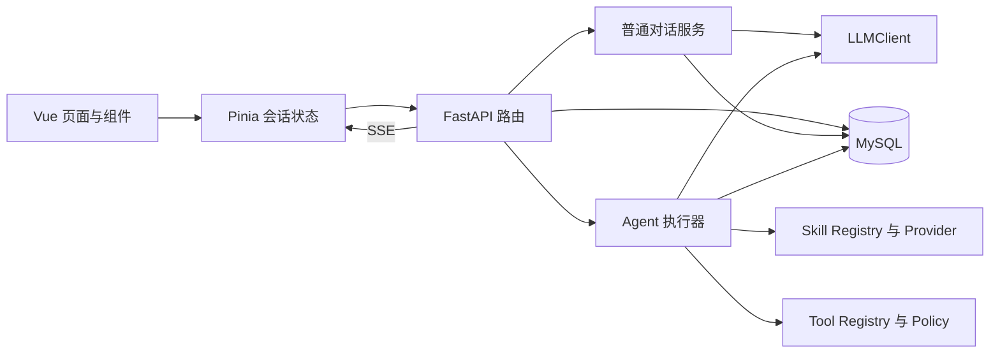

# My Agent 源码研读指南

基于 `4283e39` 的源码。按「页面动作 → 前端状态 → HTTP/SSE → 后端服务 → 数据」阅读。同一文件里有多个入口时，按表中的函数名跳转。接口参数和事件契约查 [API 文档](api.md)，分层和技术取舍查 [项目架构](how-it-works.md)。

## 1. 先读哪条链路

1. **登录 → 新建会话 → 普通发送 → 刷新回看**。理解 Cookie、会话归属、SSE 和消息提交。
2. **普通聊天 → 按需选择工具 → 执行工具 → 审批恢复**。理解模型如何提出调用，以及后端在哪里决定能否执行。
3. **手动挂载或自动挑选 Skill → 加载正文 → 读取资源 → 回放**。理解方法指引如何进入上下文，以及快照如何保存。
4. 最后读设置、工具市场、技能管理和启动入口。各节末尾的测试可以当作可执行示例。

## 2. 登录、注册与鉴权

| 顺序 | 代码位置 | 阅读重点 |
|---|---|---|
| 1 | [LoginView.vue](../frontend/src/views/LoginView.vue)、[RegisterView.vue](../frontend/src/views/RegisterView.vue) · `handleSubmit` | 表单提交后交给 Session Store，成功后导航 |
| 2 | [stores/session.ts](../frontend/src/stores/session.ts) · `login`、`register`、`loadCurrentUser`；[api/auth.ts](../frontend/src/api/auth.ts) · `login`、`register`、`fetchMe` | 请求 `/api/auth/login`、`/register` 或 `/me`，更新当前用户 |
| 3 | [api/auth.py](../backend/app/api/auth.py) · `login`、`register`；[auth/service.py](../backend/app/auth/service.py) · `authenticate`、`register_user`、`create_session` | 核对密码或创建账号，建立服务端登录会话 |
| 4 | [auth/dependencies.py](../backend/app/auth/dependencies.py) · `set_session_cookie`、`get_current_user`；[auth/service.py](../backend/app/auth/service.py) · `resolve_session` | 写 HttpOnly Cookie，后续请求凭 Cookie 找到未失效的登录会话及用户。数据见 [user.py](../backend/app/models/user.py)、[session.py](../backend/app/models/session.py) |
| 5 | [router/index.ts](../frontend/src/router/index.ts) · `router.beforeEach`；[api/client.ts](../frontend/src/api/client.ts) | 浏览器刷新时从 `/me` 恢复状态。阅读路由守卫和普通请求的 401 处理 |

测试入口：[test_auth_api.py](../backend/tests/test_auth_api.py)、[session.test.ts](../frontend/src/stores/session.test.ts)。

## 3. 新建、打开和管理会话

| 动作 | 代码位置与阅读顺序 |
|---|---|
| 点击「新建会话」 | [ThreadList.vue](../frontend/src/components/chat/ThreadList.vue) → [stores/chat.ts](../frontend/src/stores/chat.ts) · `startNew`。导航到 `/chat`，进入前端草稿状态。 |
| 发出第一条消息 | 同一 Store 的 `send` / `sendWithAgent` → `ensureConversation` → [api/chat.ts](../frontend/src/api/chat.ts) · `createConversation` → `POST /api/conversations` → [api/chat.py](../backend/app/api/chat.py) → [chat_service.py](../backend/app/services/chat_service.py) · `create_conversation` → [Conversation](../backend/app/models/conversation.py)。 |
| 加载侧栏列表 | [AsideView.vue](../frontend/src/components/layout/AsideView.vue) → Store 的 `ensureConversationsLoaded` / `loadConversations` → API 的 `listConversations` → 后端 `list_conversations`。 |
| 打开会话或刷新页面 | `ThreadList.open` 导航到 `/chat/:conversationId` → [ChatView.vue](../frontend/src/views/ChatView.vue) 监听路由参数 → Store 的 `openConversation` → API 的 `getConversation` → 后端 `get_conversation`，取会话与消息。Store 用 `threadOf` 区分各会话的草稿、消息与执行步骤。 |
| 重命名 / 删除 | ThreadList 的 `rename` / `remove` 事件 → Store 同名动作 → API 的 `renameConversation` / `deleteConversation` → 后端 `rename_conversation` / `delete_conversation`。 |

注意区分登录会话和聊天会话。前者维持身份，后者归属于用户。阅读 `chat_service.get_conversation` 时，重点看它如何同时用会话 ID 与用户 ID 查找。对应测试见 [test_chat_api.py](../backend/tests/test_chat_api.py)、[chat.test.ts](../frontend/src/stores/chat.test.ts)。

## 4. 普通发送与回复展示

1. [ChatComposer.vue](../frontend/src/components/chat/ChatComposer.vue) 的 `submit` → [ChatView.vue](../frontend/src/views/ChatView.vue) 的 `handleSend` → [stores/chat.ts](../frontend/src/stores/chat.ts) 的 `send`。深度回答只改变传入的推理强度。
2. [api/agent.ts](../frontend/src/api/agent.ts) 的 `sendAgentStream` 向 `POST /api/conversations/{id}/messages/stream` 发送 `execution: "auto"`。[api/chat.py](../backend/app/api/chat.py) 经 `agent_stream_response` 进入现有 Agent 循环。
3. `prepare_run` 提交用户消息、运行及首步骤。`_run_loop` 向模型流式请求，当前轮有工具调用时清除临时预览，最后一轮返回正式正文。Store 经 `applyAgentEvent` 和 `appendAssistantMessage` 更新消息及执行步骤。[ChatView.vue](../frontend/src/views/ChatView.vue) 在动画帧中更新 Markdown 预览。
4. 旧文本 API 和同步 API 保留。普通模式和深度回答的端到端行为可从 [test_chat_tool_stream.py](../backend/tests/test_chat_tool_stream.py) 跟读。

## 5. Tool 发现、执行与审批

| 环节 | 代码位置 | 阅读重点 |
|---|---|---|
| 启动 | [api/chat.py](../backend/app/api/chat.py) · `stream_message` → [api/agent.py](../backend/app/api/agent.py) · `agent_stream_response` → [executor.py](../backend/app/agent/executor.py) · `prepare_run`、`stream_run` | 模型、账号工具配置、消息和运行关联在开流前确定。 |
| 发现内置工具 | [executor.py](../backend/app/agent/executor.py) · `registry_for` → [tools/__init__.py](../backend/app/agent/tools/__init__.py) · `BuiltinSource.list`、`ToolRegistry.from_sources` | 内置工具来自代码。工具实现位于 [calculator.py](../backend/app/agent/tools/calculator.py)、[clock.py](../backend/app/agent/tools/clock.py)、[history.py](../backend/app/agent/tools/history.py)、[conversation.py](../backend/app/agent/tools/conversation.py)。 |
| 发现 MCP 工具 | `executor.registry_for` → [mcp_service.py](../backend/app/services/mcp_service.py) · `spec_of_row` → [manager.py](../backend/app/mcp/manager.py) · `source_for` → [client.py](../backend/app/mcp/client.py) · `list_tools` → [source.py](../backend/app/mcp/source.py) · `McpSource.list` | 为当前账号已启用的服务器组装工具，注意连接与清单缓存。市场条目由另一条管理链路提供，见 §8。 |
| 把工具交给模型 | [executor.py](../backend/app/agent/executor.py) · `_run_loop` → `ToolRegistry.specs` → [openai_compatible.py](../backend/app/llm/openai_compatible.py) · `_tool_payload`、`stream_with_tools` | 模型收到已启用工具的 Schema 并按任务决定是否调用。适配器合并调用分片，轮次完整结束后才执行。 |
| 校验并执行 | `_run_loop` → [policy.py](../backend/app/agent/policy.py) · `ToolPolicy.check` → `_execute` → `ToolRegistry.execute` → [tools/base.py](../backend/app/agent/tools/base.py) · `run_tool` → 各工具的 `run` | 策略检查启停、预算和审批；执行层解析参数并处理超时。MCP 路径经过 `McpTool.run` 本地 Schema 校验，再到 `McpClient.call_tool`。结果以 tool 消息回传模型。 |
| 审批暂停与恢复 | `_open_approval` → [ApprovalCard.vue](../frontend/src/components/chat/ApprovalCard.vue) → Store 的 `decideApproval` → API 的 `decideApprovalStream` → 后端 `decide` → 执行器的 `decide_approval`、`resume_run`、`_replay_messages` | 根据运行记录重建上下文，批准后核对工具指纹和当前策略。读 [agent_approval.py](../backend/app/models/agent_approval.py) 看审批状态。 |
| 最终回答 | `_run_loop → _save_final_message`；事件构造见 [events.py](../backend/app/agent/events.py) | 模型停止请求工具后保存助手消息并发 `run_finished`。过程步骤独立留在 [agent_step.py](../backend/app/models/agent_step.py)，运行与快照在 [agent_run.py](../backend/app/models/agent_run.py)。 |

推荐沿 [test_agent_executor.py](../backend/tests/test_agent_executor.py) 的工具往返和审批恢复用例单步阅读。MCP 路径看 [test_mcp_agent.py](../backend/tests/test_mcp_agent.py) 与 [test_mcp_source.py](../backend/tests/test_mcp_source.py)。

## 6. Skill 的发现、加载和资源读取

| 环节 | 代码位置与阅读顺序 |
|---|---|
| 登录发现 | [App.vue](../frontend/src/App.vue) 监听账号 ID → [stores/skills.ts](../frontend/src/stores/skills.ts) 的 `initialize` / `scan` → [api/skills.py](../backend/app/api/skills.py) 的 `rescan_catalog` → [skill_catalog_service.py](../backend/app/services/skill_catalog_service.py) 保存账号目录快照。 |
| 设置重扫与说明 | [SkillsPanel.vue](../frontend/src/components/settings/SkillsPanel.vue) 使用同一 Store，按需请求 `read_catalog_detail`。 |
| 单条消息选择 | [ChatView.vue](../frontend/src/views/ChatView.vue) 和 [ChatToolbar.vue](../frontend/src/components/chat/ChatToolbar.vue) 读账号目录缓存，选中的来源键保存在当前消息草稿，随 `send` 提交后清除。切换会话不查询目录。 |
| 运行发现和决定加载 | `prepare_run` 读取本地目录快照，`stream_run` 加载显式选择项，`auto` 模式通过控制动作按需加载。文件元数据解析、版本和读取由 [FileSystemSkillProvider](../backend/app/skills/providers/filesystem.py) 负责。 |
| 正文进入上下文 | 自动模式的模型控制动作 `__runtime_request_skill_load` → `_load_skill` → Registry 的 `load` → Provider → `_snapshot_payload` → `_messages_with_runtime_skills` → [build_runtime_skill_prompt](../backend/app/skills/models.py)。跟读版本校验、加载去重、上下文限制以及 `skill_loaded` / `skill_load_failed`。 |
| 按需读取参考资料 | `__runtime_read_skill_resource` → `_read_skill_resource` → Registry 的 `read_resource` → 文件 Provider → [resources.py](../backend/app/skills/resources.py) 的 `read_resource`。只读已加载技能清单内的文本，首次成功读取保存快照，同时发 `skill_resource`。可用实例见 [会议纪要检查清单](../backend/app/skills/meeting-notes/references/checklist.md)。 |
| 审批恢复 | `resume_run → _loop_state → _replay_messages` 恢复已加载指引和已读资源；跟踪运行快照与步骤记录如何配对。 |

Skill 加载和资源读取由 Runtime 直接分派。普通工具另经 Tool Policy。技能指引可推荐工具。账号启停设置和 Tool Policy 决定工具可用性与权限。测试入口：[test_skills.py](../backend/tests/test_skills.py)、[test_skill_resources.py](../backend/tests/test_skill_resources.py)、[test_agent_executor.py](../backend/tests/test_agent_executor.py)。

## 7. 会话展示、SSE 与历史回放

| 页面看到的内容 | 代码位置 |
|---|---|
| 普通回复的逐字更新、完成消息 | [api/chat.ts](../frontend/src/api/chat.ts) 兼容的 `sendMessageStream`；聊天页使用 [api/agent.ts](../frontend/src/api/agent.ts) 的 `sendAgentStream` → [stores/chat.ts](../frontend/src/stores/chat.ts) 的 `send` 回调 → [ChatView.vue](../frontend/src/views/ChatView.vue) 的 `streamingText` 展示和消息列表。 |
| 工具、技能、参考资料或审批状态 | [api/agent.ts](../frontend/src/api/agent.ts) 的 `consume` → Store 的 `applyAgentEvent` → [AgentTimeline.vue](../frontend/src/components/chat/AgentTimeline.vue) / [ApprovalCard.vue](../frontend/src/components/chat/ApprovalCard.vue)。最终答复走 Store 的 `appendAssistantMessage`，随后重新拉取会话详情。 |
| 刷新、切换会话和翻页 | `ChatView` 监听路由参数 → Store 的 `openConversation` → [chat_service.py](../backend/app/services/chat_service.py) 的 `read_message_history`，返回消息页与运行摘要。视图通过 `assistant_message_id` 把执行过程挂在对应助手消息下，展开时走 Store 的 `loadExecutionSteps` → [api/agent.py](../backend/app/api/agent.py) 的 `get_replay_steps`。待审批项通过 `listApprovals` 恢复。 |

对应测试：[api/agent.test.ts](../frontend/src/api/agent.test.ts)、[SkillInteraction.test.ts](../frontend/src/components/chat/SkillInteraction.test.ts)、[ChatView.test.ts](../frontend/src/views/ChatView.test.ts)。

## 8. 模块入口速查

| 功能 | 前端 | 后端与数据 |
|---|---|---|
| 模型设置与试连 | [ModelPanel.vue](../frontend/src/components/settings/ModelPanel.vue)、[api/settings.ts](../frontend/src/api/settings.ts) | [api/settings.py](../backend/app/api/settings.py) 的 `read_model/update_model/test_model` → [settings_service.py](../backend/app/services/settings_service.py) → [user_settings.py](../backend/app/models/user_settings.py) |
| 外观与跨设备同步 | [AppearancePanel.vue](../frontend/src/components/settings/AppearancePanel.vue)、[stores/theme.ts](../frontend/src/stores/theme.ts) 的 `syncFromAccount`，由 [App.vue](../frontend/src/App.vue) 调用 | 同上路由及服务的 `read_appearance/update_appearance` |
| 账号、设备与数据导出 | [AccountPanel.vue](../frontend/src/components/settings/AccountPanel.vue)、[DevicesPanel.vue](../frontend/src/components/settings/DevicesPanel.vue)、[DataPanel.vue](../frontend/src/components/settings/DataPanel.vue) | [api/auth.py](../backend/app/api/auth.py) 的账号与设备路由；[api/settings.py](../backend/app/api/settings.py) 的 `export_data` → [export_service.py](../backend/app/services/export_service.py) |
| 工具启停、预算与用量 | [ToolsPanel.vue](../frontend/src/components/settings/ToolsPanel.vue)、[api/settings.ts](../frontend/src/api/settings.ts) | [api/settings.py](../backend/app/api/settings.py) 的 `read_tools/update_tools/read_tool_stats` → [settings_service.py](../backend/app/services/settings_service.py)；对照执行时的 [ToolPolicy](../backend/app/agent/policy.py) |
| MCP 工具市场、安装和试连 | [MarketPanel.vue](../frontend/src/components/settings/MarketPanel.vue)、[api/mcp.ts](../frontend/src/api/mcp.ts) | [api/mcp.py](../backend/app/api/mcp.py) 的 `read_catalog/create_server/test_server` → [mcp_service.py](../backend/app/services/mcp_service.py) → [mcp_server.py](../backend/app/models/mcp_server.py) |
| 本地 Skill 目录 | [SkillsPanel.vue](../frontend/src/components/settings/SkillsPanel.vue)、[api/skills.ts](../frontend/src/api/skills.ts) | [api/skills.py](../backend/app/api/skills.py) 的 `read_catalog/rescan_catalog/read_catalog_detail` → [skill_catalog_service.py](../backend/app/services/skill_catalog_service.py) → 文件 Provider |
| 应用启动、探针与迁移 | [main.ts](../frontend/src/main.ts)、[App.vue](../frontend/src/App.vue)、[router/index.ts](../frontend/src/router/index.ts) | [main.py](../backend/app/main.py) 的路由挂载和 `healthz/readyz`、[database.py](../backend/app/database.py)、[migrations/env.py](../backend/migrations/env.py)、[部署说明](deploy.md) |

## 9. 如何用代码和测试互相验证

- 普通对话重点观察 `meta → delta → done` 与提交点。Agent 对话重点观察 `run_started → 过程事件 → run_finished`，或在 `approval_required` 后通过另一条 SSE 恢复。
- 先用 [FakeLLM](../backend/app/llm/fake.py) 与剧本测试跟读分支。另有 [实际验收脚本](../backend/scripts/skill_runtime_acceptance.py)，需要本地服务、已迁移的 MySQL 和可用的模型配置。真实模型验收进度见 [项目状态](PROJECT_STATUS.md)。
- 本文通过 CodeGraph MCP 的 `mcp__codegraph__codegraph_explore` 核对页面事件、路由、执行器、注册表及服务入口，并用源码补齐索引省略的实现。HTTP 与 SSE 的跨进程连接按 URL 和事件处理器对照。本文记录的是静态研读路径。
