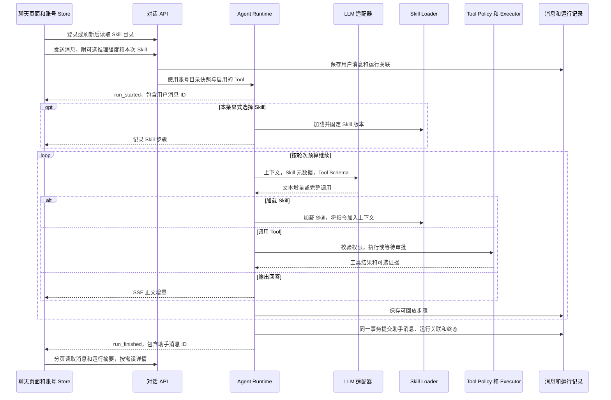

# 对话执行、Tool 与 Skill 重设计

> 2026-11-18 · 三步均已实现。本文定义目标架构和交付顺序，现行行为见 [Agent 执行循环](agent.md)、[Skill](skills.md) 和 [API](api.md)。

## 1. 重设计前的实现

| 环节 | 代码位置 | 观察 |
| --- | --- | --- |
| 发送和深度回答 | [ChatView.handleSend](../frontend/src/views/ChatView.vue#L137)、[stream_agent_run](../backend/app/api/agent.py#L53) | 前端把「深度回答」映射成是否调用 Agent 接口。普通消息走普通 SSE，模型看不到工具定义。 |
| 工具装配和 Skill | [registry_for](../backend/app/agent/executor.py#L1125)、[_tools_for_skills](../backend/app/agent/executor.py#L997)、[ToolPolicy.check](../backend/app/agent/policy.py#L89) | 注册表先装配用户可用的内置和 MCP 工具。现有手动路径可按挂载 Skill 收窄，循环还会对已加载 Skill 的非空工具集取交集。模型看到收窄后的 Schema，真正执行仍经过 Policy。 |
| Skill 发现和安装 | [ChatView.loadSkills](../frontend/src/views/ChatView.vue#L32)、[activeId 监听](../frontend/src/views/ChatView.vue#L160)、[Skill 服务](../backend/app/services/skill_service.py#L47)、[SkillsPanel](../frontend/src/components/settings/SkillsPanel.vue#L13) | 目录由内置文件和用户数据库记录组成。聊天查询传入会话 ID 以标记挂载项，切换会话会重拉。设置页提供新建、修改、删除和工具勾选。 |
| 执行过程 | [AgentRun](../backend/app/models/agent_run.py#L33)、[prepare_run](../backend/app/agent/executor.py#L97)、[_save_final_message](../backend/app/agent/executor.py#L1478)、[list_agent_runs](../backend/app/api/agent.py#L92) | 运行归属于会话，步骤归属于运行。运行没有消息外键。保存用户消息和最终助手消息时没有记录对应关系。查询返回近期运行。 |
| 历史展示 | [chat.loadAgentRuns](../frontend/src/stores/chat.ts#L594)、[ChatView 消息循环](../frontend/src/views/ChatView.vue#L239) | Store 只读取最新运行。模板只在最后一条用户消息旁插入时间线。因此多轮调用历史无法逐条回放。 |
| 流式能力 | [LLMClient](../backend/app/llm/base.py#L100)、[OpenAI 兼容适配器](../backend/app/llm/openai_compatible.py#L183) | 普通回复已有正文流。当前 `chat_with_tools` 按完整轮次返回，接入正常发送还需在模型适配层支持同时流式解析正文与工具调用。 |

现有 Skill 声明工具的设计意图见 [ADR-0013](adr/0013-skills-as-method-packages.md)。它把工具当作工作方法的配套清单，运行时用白名单减少暴露的能力。这个约束适合一个固定的窄工作流，但用于通用聊天会让 Skill 选择改变模型的能力。加载两个工具清单不相交的 Skill，还可能把可用业务工具全部过滤掉。建议保留工作流对工具的文字提示，并把准入统一交给账号工具配置和 Policy。

代码核对实际调用了 CodeGraph MCP 的 `codegraph_explore`，查询了发送、Skill 查询与挂载、运行准备、循环、工具装配和历史接口，随后核对了相关源码、工具注册和文档。

## 2. 主流 Agent 的设计对比

| 项目 | 消息、工具与 Skill | 本项目取舍 |
| --- | --- | --- |
| Claude Code | 模型可以按任务匹配 Skill，用户也可以显式调用。Skill 支持按需读参考文件。Claude 的 `allowed-tools` 可对调用 Skill 的轮次给予特定工具预批准，工具本身继续遵循权限配置。 | 采用显式与自动加载。下载的 Skill 在本项目内只提供工作指令，权限由独立设置管理。 [Skill 文档](https://code.claude.com/docs/en/skills) [权限文档](https://code.claude.com/docs/en/permissions) |
| OpenAI Codex | 按仓库、用户、管理员和系统等范围发现本地 Skill。模型先获知紧凑的目录元数据，按任务或用户点名读取完整 `SKILL.md`。公开 App Server 协议以 turn 和 item ID 标识历史步骤，支持分页读取及按需取得延迟返回的输出。 | 采用按使用范围发现和渐进加载，历史按运行和步骤标识读取。账号是当前产品已有的作用域，后续增加工作区再扩展目录作用域。 [OpenAI Skill 文档](https://learn.chatgpt.com/docs/build-skills) [App Server 协议](https://github.com/openai/codex/blob/main/codex-rs/app-server-protocol/src/protocol/v2/thread.rs) |
| DeepSeek Harness | 一轮对话包含多个模型与工具步骤。实时正文增量与持久化会话事件分开。Skill 由本地或打包 Provider 提供，可按运行作用域注册，通过模型侧 Skill 动作或 Web 输入框显式加载。历史 Skill 卡片保留当时的内容。 | 复用现有运行和步骤表，补上消息关联。保留小型 Skill 加载动作。Harness 使用会话作用域有其 preset 场景，本项目当前目录按账号共享。 [架构](https://github.com/deepseek-ai/deepseek-harness/blob/master/docs/architecture.md) [Skill 子系统](https://github.com/deepseek-ai/deepseek-harness/blob/master/docs/subsystems/skills.md) [Web Skill 交互](https://github.com/deepseek-ai/deepseek-harness/blob/master/packages/client/ui-skill/README.md) |
| Pi | 启动时扫描配置目录，提供名称、简介和路径。模型按需读取文件，用户可用 `/skill:name` 显式触发。Agent 循环组织模型请求、工具调用与事件，消息历史可随会话恢复。 | 采用账号启动预取和单条消息显式触发。Web 部署继续通过受控 Loader 读取文件。 [Skill 文档](https://github.com/earendil-works/pi/blob/main/packages/coding-agent/docs/skills.md) [Agent 循环](https://github.com/earendil-works/pi/blob/main/packages/agent/README.md) [会话格式](https://github.com/earendil-works/pi/blob/main/packages/coding-agent/docs/session.md) |

这里比较的是 Codex 编程 Agent 与 DeepSeek Harness 本身。模型侧 Function Calling 提交结构化调用请求，执行、权限和回放由宿主负责。 [DeepSeek Tool Calls](https://api-docs.deepseek.com/guides/tool_calls/)

## 3. 每条助手消息的执行过程

- 在 `AgentRun` 增加可空的 `user_message_id`、`assistant_message_id`。保存输入时用其主键关联运行，等待审批和未完成状态可以锚定到用户消息。最终保存助手消息时，在同一事务里写入其 ID 和运行终态。对新数据保证同账号、同会话、角色正确，每条最终助手消息最多关联一次运行；已有会话删除、账号删除路径应覆盖迁移回归。
- 一次运行产生一个正式助手消息，内部模型轮次只记为步骤。批准或拒绝后仍续同一运行。审批重复决定沿用现有 409 判断，统一发送入口的幂等键在第二步通过可选 UUID 请求标识实现。已执行但结果未确认的有副作用调用交给现有审批和恢复约束处理，避免重试重复执行。
- 当前会话详情一次返回全部消息。第一步新增按消息主键游标读取的历史接口，按同一批消息批量读取运行摘要，例如 `run_id`、状态和可展示步骤数。展开时按运行 ID 读取授权后的步骤详情。活跃或等待审批的运行单独恢复，避免被最新消息页过滤。已完成记录跟随各自的助手消息；失败、取消或等待审批且没有助手消息的运行，过程显示在对应用户消息下。
- SSE 以 `run_id` 标识运行，以 `seq` 标识持久步骤。开始事件返回输入消息 ID，最终提交后的结束事件带助手消息 ID。前端 Store 按运行 ID 更新并按助手消息 ID 索引，实时完成后缓存对应运行的步骤，重新打开会话时以持久化摘要核对该缓存。切换会话时事件仍写入原会话。
- 时间线继续保持浅色单行和可展开详情。仅进行中的运行显示「正在思考…」。完成后，对有工具、Skill 或审批记录的回复显示「查看执行过程」，逐项展开可展示的参数、结果、状态。展示层明确排除模型私有推理、内部 Prompt、凭据和超长原始输出。
- 上线前的记录缺少消息外键，无法可靠回填归属。按 2026-11-18 的清理决定，迁移 `b72e80d193ac` 删除两个消息关联均为空的已结束运行及其步骤、审批，不再提供会话级旧执行记录入口。消息正文、具备任一消息关联的运行和活跃运行保留。新记录按消息展示。

## 4. 对话内容决定是否调用 Tool

推荐将聊天输入框统一接入现有 Agent 循环，对外收拢为 `POST /api/conversations/{id}/messages/stream` 的演进契约。过渡期让原 Agent 入口共用同一执行服务，前端切换后再移除旧路径。输入包含 `content`、可选的 `reasoning_effort`、当前消息选择的 `skill_keys` 和幂等请求标识。

- 对支持 Function Calling 的模型，默认提供已启用、允许向模型公开的 Tool Schema，使用自动选择。用户消息、工具描述和参数 Schema 共同决定模型会请求什么。Runtime 执行前再核验注册、账号权限、参数、超时、预算和审批，结果按 `tool_call_id` 回传模型。模型生成最终正文后停止。
- 「深度回答」只映射为模型适配器支持的推理强度。推理强度与 Tool 是否可用分别建模。适配器明确选择组合兼容的参数。模型不支持推理强度时隐藏或禁用这个入口。模型不支持工具时走当前纯文本流，在需要实际工具能力的场景明确说明当前限制。
- 将已存在的 `now` 工具用于「现在几点」。给工具统一时区参数语义，采用用户明确指定的时区，未指定时使用应用默认值 `Asia/Shanghai`，结果包含时区名和 UTC 偏移。账号级时区设置留作后续扩展。「搜索 Agent 怎么实现」调用已配置的网页搜索能力，并展示来源。工具市场提供 Exa 网页搜索，也可以配置其他搜索 MCP 工具。当前外部工具仍走审批。搜索未启用或未获授权时明确告知，来源仅由实际工具结果生成。「解释 Agent Loop」这类可直接回答的问题允许模型零调用。
- Q&A 与工具循环共用模型流式能力。适配器对每轮累积函数名、调用 ID 和参数片段，轮次结束后校验完整调用并执行。最终正文增量继续走现有 Markdown 流式组件。提供商明确标记的中间内容进入过程视图。只能在轮终判定的文本先作为本轮临时预览，工具轮终时清理，只有终答进入正式消息；需要纯净预览的适配器可缓冲不确定片段。无需额外发一个模型请求来预测是否用工具。
- 比起「先关键词分流，再选择接口」，上述做法能处理改写、上下文省略和多工具组合。代价是更多对话携带 Tool Schema，以及适配层要处理碎片化调用。首版控制注册表大小和轮次预算，保留现有无工具流作为不支持 Function Calling 模型的适配分支。

## 5. 本地 Skill 生命周期

1. **安装**。管理员或本地用户从项目外部下载后，将目录放进后端配置的受信任 Skill 根目录。保留随应用发布的内置 Skill。容器通过明确的只读卷挂载。远程部署中的“本地”指后端进程可读取的目录。浏览器所在电脑上的文件需要先由用户放到对应部署目录。共享部署按账号显式映射私有根，只有管理员配置的目录允许跨账号共享。
2. **发现**。登录成功或刷新页面后，认证初始化流程获取一次账号级元数据。进入设置中的 **Skill** 页时再次发现，页面内提供「重新扫描」。前端 Store 对同账号的并发请求去重，退出或换账号时清理。返回技能键、名称、描述、来源、版本和可用状态。切换、新建和打开已有会话都读 Store。发送消息使用服务端该范围的发现快照，运行期间可按注册路径加载内容，避免全树重扫。
3. **校验和更新**。沿用文件 Provider、Registry、Loader 和资源路径约束。限制扫描目录深度、数量、大小和正文预算。校验 frontmatter 和路径，隔离损坏条目，内置与外部同名项按稳定来源键区分，歧义时告知而不静默选中。服务端按账号或授权范围保存目录快照与版本；多进程部署用同一个共享版本与缓存存储。文件发生变更、删除或读失败时返回可解释的加载失败，由用户在设置里刷新目录。已加载内容和审批恢复继续采用现有运行快照。
4. **使用**。模型首先收到 `name` 和 `description`，需要时发出 Skill 加载动作。用户可通过工具条菜单选择本次使用的 Skill。两条路径进入同一 Loader 且运行内按键与版本去重。正文和授权的文本资源进入当前运行上下文。Skill 可以描述适合的工具，也可以用现有加载动作读取资源。下载包中的脚本保留为文件，当前加载器没有执行入口。第三方 frontmatter 中的 `tools` 或 `allowed-tools` 均不影响权限与审批。
5. **迁移与界面**。统一把所有面向用户的「技能」文案、设置导航、表单和时间线标签改为「Skill」。设置页改为只读目录与重新扫描，删除网页新建、编辑和工具勾选。迁移前提供既有数据库 Skill 的文件导出和冲突提示，用户将文件放到配置目录。会话已有的挂载项可提示一次，并由用户选择是否用于本条消息。新版停写 `skill_slug`，过渡期保留原记录和读接口。导出及兼容期结束后，再清理数据库 Provider 和写接口。历史回复仍读取当时记录的 Skill 名称、来源和版本。

把发现和加载分开的收益是切换页面无需目录请求，工具请求也不会触发扫描。会话之前保存的是「将这套方法默认用于这里」的产品设置，因此查询才耦合。新版选择范围是一条消息，目录范围是当前账号。运行快照用于复现当时所用的版本。

## 6. 后续 RAG 保留的边界

首版在 Agent 组装上下文与工具结果之间约定可选的 `EvidenceRef`，包含 `kind`、`source_id`、`version`、`locator`，按来源扩展块 ID、标题和可展示链接。网页搜索可先使用同一证据表示。证据与运行及助手消息关联，刷新按稳定 ID 回放。引用由后端校验来自当前运行已接纳的证据。

后续优先把知识库检索接为 `search_knowledge`，内部调用 `Retriever.retrieve(query, scope, limit)`，返回有界片段及证据 ID。指定知识库、显式要求基于资料回答等场景可再接上下文组装阶段的自动检索，并对同一轮已有证据去重。检索前应用账号或工作区范围，读历史引用时再次鉴权。对权限取消和资料下线给出明确状态。片段作为外部资料进入上下文，遵守长度、数量、时间预算，权限、执行与审批仍由宿主负责。实际索引、向量存储、文档上传和召回调优留给 RAG 实施阶段。

## 7. 目标链路

等待审批会结束当前 SSE，由现有审批入口续同一运行。SSE 断线后以持久化状态回放；进程异常退出后，已提交的步骤与运行状态由恢复流程核对。

## 8. 实施顺序与验收

| 步幅 | 独立交付 | 对应测试 |
| --- | --- | --- |
| 1 | **按助手消息回放执行过程**（已实现）。迁移、运行关联、历史摘要与详情、前端按消息展示。当前两条发送入口可继续工作。 | 同一会话完成两次带工具的回复，刷新后分别展开；分页加载较旧的消息；切换和深链；流式和历史合并；审批刷新、恢复、拒绝；老数据、会话删除和跨账号拒绝。 |
| 2 | **普通聊天按需调用 Tool**（已实现）。统一 Runtime，拆出推理强度，支持带工具的流式适配，移除 Skill 对工具注册表的收窄，接入可配置搜索能力。 | 不开深度回答也能调用时间和测试搜索；普通咨询零调用；参数分片、多个调用、超时、断流、审批重试、禁用工具和不支持工具的模型；同轮多个 Skill 不收窄 Tool，Skill 中的授权提示不能跳过审批；真实模型与实际配置的搜索各做一次独立验收。 |
| 3 | **账号级本地 Skill**（已实现）。登录预取、设置刷新、只读目录、单次显式使用及模型自动加载，兼顾旧数据过渡。 | 登录和刷新各请求一次，切多会话无额外请求，打开设置刷新；目录安装、删除、冲突、非法路径、账号隔离、加载版本稳定；历史卡片稳定。 |

证据接口随第二步的搜索结果评审，现阶段无需单设 RAG 开发步骤。每步提交完整功能及对应测试，汇报结果后等待确认。三步交付后停止，下一项工作由用户确认。现行 Skill 行为与部署配置见 [Skill 文档](skills.md)。
