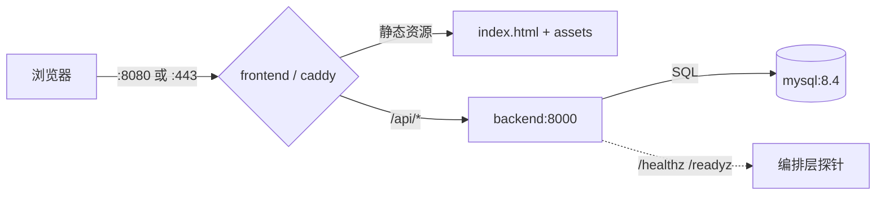

# 容器化与一键部署

用 Docker Compose 把「MySQL + FastAPI 后端 + Vue 前端 + Caddy 反向代理」一次拉起。默认单机部署，够用且好排障；后续要上云只需要换机器和域名。

## 1. 前置条件

- Docker Engine 24+（或 Docker Desktop / colima）
- Docker Compose v2（`docker compose version` 能输出即可）
- 首次构建需要能拉取 `python:3.12-slim`、`node:22-alpine`、`nginx:1.27-alpine`、`mysql:8.4`、`caddy:2.9-alpine`

## 2. 三步启动

```bash
cp .env.example .env      # 改掉 MYSQL_ROOT_PASSWORD 与 MYSQL_PASSWORD
docker compose up -d --build
open http://localhost:8080
```

首次启动后端会自动执行 `alembic upgrade head`，把表结构建好；之后再启动是幂等的，不会重复建表。

## 3. 服务与端口

| 服务 | 镜像/构建 | 对外端口 | 说明 |
| --- | --- | --- | --- |
| `frontend` | `fullstack/product-admin/Dockerfile` | `${FRONTEND_PORT:-8080}→80` | nginx 托管静态产物，`/api` 反代到 `backend:8000` |
| `backend` | `python/fastapi-demo/Dockerfile` | 仅容器网络 | 启动先跑迁移，再 `uvicorn` 监听 8000 |
| `db` | `mysql:8.4` | 仅容器网络 | utf8mb4，数据在 `db-data` 卷 |
| `caddy` | `caddy:2.9-alpine` | `${HTTP_PORT:-80}` / `${HTTPS_PORT:-443}` | 可选，`--profile https` 才启动 |

`backend`、`db` 不对宿主机开放端口：外部流量只能经 `frontend` 或 `caddy` 进来。两个探针在边缘层也一并暴露：`http://localhost:8080/healthz`、`http://localhost:8080/readyz`。

### 3.1 环境变量总表

两个 `.env.example` 分管两件事，互不覆盖：

- 仓库根 `.env.example` → 给 **docker compose** 用（复制成根 `.env`）
- `python/fastapi-demo/.env.example` → 给 **本地直接跑后端** 用（复制成该目录 `.env`）

| 变量 | 谁读 | 必填 | 默认 | 说明 |
|---|---|---|---|---|
| `MYSQL_ROOT_PASSWORD` | compose → `db` | ✅ | — | MySQL root 密码；未设时 compose 直接报错退出 |
| `MYSQL_DATABASE` | compose → `db`、`backend` | | `fastapi_demo` | 库名，后端连接串里的数据库 |
| `MYSQL_USER` | compose → `db`、`backend` | | `fastapi` | 应用账号（非 root） |
| `MYSQL_PASSWORD` | compose → `db`、`backend` | ✅ | — | 应用账号密码；未设时 compose 直接报错退出 |
| `DATABASE_URL` | `backend`（`app/config.py`） | ✅ | — | 本地跑必填；compose 里由上面四个变量拼出来，不用手写 |
| `FRONTEND_PORT` | compose → `frontend` | | `8080` | 宿主机端口，冲突时改成 8081 等 |
| `HTTP_PORT` / `HTTPS_PORT` | compose → `caddy` | | `80` / `443` | 仅 `--profile https` 时生效 |
| `SITE_ADDRESS` | `caddy` | | `localhost` | 域名；填真实域名由 Caddy 自动签证书 |

安全约定：`.env` 都在 `.gitignore` 里，仓库只提交 `.env.example` 且不含真实密码。换环境时改的是 `.env`，不是这里的表。


## 4. 两种访问方式

**开发/内网联调（默认）**：只起三个服务，直接访问 `http://localhost:8080`。

**带 HTTPS**：在 `.env` 里把 `SITE_ADDRESS` 改成真实域名，然后

```bash
docker compose --profile https up -d --build
```

Caddy 会自动申请证书；`SITE_ADDRESS=localhost` 时签本地自签名证书（浏览器会警告，属预期）。

## 5. 请求链路



## 6. 健康检查

| 端点 | 作用 | 失败表现 |
| --- | --- | --- |
| `GET /healthz` | 进程存活，不碰数据库 | 容器被重启 |
| `GET /readyz` | 真的执行 `SELECT 1` | 返回 503，`{"status":"unavailable","database":"down"}` |

compose 里三者都配了 `healthcheck`，`backend` 等 `db` 健康、`frontend` 等 `backend` 健康，避免启动竞态。

## 7. 数据与备份

数据在命名卷 `db-data` 里，`docker compose down` 不会删除；`docker compose down -v` 才会连卷一起删。

```bash
# 备份
docker compose exec db sh -c 'mysqldump -uroot -p"$MYSQL_ROOT_PASSWORD" "$MYSQL_DATABASE"' > backup.sql

# 恢复
docker compose exec -T db sh -c 'mysql -uroot -p"$MYSQL_ROOT_PASSWORD" "$MYSQL_DATABASE"' < backup.sql
```

## 8. 常用运维命令

```bash
docker compose ps                       # 各服务状态与健康
docker compose logs -f backend          # 跟后端日志
docker compose exec backend alembic current   # 当前迁移版本
docker compose exec backend alembic upgrade head
docker compose down                     # 停服务，保留数据
docker compose down -v                  # 连数据一起清掉（谨慎）
```

## 9. 排障

- **`db` 一直 unhealthy**：看 `docker compose logs db`；常见是 `.env` 里 `MYSQL_PASSWORD` 为空，或端口被宿主机已有 MySQL 占用（本项目端口不映射到宿主机，通常不会冲突）。
- **前端 502**：`backend` 还没起或迁移失败，`docker compose logs backend` 会有 Alembic 报错。
- **`--frozen` 构建失败**：说明 `uv.lock` 与 `pyproject.toml` 不一致，本地先 `uv lock` 再重新构建。
- **改完依赖没生效**：`docker compose build --no-cache backend`。

## 10. 已知限制

- 单机 Compose，没有多副本、滚动发布；要水平扩展需要换编排方案。
- 镜像未在 CI 里构建，构建失败只能在本地暴露；后续可加 `docker build` 的 CI job。
- 前端静态资源走 nginx，未做 CDN；后端未配 Gunicorn 多 worker，默认单进程。
- 没有集中式日志与指标，排障依赖 `docker compose logs`。
- **Caddy / HTTPS 未实测**：验证只覆盖了 HTTP（`http://localhost:8080`）。`--profile https` 的证书申请、`SITE_ADDRESS` 真实域名签发、HTTP→HTTPS 跳转均未在真实环境跑过。
