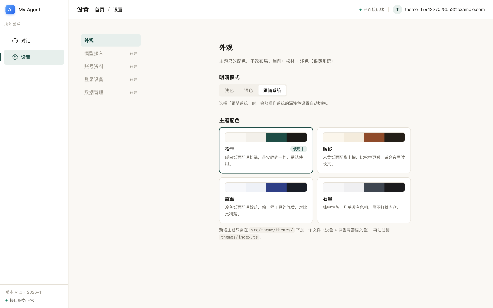
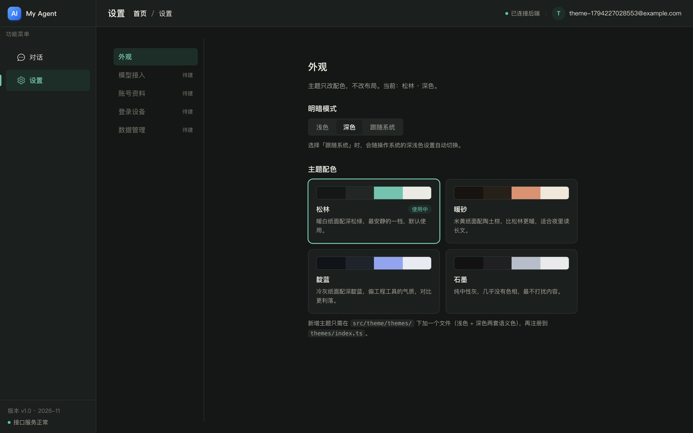
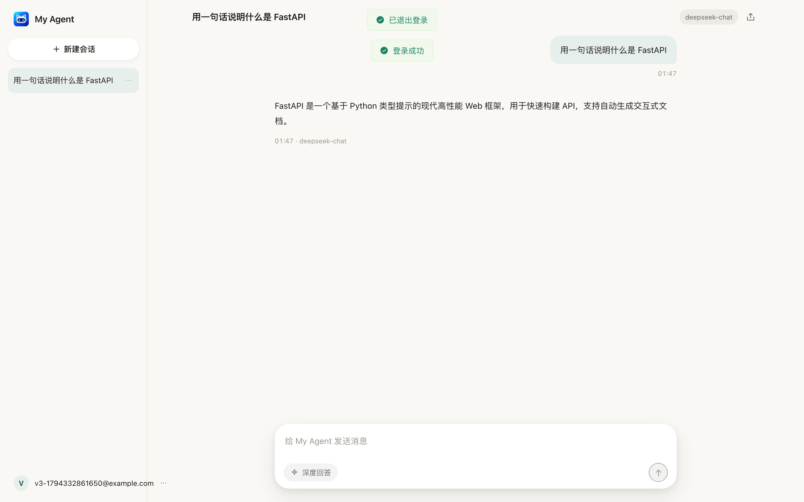
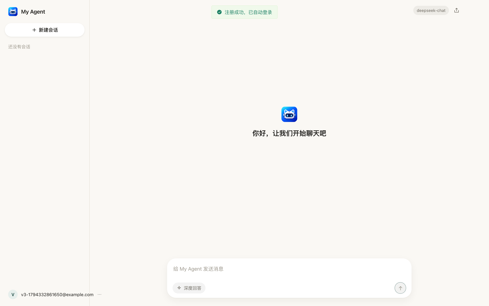
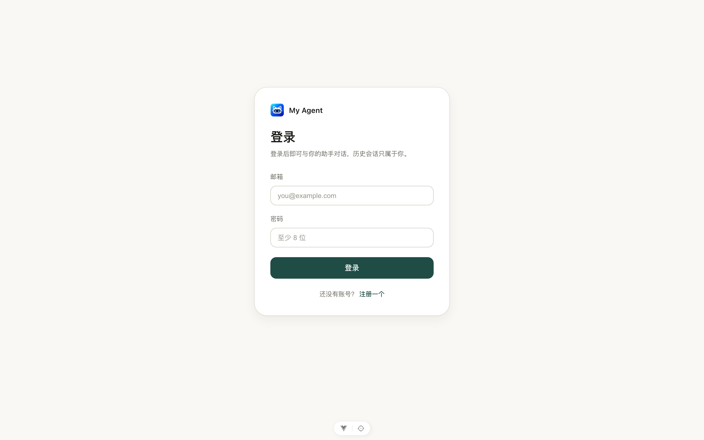
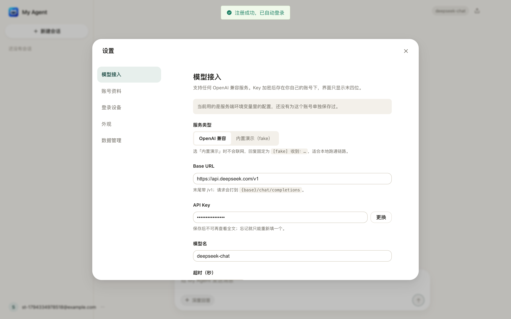
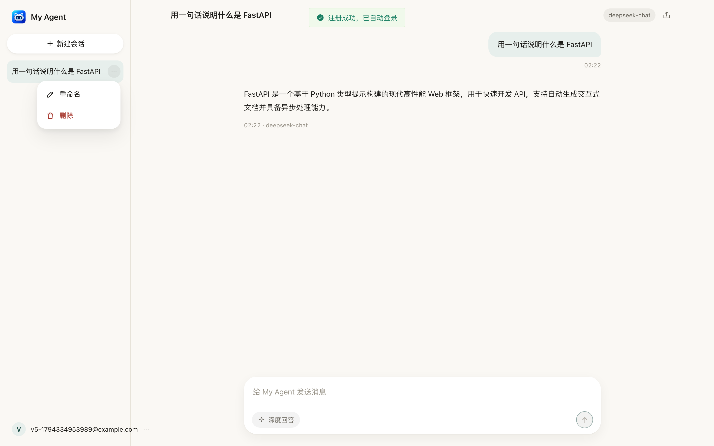
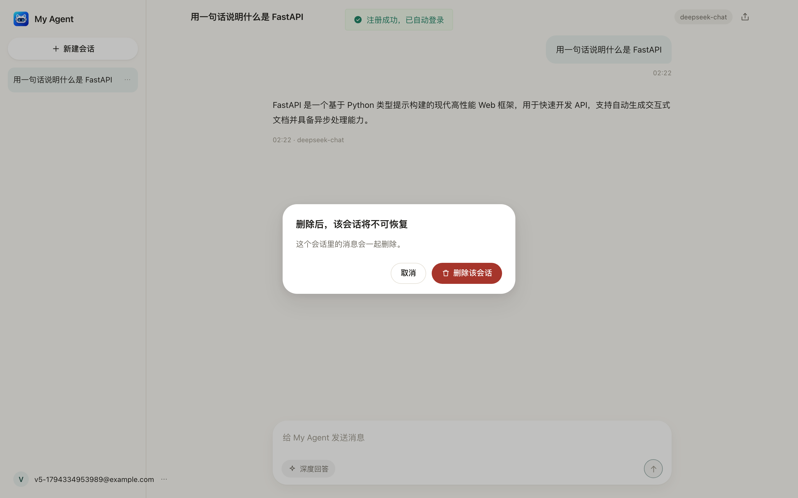

# 设计稿（My Agent）

> 设计系统 **以根目录 [`DESIGN.md`](../../DESIGN.md) 为唯一来源**（token、排版、布局、组件规则都在那里）。
> 本目录只放**可点开的高保真稿**：`mockups/*.html`（自包含，无外部依赖）+ `docs/images/design-*.png` 截图。

工具链与复现流程见 [`toolchain.md`](toolchain.md)（为什么用 impeccable 主导、taste-skill 只借细节）。

## 为什么不用旧的那套

旧设计（`archive/product-admin/docs/design/`）是商品管理后台的，页面已归档下线；当前应用只有对话、登录、注册、设置四类页面，按 2026-11-09 的裁决**从零重建，不参考旧实现**。

## 设计立场（一句话版）

暖白纸面 + 墨色文字 + 深松绿单一强调色；一屏一件事；危险操作必须说清后果；不做装饰性动效。

## 页面清单

| # | 页面 | 路由 | 稿 | 截图 |
|---|---|---|---|---|
| 01 | 登录 | `/login` | [01-login.html](mockups/01-login.html) | [design-01-login.png](../images/design-01-login.png) |
| 02 | 注册 | `/register` | [02-register.html](mockups/02-register.html) | [design-02-register.png](../images/design-02-register.png) |
| 03 | 对话 | `/chat` | [03-chat.html](mockups/03-chat.html) | [design-03-chat.png](../images/design-03-chat.png) |
| 04 | 设置 · 概览 | `/settings` | [04-settings.html](mockups/04-settings.html) | [design-04-settings.png](../images/design-04-settings.png) |
| 05 | 设置 · 模型接入 | `/settings/model` | [05-settings-model.html](mockups/05-settings-model.html) | [design-05-settings-model.png](../images/design-05-settings-model.png) |

设置其余分节（账号资料 / 登录设备 / 外观 / 数据管理）共用 04 与 05 的版式：左侧二级导航 + 右侧单列卡片，不重复出稿。

## 实现状态（T-FE-01，2026-11-09 完成）

设计稿已按 1:1 落进代码，逐条对照：

| 设计点 | 实现位置 |
|---|---|
| 配色改为 `--ma-*` 语义 token，主色深松绿 | `frontend/src/theme/` + `frontend/src/styles/index.css` |
| 侧栏 264px、`sunken` 底、选中项 `accent-soft` + 3px 左竖条 | `frontend/src/App.vue`、`components/chat/ThreadList.vue` |
| 对话阅读列 720px 居中、用户气泡实底右对齐、助手气泡白底描边、时间在气泡外 | `views/ChatView.vue`、`components/chat/ChatMessage.vue` |
| 输入区白底描边盒 + 独立发送按钮 + 左下计数 | `components/chat/ChatComposer.vue` |
| 设置页 200px 二级导航 + 560px 表单 | `views/SettingsView.vue` |
| 登录/注册 400px 卡片、衬线标题、距顶 12vh | `styles/index.css` 的 `.auth*`、`views/LoginView.vue`、`views/RegisterView.vue` |
| 品牌资产（logo / favicon / manifest） | `frontend/public/*`、`frontend/index.html`（源图在仓库根 `images/`） |

实体截图见下方「实现截图」，与 `design-*.png` 同尺寸（1440×900 @2x），可直接叠对比。

## 怎么预览

```bash
# 直接双击打开，或：
open docs/design/mockups/03-chat.html
```

截图重出（1440×900，2x）：

```bash
"/Applications/Google Chrome.app/Contents/MacOS/Google Chrome" \
  --headless=new --no-sandbox --disable-gpu --hide-scrollbars \
  --user-data-dir=/tmp/cp-shot --window-size=1440,900 --force-device-scale-factor=2 \
  --screenshot=docs/images/design-03-chat.png \
  "file://$PWD/docs/design/mockups/03-chat.html"
```

## 已定口径

- 设置页保留「外观」（明暗主题牵动整套 token 的暗色映射，已实现）。
- 「数据管理」的导出：**JSON 与 Markdown 都给**（T-FE-02 实现时落）。
- **不做**「关于」分节（2026-11-09 裁决）。

## 主题系统（2026-11-09 落地）

主题是**运行时可切**的：`:root` 上挂一层 `--ma-*` 语义变量，组件只引用这层；换主题 = 重写这批变量，不重渲染组件、不换 CSS 文件。

| 位置 | 作用 |
|---|---|
| `frontend/src/theme/types.ts` | `ThemeColors` 的 18 个语义色 + `ThemeDefinition`（一套主题必须同时给 light / dark） |
| `frontend/src/theme/themes/*.ts` | 每套主题一个文件：松林（默认）/ 暖砂 / 靛蓝 / 石墨 |
| `frontend/src/theme/themes/index.ts` | 注册表：数组顺序即设置页展示顺序，第一个是默认 |
| `frontend/src/theme/apply.ts` | `buildThemeVars()` 编译 CSS 变量；`buildElementPlusVars()` 用 `color-mix` 把 accent 派生成 Element Plus 的 6 档主色，**不需要为每个主题手写色阶** |
| `frontend/src/stores/theme.ts` | Pinia setup store：`themeId` + `mode(light/dark/system)` + `systemDark`，写 `localStorage['my-agent.theme']`，监听 `prefers-color-scheme`；`main.ts` 里 `app.use(createPinia())` 之后、挂载之前调 `initTheme()` 防闪白 |
| `frontend/src/styles/index.css` | 兼容层：旧的 `--pa-*` 全部指向 `--ma-*`，老页面不用改就跟着换肤 |

**新增一套主题（只改两处）**：

```ts
// 1) frontend/src/theme/themes/sakura.ts
export const sakuraTheme: ThemeDefinition = {
  id: 'sakura',
  name: '樱',
  description: '一句话描述这锅配色适合什么时候用。',
  light: { canvas: '#…', surface: '#…', /* 18 个键都不能少 */ },
  dark: { /* 同上 */ },
}

// 2) frontend/src/theme/themes/index.ts
export const themes = [pineTheme, sandTheme, indigoTheme, graphiteTheme, sakuraTheme]
```

漏任何一个色键，`src/theme/apply.test.ts` 的「每个主题都给全」用例会直接红灯，不会等到界面上出现透明洞。

### 截图

| 浅色 · 松林 | 深色 · 松林 |
|---|---|
|  |  |

## 实现截图（1440×900 @2x，2026-11-09）

| # | 页面 | 截图 |
|---|---|---|
| 01 | 登录 | [ui-01-login.png](../images/ui-01-login.png) |
| 02 | 注册 | [ui-02-register.png](../images/ui-02-register.png) |
| 03 | 对话（真实模型回答） | [ui-03-chat.png](../images/ui-03-chat.png) |
| 04 | 设置 · 外观（浅色） | [ui-04-settings.png](../images/ui-04-settings.png) |
| 05 | 设置 · 外观（深色） | [ui-05-settings-dark.png](../images/ui-05-settings-dark.png) |

重出命令（需要后端 8000 与 dev 5173 在跑）：

```bash
cd frontend && node .shots-light.mjs /tmp/ui-shots   # 临时脚本，出浅色四张
```

> `theme-*.png` 是主题系统落地时的专项截图（含暖砂与深色对话页），保留作主题回归基线。

## 主题的存储与优先级（2026-11-10）

- 本机 `localStorage`（键 `my-agent.theme`）：**先读它再绘制**，保证首屏不闪。
- 账号设置（`user_settings.theme_id` / `theme_mode`，见 [`docs/api.md`](../api.md) §4.5）：**登录后拉一次**。
- 优先级：**账号 > 本机**。账号存过就以账号为准（换设备自动生效）；账号为空则把本机这套写上去。
- 切换主题：本地立即生效（不等网络），随后异步写回账号；写失败只影响跨设备同步，不影响当前设备。

## 2026-11-11 排版修订（对齐对话型产品）

参考主流对话产品（DeepSeek 网页端）的排版与组件观感，对现有页面做了一次**只改样式、不改功能**的调整。新的口径：

| 维度 | 旧 | 新 |
|---|---|---|
| 标题字体 | 衬线（Songti）用于登录标题与空态 | 全部无衬线，靠字重与字号分层（h1 24/600、h2 18/600、h3 15/600） |
| 圆角 | 6 / 10 / 14 | **8 / 12 / 18 / 26**（`radius-xl` 给输入盒与登录卡） |
| 阴影 | 只有 1px 边 | 新增 `--ma-shadow-soft`（浮起一档）与 `--ma-shadow-float`（弹层） |
| 助手消息 | 白底 + 描边气泡 | **不套气泡**，正文直接落在纸面，长文更好读 |
| 用户消息 | 深色实底 + 白字 | 浅强调色底 + 正文色，右下角小圆角形成「指向」 |
| 输入盒 | 10px 圆角、无阴影 | **26px 圆角 + 常驻淡阴影**，聚焦时加 3px 强调色外环 |
| 新建会话 | 侧栏右上小按钮 | **整宽胶囊按钮**，放在列表顶部 |
| 空态 | 纯文字 | logo + 标题 + 说明 + 主按钮（首屏有视觉锚点） |

约束不变：颜色仍由主题 token 提供（不引入新色值）、`DESIGN.md` 的语义不变、所有 E2E 选择器（`.chat__*`、`.auth__*`、`.theme-card`、`.layout__user-trigger`）保持不变。

## 2026-11-11 第二轮：组件化与「减少边界」

第一轮只调了观感，第二轮解决的是**结构**问题：

| 诉求 | 做法 |
|---|---|
| 设置不该是一个页面 | 改成**悬浮窗**（`components/settings/SettingsDialog.vue`），盖在对话之上，关掉回到原处；`/settings` 仍可深链（重定向到 `/chat?settings=1`） |
| 顶栏冗余 | 删除 `layout__topbar`，模型标签与分享移到对话区右上角的工具栏（`ChatToolbar.vue`） |
| 小模块之间的边界太多 | 侧栏 footer、设置导航去掉 1px 分隔线；按钮与输入盒用**阴影**表达「浮起」，不再画边框 |
| 会话项操作太重 | 右侧改为 26px 圆形「…」（`IconButton.vue`），hover 才出现；菜单只留「重命名 / 删除」，选中态只靠背景色 |
| 一个文件写完整个页面 | 抽出组件库：`ui/AppIcon.vue`（内联 SVG）、`ui/IconButton.vue`、`ui/SoftButton.vue`、`ui/MyDropdownMenu.vue`、`ui/MyMessageBox.vue`、`chat/ThreadItem.vue`、`chat/ChatToolbar.vue`、`chat/ChatEmpty.vue` |

菜单与确认框不再用 Element Plus 的 `el-dropdown-menu` / `el-message-box`：

- `MyDropdownMenu.vue`：面板 fixed 定位（不受 `overflow` 裁切）、点外部/Esc 关闭、`items` 描述项，`variant: 'danger'` 渲染红色；hover 用一层很淡的渐变而不是整块灰。
- `MyMessageBox.vue` + `ui/messageBox.ts`：命令式 API `confirmDialog()` / `promptDialog()`，宿主在 `App.vue` 挂一次；标题 + 一行说明 + 右侧「取消 / 危险操作」两个胶囊按钮。
- 选中态：`chat__item--active:hover` 保持选中色，不再随 hover 变化。
- 菜单、列表、设置分节**都不带分割线**（2026-11-11 起）：分组靠间距（24/32px）、底色与阴影，规则见 [`DESIGN.md`](../../DESIGN.md) 的「边界规则：不要轻易加分割线」。

界面上的文字只保留必要信息：删掉了「助手」标签、消息条数、字数计数、空态的长说明。

实现截图：

- 对话页：
- 空态：
- 登录页：
- 设置悬浮窗：
- 会话项菜单：
- 删除确认（自绘）：
