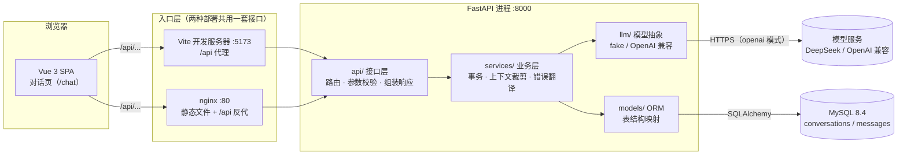
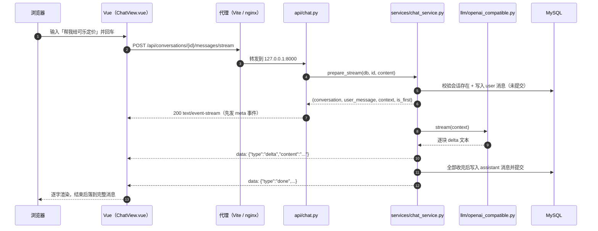
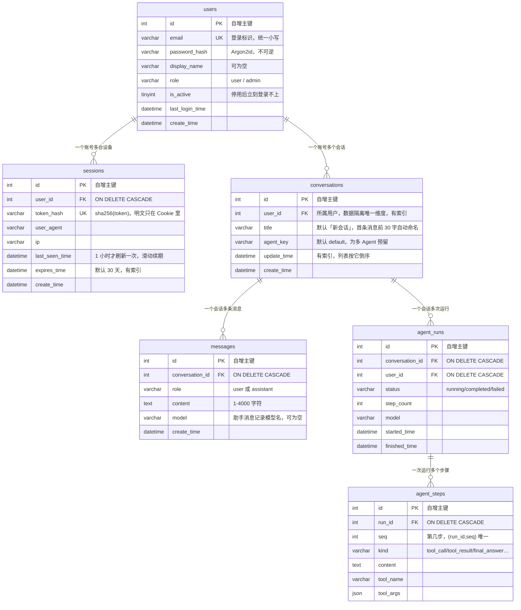

# 这个项目是怎么跑起来的

> 一页纸讲清三件事：**请求怎么走**、**代码为什么这样分层**、**数据存在哪**。
> 看完这一页，再看 `docs/toolchain.md`（工具怎么用），就够跟上进度了。

## 0. 一句话

**My Agent**：一个带对话界面的 AI 应用。前端 Vue 3 聊天页，后端 FastAPI 提供会话与消息接口，模型调用被抽成 `LLMClient`（默认 `fake` 假实现，配 `LLM_PROVIDER=openai` 即接真实模型），数据落 MySQL——刷新、换浏览器、重启都在。

> 商品 / 分类 / 概览页与它们的后端接口已于 2026-11-08 归档（`archive/product-admin/`），本页只描述当前在跑的部分。

## 1. 全景：谁在跟谁说话



（图片版：[`images/diagram-architecture.png`](images/diagram-architecture.png)，由本节 mermaid 导出；改图请改上面的代码块，图片只是快照）

**看图记住三件事**：

1. 前端永远只调 `/api/...`，它不知道后端在哪——开发时 Vite 代理转发，部署时 nginx 转发。所以同一份前端代码两种环境都能跑。
2. 后端是**单向分层**：`api → services →（models | llm）`。反过来不行（service 不 import api，model 不 import service）。
3. **模型是外挂的**：`services` 只依赖 `LLMClient` 协议，不关心是假的、DeepSeek 还是别的；换模型不改业务代码，只改 `.env`。

## 2. 一次请求怎么走

以「在对话页发一句话」为例（走流式接口，边生成边显示）：



（图片版：[`images/diagram-request.png`](images/diagram-request.png)，由本节 mermaid 导出；改图请改上面的代码块，图片只是快照）

出错了会怎样？

- **开流之前**（会话不存在、内容为空）还是普通 JSON + 400/404，由 `app/main.py` 注册的 5 个异常处理器统一翻译成 `{"code":404,"message":"会话不存在","data":null}`。
- **开流之后**（模型超时、鉴权失败、余额不足）状态码已固定 200，只能发一个 `error` 事件；同时事务回滚，库里不会留下「有提问没回复」的半条对话。
- **客户端中途断开**（关页面、切会话）后端同样回滚。

**前端永远只需要认 `code/message/data` 三个字段**（流式时认事件里的 `type`）。

## 3. 为什么这样分层（每层只干一件事）

| 层 | 目录 | 只负责 | 不负责 | 为什么要有它 |
|---|---|---|---|---|
| 接口层 | `app/api/` | 路由、请求参数、调用 service、包 `Response` / SSE 帧 | 业务规则、SQL、模型细节 | 让 URL 与业务解耦，换路由不影响规则 |
| 数据契约 | `app/schemas/` | 入参出参的字段与校验（Pydantic） | 数据库 | 前端看到的字段与数据库字段不必一样（如时间统一格式化成字符串） |
| 业务层 | `app/services/` | 规则（标题去空白、上下文只带最近 20 条、失败回滚）、事务提交 | HTTP 状态码细节、具体模型厂商 | 同一个规则被多个接口复用时只写一次 |
| 模型抽象 | `app/llm/` | `LLMClient` 协议、fake 与 OpenAI 兼容两种实现、上游错误翻译 | 存库、业务规则 | 换模型 / 加工具调用时不碰业务层 |
| 模型层 | `app/models/` | 表结构（SQLAlchemy） | 业务判断 | 数据库结构的唯一描述，Alembic 据此生成迁移 |
| 鉴权层 | `app/auth/` | 密码哈希（Argon2id）、会话 token 的签发/校验/撤销、`get_current_user` 依赖 | 业务规则、SQL 之外的事 | 「谁能看什么」集中一处：所有接口默认拒绝，显式依赖才放行 |
| 公共层 | `app/common/` | 统一响应 `Response`、`BusinessError` 与 5 个处理器 | 具体业务 | 「所有接口长得一样」这件事只实现一次 |

一句话记忆：**api 管门面，schemas 管形状，services 管规矩，auth 管放行，llm 管模型，models 管表，common 管统一。**

另有三个装配文件不在上表里：`app/main.py`（创建应用、挂路由、注册 5 个异常处理器与 CORS）、`app/database.py`（Engine、公共 `Base`、`SessionLocal`）、`app/dependencies.py`（`get_db` 为每个请求提供一个 Session）。它们不含业务逻辑，改动风险低但影响面大。

### 3.1 登录态是怎么一路传到 SQL 的

```
浏览器 Cookie: my_agent_session=...
  → app/auth/dependencies.py: get_current_user  校验 token 哈希、过期时间、账号是否停用
  → app/api/chat.py: user: CurrentUser          每个路由都要求它（没有就 401）
  → app/services/chat_service.py                user.id 出现在每条 SQL 的 where 里
```

三条硬规则（改代码时别破坏）：

1. **默认拒绝**：除 `/api/auth/register`、`/api/auth/login` 与 3 个探针，所有路由都声明 `user: CurrentUser`，漏写就等于公开接口。
2. **隔离在 service 层强制**：查询一条会话必须是 `where(id == x, user_id == user.id)`，查不到就 404（**不返回 403**，避免暴露「这个 id 存在」）。
3. **归属只在 `conversations.user_id`**：`messages` 不冗余 `user_id`，避免两处不一致。

## 4. 数据长什么样



（图片版：[`images/diagram-data-model.png`](images/diagram-data-model.png)，由本节 mermaid 导出；改图请改上面的代码块，图片只是快照）

三条真实约束，验收时会碰到：

1. **删会话即删消息**：数据库外键 `ON DELETE CASCADE`，前端不需要逐条删。
2. **上下文只带最近 20 条**：`CONTEXT_LIMIT=20`，system 消息全带；这是成本与连贯性的折中，不是越多越好。
3. **删账号即删数据**：`sessions` 与 `conversations` 都对 `users.id` 建了 `ON DELETE CASCADE`，消息随会话级联删除；这是 v1 的取舍——没有回收站，删了就没了。

## 4.5 深度回答（agent 循环）是怎么转起来的

普通对话是「一次请求、一次回答」；勾上「深度回答」后，后端会在同一个请求里跑一个循环：

```
用户提问
  └─ 建 run（agent_runs）+ 落 user_message 步
       └─ 循环（最多 8 步，每步先落库再推事件）
            模型 chat_with_tools →
              有 tool_calls？ ── 是 ─→ 记 tool_call 步 → 执行工具（2s 超时）
                                    → 记 tool_result 步 → 把结果回灌 → 下一轮
                              └─ 否 ─→ 这段文本就是最终答复 → 记 final_answer 步
                                    → 写进 messages → run 标 completed
```

三条设计取舍：

1. **不用 ReAct 提示词模板**：Action 让模型输出自由文本、再正则解析，参数类型和错误语义都得自己兜；原生工具调用（`tools` + `tool_calls`）把「叫什么、传什么」变成结构化 JSON，pydantic 直接校验，错误可以用 `ok:false` 回灌给模型。
2. **过程与对话分表**：`agent_steps` 记全部往返，`messages` 只留最终答复；聊天记录保持干净，时间线可以随时回放。
3. **失败也要落库**：工具失败、超过 8 步、模型 502、客户端断开，都会把 run 标成 `failed` 并写 `error_message`——不会出现「界面一直转圈但库里什么都没有」。

代码入口：`backend/app/agent/executor.py`（循环）、`backend/app/agent/tools/`（工具）、`backend/app/api/agent.py`（流式接口）。

## 5. 代码地图（要改什么去哪）

| 我想做的事 | 改这里 | 顺手要改 |
|---|---|---|
| 加一个接口 | `app/api/chat.py` | `app/schemas/`、`docs/api.md`（契约） |
| 改业务规则 | `app/services/chat_service.py` | `tests/test_chat_service.py` |
| 加登录 / 改鉴权 | `app/auth/`、`app/api/auth.py` | `tests/test_auth_service.py`、`tests/test_auth_api.py`、`docs/auth.md` |
| 换模型 / 加模型参数 | `app/llm/`、`app/config.py` | `tests/test_llm.py`、`backend/README.md`「接入真实模型」 |
| 加字段 | `app/models/` → `make revision m="..."` | `app/schemas/`、`docs/api.md` |
| 改页面 | `frontend/src/views/ChatView.vue` | `frontend/src/api/chat.ts`、`utils/markdown.ts` |
| 改登录页 / 守卫 | `frontend/src/views/{Login,Register}View.vue`、`router/index.ts` | `src/stores/session.ts`、`src/api/client.ts` |
| 改样式 | `frontend/src/styles/index.css` + 组件内 `<style scoped>` | — |
| 改部署 | `docker-compose.yml`、两个 `Dockerfile`、`nginx.conf` | `docs/deploy.md` |

## 6. 读代码的顺序（约 40 分钟）

1. `backend/app/main.py`（约 80 行）——应用怎么装起来的
2. `app/api/chat.py` → `app/services/chat_service.py` → `app/models/conversation.py`——顺着一条链路看穿分层
3. `app/llm/base.py` → `app/llm/fake.py` → `app/llm/openai_compatible.py`——模型是怎么被抽象掉的
4. `app/common/response.py` 与 `app/common/exceptions.py`——统一响应与错误是怎么做到的
5. `app/auth/dependencies.py` → `app/api/chat.py`——登录态怎么变成 `user.id` 并进到 SQL
6. `frontend/src/api/chat.ts` → `views/ChatView.vue`——前端怎么调接口、怎么渲染流式与 Markdown
7. 回到本页第 2 节，把时序图与真实代码对一遍
