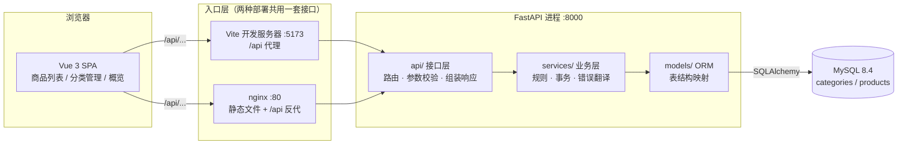
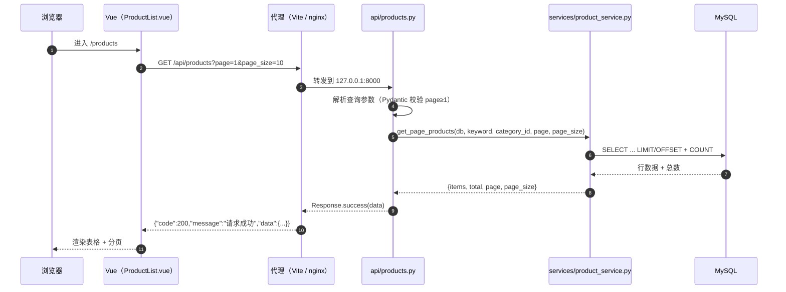
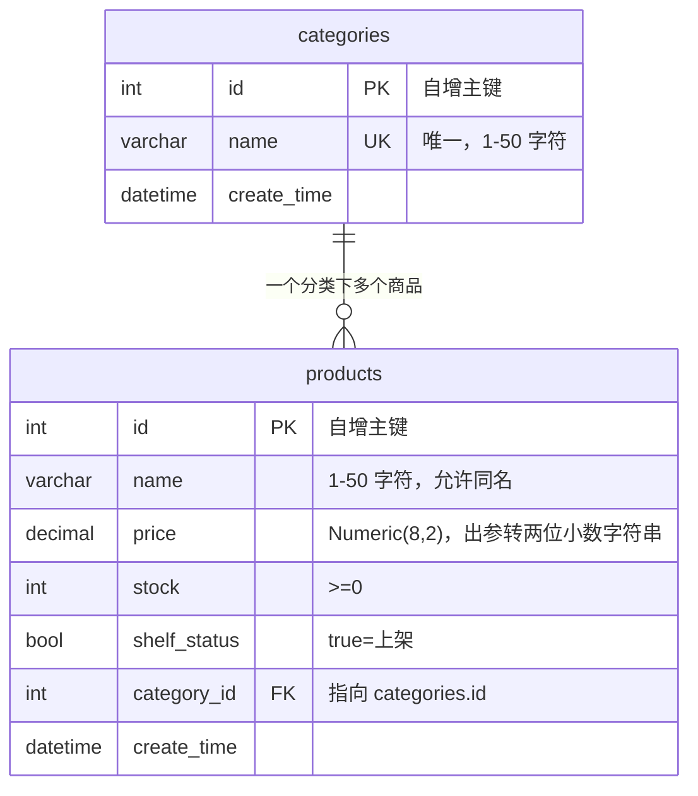

# 这个项目是怎么跑起来的

> 一页纸讲清三件事：**请求怎么走**、**代码为什么这样分层**、**数据存在哪**。
> 看完这一页，再看 `docs/toolchain.md`（工具怎么用），就够跟上进度了。

## 0. 一句话

一个**商品管理后台**：Vue 3 网页 + FastAPI 接口 + MySQL 数据库。网页上能增删改查商品和分类，接口是一套 REST，数据库里两张表。这套东西现在既能本地 `pnpm dev` + `make run` 跑，也能 `docker compose up` 一键起。

## 1. 全景：谁在跟谁说话

（图片版：[`images/diagram-architecture.png`](images/diagram-architecture.png)，由本节 mermaid 导出；改图请改上面的代码块，图片只是快照）

**看图记住两件事**：

1. 前端永远只调 `/api/...`，它不知道后端在哪——开发时 Vite 代理转发，部署时 nginx 转发。所以同一份前端代码两种环境都能跑。
2. 后端是**单向四层**：`api → services → models → 数据库`。反过来不行（service 不 import api，model 不 import service）。

## 2. 一次请求怎么走

以「打开商品列表，加载第 1 页」为例：

（图片版：[`images/diagram-request.png`](images/diagram-request.png)，由本节 mermaid 导出；改图请改上面的代码块，图片只是快照）

出错了会怎样？`services` 层抛 `BusinessError("商品分类不存在", code=400)`，由 `app/main.py` 注册的 5 个异常处理器统一翻译成 `{"code":400,"message":"商品分类不存在","data":null}`；参数不合法则由 FastAPI 自己抛 422，也被同一个处理器改写。**前端永远只需要认 `code/message/data` 三个字段。**

## 3. 为什么这样分层（每层只干一件事）

| 层 | 目录 | 只负责 | 不负责 | 为什么要有它 |
|---|---|---|---|---|
| 接口层 | `app/api/` | 路由、请求参数、调用 service、包 `Response` | 业务规则、SQL | 让 URL 与业务解耦，换路由不影响规则 |
| 数据契约 | `app/schemas/` | 入参出参的字段与校验（Pydantic） | 数据库 | 前端看到的字段与数据库字段不必一样（如 `price` 出参是字符串） |
| 业务层 | `app/services/` | 规则（去空白、分类必须存在、分类下有商品不能删）、事务提交/回滚 | HTTP 状态码细节 | 同一个规则被多个接口复用时只写一次 |
| 模型层 | `app/models/` | 表结构（SQLAlchemy） | 业务判断 | 数据库结构的唯一描述，Alembic 据此生成迁移 |
| 公共层 | `app/common/` | 统一响应 `Response`、`BusinessError` 与 5 个处理器 | 具体业务 | 「所有接口长得一样」这件事只实现一次 |

一句话记忆：**api 管门面，schemas 管形状，services 管规矩，models 管表，common 管统一。**

另有三个装配文件不在上表里：`app/main.py`（创建应用、挂路由、注册 5 个异常处理器）、`app/database.py`（Engine、公共 `Base`、`SessionLocal`）、`app/dependencies.py`（`get_db` 为每个请求提供一个 Session）。它们不含业务逻辑，改动风险低但影响面大。

## 4. 数据长什么样

（图片版：[`images/diagram-data-model.png`](images/diagram-data-model.png)，由本节 mermaid 导出；改图请改上面的代码块，图片只是快照）

两条真实约束，验收时会碰到：

1. **分类名唯一**：重名插入触发 MySQL 1062，后端翻译成 `409 分类名称已存在`。
2. **分类下有商品不能删**：service 先查商品数，有则 `409 分类下有其他商品，不能删除分类`。

## 5. 代码地图（要改什么去哪）

| 我想做的事 | 改这里 | 顺手要改 |
|---|---|---|
| 加一个接口 | `app/api/products.py` | `app/schemas/`、`docs/api.md`（契约） |
| 改业务规则 | `app/services/` | `tests/test_*_service.py` |
| 加字段 | `app/models/` → `make revision m="..."` | `app/schemas/`、`docs/api.md` |
| 改页面 | `frontend/src/views/` | 复用 `components/` 与 `styles/index.css` 的 token |
| 改样式 | `frontend/src/styles/index.css` | `docs/design/design.md`（规范） |
| 改部署 | `docker-compose.yml`、两个 `Dockerfile`、`nginx.conf` | `docs/deploy.md` |

## 6. 读代码的顺序（约 40 分钟）

1. `backend/app/main.py`（40 行）——应用怎么装起来的
2. `app/api/products.py` → `app/services/product_service.py` → `app/models/product.py`——顺着一条链路看穿四层
3. `app/common/response.py` 与 `app/common/exceptions.py`——统一响应与错误是怎么做到的
4. `frontend/src/api/client.ts` → `views/ProductList.vue`——前端怎么调接口、怎么渲染
5. 回到本页第 2 节，把时序图与真实代码对一遍

看完还看不懂的地方，就是文档该补的地方——直接开 issue 或告诉 AI 助手。

## 7. 新增一个资源要动哪些文件

以「新增订单 orders」为例，按顺序做完即可端到端可用（每步都可单独验证）。**顺序不能颠倒**：模型先于迁移，迁移先于服务。

| 步 | 改什么 | 具体动作 | 怎么验证 |
|---|---|---|---|
| 1 | `app/models/order.py` | 继承 `Base`，写字段与 `__table_args__`；在 `app/models/__init__.py` 的 `__all__` 里导出 | `python -c "from app.models import Order"` |
| 2 | 迁移 | `make revision m="add orders"` → **人工检查**生成的 `migrations/versions/*.py` → `make migrate`（Alembic 对表/列改名会误判为「删+建」，必须看） | `make check-migration` 无漂移；`alembic current` 是 head |
| 3 | `app/schemas/order.py` | `Create/Update/Response` 三个模型，`Response` 要 `ConfigDict(from_attributes=True)` 与需要的 `field_serializer` | `pytest tests/test_schemas.py` 风格补用例 |
| 4 | `app/services/order_service.py` | 业务规则、`db.commit()` + `db.refresh()`、失败 `db.rollback()`、抛 `BusinessError` | `tests/test_order_service.py` 用内存 SQLite 夹具 `db_session` |
| 5 | `app/api/orders.py` | `APIRouter(prefix="/orders")` + 处理函数；在 `app/api/__init__.py` 里 `include_router` | Swagger `/docs` 能看到新路径 |
| 6 | 测试 | 服务层用例 + 参数校验用例（422/400 各一条） | `make check`（ruff + 覆盖率门槛 80%） |
| 7 | 文档 | `docs/api.md` 补契约、`docs/product/prd.md` 补 F/AC、`docs/how-it-works.md` §5 代码地图若新增目录要改 | 检查 `docs/README.md` §4 单一来源有没有被绕过 |
| 8 | 前端（可选） | `src/api/orders.ts` → `src/views/OrderList.vue` → `src/router/index.ts` 加路由 | `pnpm lint && pnpm test && pnpm build` |

两个常见坑：

- 只改模型不生成迁移 → 本机能跑、容器里 `alembic upgrade head` 后表不存在。
- 只加接口不写 `include_router` → 404，但 `/docs` 里也看不到，容易误判为「路径写错」。
