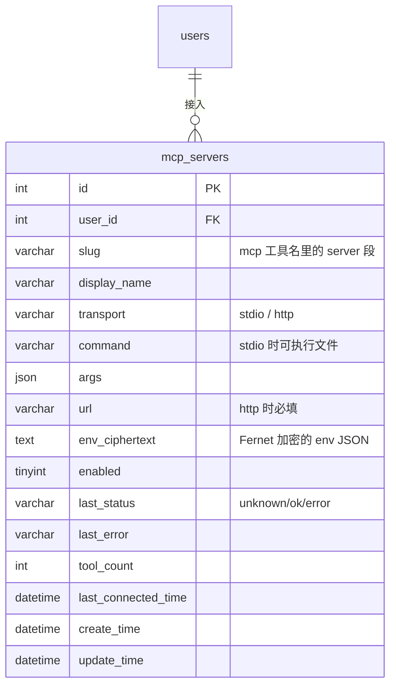

# 阶段 7 设计：MCP 接入与「工具市场」

> **状态**：已交付（2026-11-11，T1–T7 全部完成）。
> **上游**：[`tools.md`](tools.md)（阶段 6 工具生态与权限治理）、[ADR-0011](adr/0011-tool-permissions-and-approvals.md)、[`agent-architecture.md`](agent-architecture.md) §6.5、[`playbooks/05`](playbooks/05-development-plan-and-mvp-tasks.md) 阶段 7。

## 1. 要解决的问题

阶段 6 把「加工具」变成了实现一个 `Tool` 类 + 放进一个 `ToolSource`。代价是**工具只能由我们写**：想用社区现成的 filesystem / git / fetch，就得把别人的能力重抄一遍。

MCP（Model Context Protocol）解决的正是这件事：工具由独立的 server 进程或远端服务提供，客户端只做三件事——握手、列工具、调工具。

| 缺口 | 现状 | 后果 |
|---|---|---|
| 工具只能内置 | `BuiltinSource` 里四个手写工具 | 每加一个能力都要改后端代码并发版 |
| 用户装不了东西 | 没有服务器的概念 | 「工具生态」是空的，用户无法自助扩展 |
| 没有来源标识 | `ToolMeta.source` 只有 `"builtin"` | 权限与可观测性无法区分「我们的工具」和「别人的工具」 |

阶段 7 的目标：**用户能在一个页面上挑服务、授权、随时关掉，模型用到的是 `mcp__{server}__{tool}` 这样的外部工具，且一律走审批**。

## 2. 依赖决策：用官方 SDK（已定）

`mcp==2.3.0` 覆盖 stdio / streamable-http / sse 与全部协议细节，代价是 13 个新包（含 `httpx2`）。

| 方案 | 新增依赖 | 结论 |
|---|---|---|
| A. 官方 `mcp==2.3.0` | 13 个（`mcp` `mcp-types` `httpx2` `httpcore2` `jsonschema` `jsonschema-specifications` `referencing` `rpds-py` `opentelemetry-api` `pyjwt` `sse-starlette` `truststore` `attrs`） | ✅ **采用**（2026-11-11 确认）：协议细节交给上游 |
| B. 手写最小客户端 | 0 | ❌ 放弃：省下的时间不如用在权限与页面上 |

把 SDK 关进笼子的四条约束（详见 [ADR-0012](adr/0012-mcp-client-uses-official-sdk.md)）：

1. 只有 `backend/app/mcp/` 能 import `mcp`，`agent/` 仍只认 `ToolSource`；
2. 只暴露 `connect` / `list_tools` / `call_tool` 三条方法；
3. SDK 是 async，执行器是 sync → `runner.py` 用「独立线程 + 事件循环」做同步桥；
4. `mcp==2.3.0` 精确锁定，升级前先跑协议一致性用例。

> **双 HTTP 栈警告**：SDK 2.x 用 `httpx2`，LLM 客户端用 `httpx` 0.28。两套连接池、两套代理与超时语义并存，排查网络问题时先确认是哪一套。

## 3. 设计

### 3.1 分层

```
app/mcp/
├── client.py      McpClient：connect() → list_tools() → call_tool()
├── runner.py      同步桥：独立线程 + 事件循环，submit(coro) -> result
├── errors.py      McpError（连接 / 超时 / 工具错误）
├── catalog.py     内置市场清单（纯数据，来自仓库，不联网）
├── source.py      McpSource(ToolSource)：把远端工具包成 Tool
└── manager.py     按用户装配、连接缓存、状态落库
```

依赖方向：`agent/` 只认 `ToolSource` 协议，不认识 MCP。`manager.py` 是唯一把 `mcp_servers` 表变成 `McpSource` 的地方。

### 3.2 传输

| 传输 | 形态 | 用途 | 本期 |
|---|---|---|---|
| `stdio` | 起子进程，stdin/stdout 按行 JSON-RPC | 本地服务（filesystem、git、sqlite） | ✅ |
| `http` | `POST {url}`，响应可能是 `application/json` 或 `text/event-stream` | 远端服务（fetch、github） | ✅ |
| `sse`（旧版） | GET 建流 + POST 发消息 | 旧服务兼容 | ❌ 明确不做 |

握手固定顺序：

```
→ initialize {protocolVersion, capabilities:{}, clientInfo:{name:"my-agent", version}}
← {protocolVersion, capabilities, serverInfo}
→ notifications/initialized
→ tools/list {cursor?}      （分页直到 nextCursor 为空）
→ tools/call {name, arguments}
```

`protocolVersion` 用 `2025-06-18`；服务端返回不同版本时按服务端给的走，只记录不阻塞。

**SDK 2.x 用法备忘**（这两条踩过）：

```python
from mcp import ClientSession, StdioServerParameters
from mcp.client.stdio import stdio_client                 # async CM → (read, write)
from mcp.client.streamable_http import streamable_http_client  # 注意不是 streamablehttp_client

async with stdio_client(StdioServerParameters(command="uvx", args=[...])) as (read, write):
    async with ClientSession(read, write) as session:      # 构造参数含 client_info
        info = await session.initialize()
        page = await session.list_tools()                  # page.next_cursor 分页
        result = await session.call_tool("echo", {"text": "hi"})  # result.content / is_error
```

`FastMCP` 在 2.x 改名 `MCPServer`（`from mcp.server.mcpserver import MCPServer`）。

### 3.3 工具暴露

- 名称：`mcp__{server_slug}__{tool_name}`，slug 只允许 `[a-z0-9-]`，长度 ≤32；重名由注册表报错。
- 等级：`annotations.readOnlyHint == true` → `ToolLevel.READ`；其余一律 `ToolLevel.EXTERNAL`（**一律审批**）。
  规范明确「annotations 是提示不是安全边界」，所以只用来**降级到只读**，绝不用来跳过审批。
- 超时：`ToolMeta.timeout_seconds = 10`（远端比内置慢）。顺带修 T-26：`executor._execute()` 改成读 `meta_of(tool).timeout_seconds`，而不是写死 2s。
- 参数：原样透传 `inputSchema` 给模型；执行前仍走 `ToolPolicy`（未知工具 / 禁用 / 日预算 / 参数规则 / 审批）。

### 3.4 连接管理

- **按需连接**：`McpSource.list()` 被调用时才连（第一次发起 run 或打开市场页点「测试」）。
- **进程内缓存**：`manager.py` 持有 `dict[(user_id, server_id), McpConnection]`，空闲 5 分钟回收；`call_tool` 复用同一连接。
- **失败隔离**：单个 server 连不上 → 该 server 的工具不出现，`mcp_servers.last_status = "error"` + `last_error` 落库；其它来源不受影响。
- **超时**：连接 5s、列工具 10s、调用 10s（与 `ToolMeta` 一致）。
- **进程回收**：stdio 子进程在 `close()` 时 `terminate()` → 2s 后 `kill()`；进程退出时 `atexit` 兜底。

### 3.5 「工具市场」页面

设置悬浮窗新增一节 **工具市场**（`SettingsView` 的 `sections` 增加 `{ key: 'market', label: '工具市场', component: MarketPanel }`），内容：

```
工具市场                        内置 6 个 · 已接入 2 个
┌──────────────────────────────────────────────────────┐
│ [全部] [已接入] [本地] [远程]                  + 自定义 │  ← 筛选 chip
├──────────────────────────────────────────────────────┤
│ ┌───────────────┐ ┌───────────────┐ ┌───────────────┐ │
│ │ 📁 filesystem │ │ 🌐 fetch      │ │ 🔀 git        │ │  ← 卡片网格
│ │ 读写本地文件   │ │ 抓网页正文     │ │ 查提交与差异   │ │
│ │ 本地 · 12 工具 │ │ 远程 · 4 工具  │ │ 本地 · 8 工具  │ │
│ │      [开关]   │ │      [开关]   │ │      [开关]   │ │
│ └───────────────┘ └───────────────┘ └───────────────┘ │
└──────────────────────────────────────────────────────┘
```

卡片交互：开关 = 启用/停用；点卡片展开「工具清单 + 状态 + 移除/重新连接」。危险操作（移除服务器）走 `MyMessageBox.confirmDialog`。

### 3.6 对 DESIGN.md §5 的覆盖检验

这是本阶段的副目标：看现有组件够不够。结论——**4 个规格要新增，其余可复用**：

| 场景需要 | §5 现状 | 处理 |
|---|---|---|
| 卡片网格（等高、间距、断点换行） | 只有单卡规格 | 新增 §5.3.1「卡片网格」：`repeat(auto-fill, minmax(228px, 1fr))`、`gap: 16px`、等高 `align-items: stretch` |
| 开关 | 未收录（ToolsPanel 用 `el-switch` 但没写进规范） | 新增 §5.2.1「开关」：24×40、开 accent / 关 line-strong、过渡 0.15s |
| 筛选 chip 组 | 未收录（设置里只有 `el-radio-group` 分段） | 新增 §5.7.1「筛选 chip」：圆角 999、选中 accent-soft、hover 用 `.u-tint--soft` |
| 服务图标（48px 圆角方块） | 未收录（只有 16/20 的行内图标） | 新增 §5.8.1「服务图标」：48×48、radius 12、accent-soft 底 + 图标 accent |
| 状态胶囊（未连接/已连接/失败） | §5.7 有 | 复用，补 `--error` 变体 |
| 空态（没有匹配的服务） | §5.7 有 | 复用，文案换成「没有匹配的服务」 |
| 移除确认 | `MyMessageBox` 有 | 复用 |
| 工具数/传输标签 | 无 | 用正文 12px + `line` 色，不新增组件 |

## 4. 数据模型



- `UniqueConstraint(user_id, slug)`；级联删除跟随用户。
- 市场目录**不入库**：`app/mcp/catalog.py` 里是一份常量清单（slug / 名称 / 一句话 / 传输 / 启动参数模板 / 图标 key），随代码发布。
- `env` 复用阶段 4 的 Fernet（`APP_SECRET_KEY`），库里只存密文，接口只回「已配置的键名」。

## 5. 接口契约

| 方法 | 路径 | 说明 |
|---|---|---|
| GET | `/api/mcp/catalog` | 内置市场清单 + 每个 slug 是否已接入 |
| GET | `/api/mcp/servers` | 已接入服务器（含状态、工具数、工具清单摘要） |
| POST | `/api/mcp/servers` | 接入一个内置条目或自定义条目 |
| PATCH | `/api/mcp/servers/{id}` | 启停、改 url/args/env |
| DELETE | `/api/mcp/servers/{id}` | 移除（连带关连接） |
| POST | `/api/mcp/servers/{id}/test` | 立即连接并列工具，返回 `{ok, tools[], error?}` |

工具本身不新接口：`GET /api/settings/tools` 里 `source` 会出现 `"mcp"`，`enabled` 表示「接入且启用且连接成功」。

## 6. 安全与护栏

1. **一律审批**：`mcp__*` 工具不进 READ 白名单，除 `readOnlyHint` 外全部 `EXTERNAL` → 每次调用都要用户点。
2. **命令白名单**：`stdio` 的 `command` 只允许 `npx`、`uvx`、`node`、`python`、`python3` 之一，其余直接拒绝（防用户被诱导填 `rm -rf`）。
3. **不出站**：`http` transport 只允许 `https://`，且不允许指向内网段（`127.`、`10.`、`192.168.`、`169.254.`、`::1`）。
4. **env 加密**：`env` 里常放 token，库里只存密文；接口永不回显明文。
5. **超时与并发**：连接/调用各有超时；同一连接上的并发调用加锁（JSON-RPC 有 id，但 stdio 写入需要串行）。
6. **审计**：每次 MCP 调用落 `agent_steps`（`tool_name` 已带 server 前缀），审批落 `agent_approvals`，与内置工具同一条链路。

## 7. 任务拆分

| # | 任务 | 交付 | 验收 |
|---|---|---|---|
| T1 ✅ | 客户端与同步桥 | `app/mcp/{client,runner,errors,specs}.py` + 测试用 stdio server 夹具 `tests/fixtures/mcp_echo_server.py` | 单测 9 例：真握手、`tools/list` 名与 schema、`tools/call` 文本、`isError` 不当异常、坏命令映射成 `McpError`、runner 超时 |
| T2 ✅ | 目录与数据模型 | `catalog.py`（7 个内置条目，含 1 个远程）、`models/mcp_server.py`、迁移 `4f9edca19113` | 迁移在临时库 up→check→down→up 全绿；`UniqueConstraint(user_id, slug)` 生效；级联删除生效 |
| T3 ✅ | 装配与连接管理 | `source.py`（`McpTool`/`McpSource`）、`manager.py`（连接池 + `probe`）、`registry_for()`、修掉 T-26（超时读 `meta.timeout_seconds`） | 单测 11 例：前缀 `mcp__<slug>__<tool>`、`EXTERNAL` 级别、schema 透传、`isError`→`ToolError`、连接复用与空闲回收、禁用服务器不出现、连不上只记 `last_status=error` 不打断对话 |
| T4 ✅ | 接口 | 6 个接口（`api/mcp.py` + `schemas/mcp.py` + `services/mcp_service.py`） | 契约测试 12 例：清单带已接入状态、接入市场条目、缺 path/重复 slug/命令不在白名单 400、启停与改配置断连接、越权与未登录、试连成功/失败落库、env 只存密文 |
| T5 ✅ | 前端市场页 | `frontend/src/components/settings/MarketPanel.vue`、`frontend/src/api/mcp.ts`、`SettingsView` 新增「工具市场」节、`ui/icon-paths.ts`（图标表独立成文件，后端给的图标名要做类型收窄） | 卡片网格（`minmax(260px, 1fr)` / gap 16）、四种筛选、开关即时生效并失败回滚、点工具数展开清单（连接池冷的时候先试连一次）、移除走确认框；规格已回写 `DESIGN.md` §5.7；截图 `docs/images/ui-15-tool-market.png`、`ui-16-tool-market-installed.png` |
| T6 ✅ | 审批联调 | `backend/tests/test_mcp_agent.py`（真 stdio server 走完 `registry_for → stream_run → approval_required → decide_approval → resume_run`） | 3 例：MCP 工具在注册表里是 `EXTERNAL` + `requires_approval`；调用挂起且 run 变 `waiting_approval`；批准后事件为 `tool_result` 且内容等于服务器回显、run 收尾 `completed`、服务器 `last_status=ok`；拒绝时回灌「用户拒绝…+理由」且工具未执行 |
| T7 ✅ | 文档与 DESIGN 回写 | `docs/api.md` §6.5、`DESIGN.md` §5.7 + §5.2、`frontend/scripts/mcp-acceptance.mjs`、`backend/scripts/seed_mcp_approval.py` | `pnpm acceptance:mcp` 11/11（市场浏览→筛选→自定义接入→自动试连→展开工具→工具节可见→启停→移除→审批卡→批准执行→刷新无残留→控制台无报错）；截图 `docs/images/ui-15-tool-market.png`、`ui-16-tool-market-installed.png` |

## 8. 验收标准

1. 设置页能浏览内置市场、接入一个服务器、看到工具数、关掉后模型看不到该工具。
2. 模型调用 `mcp__*` 工具必定挂起审批；拒绝后时间线记 `ok=false` 且带理由。
3. 服务器连不上时：市场页显示错误原因，run 不因此失败，其它工具照常。
4. `DELETE` 后连接被回收，`ps` 里没有残留子进程（账号注销也会回收：`McpManager.forget_user()`）。
5. `mcp` 只出现在 `backend/app/mcp/` 与 `pyproject.toml`；`agent/` 无 `import mcp`。
6. 新页面只用 `var(--ma-*)` token；DESIGN.md §5 的 4 条新规格落地并可被下一个页面直接复用。

### 8.1 怎么复现（2026-11-11 实测）

```bash
# 后端 + 前端都在跑（scripts/dev.sh）
cd frontend && pnpm acceptance:mcp     # 11 项，约 60 秒
```

`acceptance:mcp` 用真浏览器、真后端、真 stdio 服务器跑两段：

1. **市场页**：浏览 7 条内置清单 → 用「远程」筛一次 → 自定义接入一台 echo（`uv run --no-sync python tests/fixtures/mcp_echo_server.py`）→ 等自动试连变「正常」→ 展开工具清单 → 切到「工具」节确认 `mcp__echo__echo` 标着「需确认」→ `PATCH` 关掉后工具从清单消失 → 移除并刷新确认回到未接入。
2. **审批链**：`backend/scripts/seed_mcp_approval.py` 直接造一条 `waiting_approval` 的 run（不赌模型这次肯不肯调工具，脚本会写 `Conversation` + `Message` + `AgentRun` + 两步 `AgentStep` + 一条 pending 审批）→ 前端点进该会话看到审批卡 → 点「批准执行」→ 后端 `resume_run` 重放并通过 MCP 真的调一次 echo → 时间线出现回显文本、卡片消失 → 刷新无残留。

实测结果：11/11 通过；`ps` 里没有残留的 MCP 子进程（账号注销会走 `McpManager.forget_user()` 关掉该账号名下所有连接）。

## 9. 明确不做

- MCP 的 `resources` / `prompts` / `sampling` / `roots` / `elicitation`。
- OAuth 授权流程（远端服务先只支持「无鉴权」或「手填 token」）。
- 从远端仓库动态拉取市场目录（先内置清单，避免供应链问题）。
- 旧版 HTTP+SSE 传输。
- 多用户共享一个 server 进程。

## 10. 风险

| 风险 | 处置 |
|---|---|
| SDK 2.x API 还在变（`FastMCP`→`MCPServer`、`httpx`→`httpx2`） | 精确锁 `mcp==2.3.0`；升级前先跑 `tests/test_mcp_client.py`；只允许 `app/mcp/` import `mcp` |
| stdio 子进程泄漏 | `close()`/`atexit`/空闲回收三道；E2E 里 `ps` 断言 |
| 远端工具 description 里注入 prompt | 工具描述原样进模型上下文 → 已在阶段 6 记 T-2x 类风险；本阶段在市场页展示「来自第三方」提示 |
| 市场清单过期（命令/包名变了） | 清单随代码走，条目带 `updated` 字段；「测试连接」让人一眼看出坏了 |
| 连接慢拖垮首字延迟 | 按需连接 + 缓存；市场页提供「预连接」开关（默认关） |
