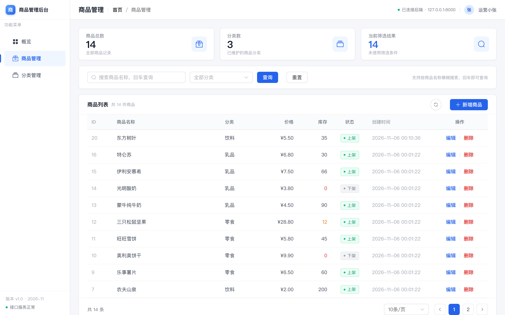
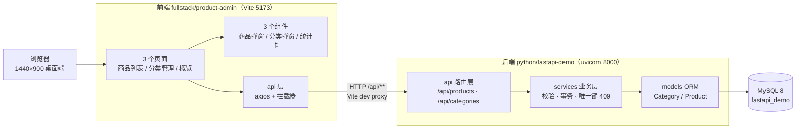
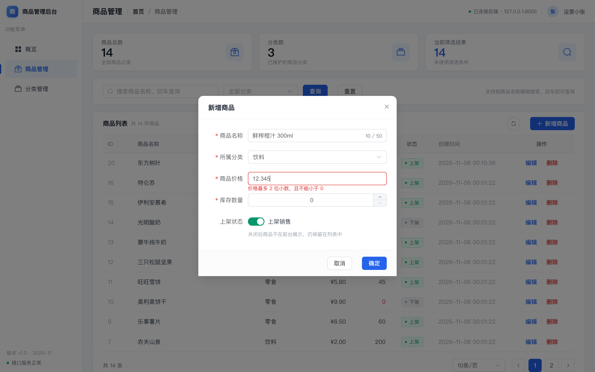
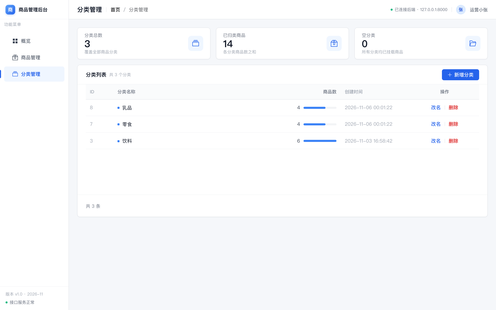
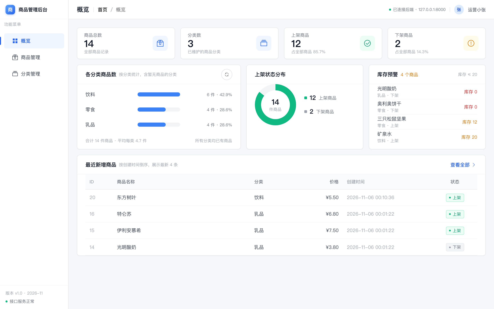
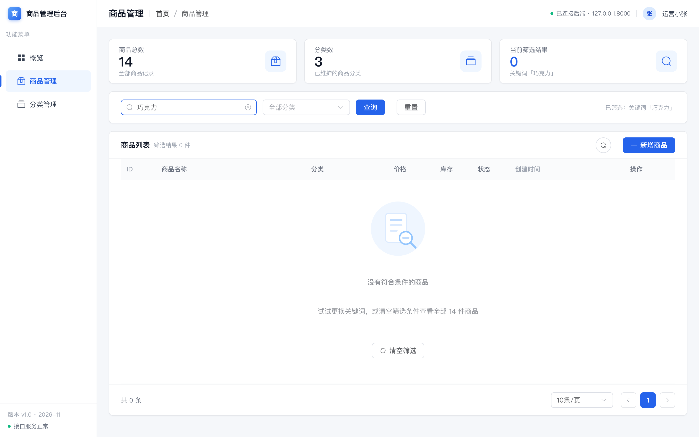

# 商品管理后台 · 交付与验收说明

一个前后端分离的简易商品管理网站：Vue 3 单页管理后台 + 复用 `python/fastapi-demo` 的 FastAPI 接口 + MySQL。
本文档是 **交付说明 + 验收报告**（用例级明细见 [acceptance.md](./acceptance.md)），回答三件事：怎么跑起来、做了什么、验收证据在哪。

| 项 | 内容 |
| --- | --- |
| 版本 | v1.0（2026-11-06） |
| 负责人 | Tech Lead（本仓库会话） |
| 前端 | `fullstack/product-admin/`（Vue 3.5 + TS 5.7 + Vite 6 + Element Plus 2.9 + axios + vue-router 4） |
| 后端 | `python/fastapi-demo/`（FastAPI 0.124 + SQLAlchemy 2.0 + MySQL 8） |
| 验收结论 | P0 全部 16 条（F-01…F-16）通过；自动化 UI 用例 **18/18 通过**；后端 `make check` 全绿（ruff + 23 个单测） |



---

## 1. 他山之石：这次是怎么分工的

用「技术团队」的方式，把一件完整的交付拆成 4 个可并行、各自有产出物的任务，再由 Lead 汇总联调：

| 角色 | 任务 | 产出 |
| --- | --- | --- |
| 产品经理 | 提需求、定义边界与验收标准 | [PRD](../product/product-admin-prd.md)：21 条需求（16 P0 + 5 P1）、15 条验收标准 AC、7 条待确认问题 |
| UI 设计师 | 出设计稿与可落地的设计规范 | [设计规范](../design/product-admin-design.md) + [5 张设计稿](../design/README.md)：Design Token、布局预算、组件规格 |
| Python 后端 | 在既有 demo 上补齐履约能力 | [API 契约](../../python/fastapi-demo/docs/api.md)：11 个业务接口 + CORS + 演示数据种子 |
| Vue 前端 | 实现页面、交互与错误透传 | `fullstack/product-admin/`：3 个页面 + 3 个弹窗组件 + 3 个 API 模块 |
| Tech Lead | 技术决策、拆任务、联调、验收 | 本文档 + 验收脚本 `pnpm acceptance` |

> 关键协作点：设计规范里的「92px 统计卡行高预算」是前端最容易做错的硬约束，被写进设计文档并由 Lead 转达为代码要求，
> 最终以 DOM 实测（92 / 44 / 48px）闭环，而不是靠肉眼"差不多"。

---

## 2. 系统结构



三个容易被忽略的工程细节：

1. **开发期用 Vite proxy，而不是写死后端地址**：`vite.config.ts` 把 `/api` 转发到 `127.0.0.1:8000`，前端代码里 baseURL 永远是 `/api`，换环境只改代理。
2. **CORS 仍然要配**：proxy 之外，后端还加了 `CORSMiddleware`（允许 5173 / 4173 的 localhost 与 127.0.0.1），因为 `pnpm preview`、直接用浏览器调试接口、以及将来独立部署都需要它。
3. **响应结构统一**：所有接口返回 `{code, message, data}`；`code != 200` 时 axios 拦截器统一 `ElMessage.error(message)` 并 reject，页面层不必各写一套错误处理。

---

## 3. 快速开始

### 3.1 前置

| 依赖 | 版本 | 说明 |
| --- | --- | --- |
| MySQL | 8.x | 默认连 `127.0.0.1:3306`，库名 `fastapi_demo` |
| Python | 3.11+ | 后端运行环境（本项目验证用 3.12 / 3.15） |
| Node.js | 18+ | 前端构建（本项目验证用 v24） |
| pnpm | 9+ | 前端包管理（仓库带 `pnpm-lock.yaml`，不要用 npm 混装） |

### 3.2 起后端（8000）

```bash
cd python/fastapi-demo
python3 -m venv .venv && source .venv/bin/activate    # 首次
uv sync                                               # 首次按 uv.lock 装依赖
cp .env.example .env                                   # 首次，改 DATABASE_URL
mysql -uroot -p -e "CREATE DATABASE IF NOT EXISTS fastapi_demo DEFAULT CHARSET utf8mb4;"
python -m app.init_db      # 建表
python -m app.seed         # 灌演示数据：3 个分类 + 12 个商品（幂等，可反复执行）
uvicorn app.main:app --reload --port 8000
```

验证：`curl http://127.0.0.1:8000/api/products?page=1&page_size=2` 返回 `{"code":200,...}`，
接口文档见 <http://127.0.0.1:8000/docs>。

### 3.3 起前端（5173）

```bash
cd fullstack/product-admin
pnpm install
pnpm dev          # http://127.0.0.1:5173
```

首屏会请求 `/api/products`、`/api/categories`，右上角状态点显示「已连接后端 · 127.0.0.1:8000」。

> 如果页面能打开但列表报「网络异常，请确认后端已启动」，先确认 8000 是否在跑：
> `curl -s http://127.0.0.1:8000/api/products/count`。

---

## 4. 功能验收：PRD → 实现

| 编号 | 功能 | 状态 | 落点 |
| --- | --- | --- | --- |
| F-01 | 布局与导航（概览 / 商品管理 / 分类管理） | ✅ | `src/App.vue` + `src/router/index.ts`，`/` 重定向 `/products` |
| F-02 | 商品列表分页，默认第 1 页、每页 10 条，ID 倒序 | ✅ | `src/views/ProductList.vue` |
| F-03 | 8 列定义，价格右对齐两位小数，状态用标签 | ✅ | 同上，`price` 序列化 `¥x.xx` |
| F-04 | 关键词模糊搜索，回车或「查询」触发 | ✅ | `@keyup.enter` + 查询按钮 |
| F-05 | 分类筛选，可与关键词组合 | ✅ | `category_id` 参数，change 即查 |
| F-06 | 每页 10/20/50，显示总数，翻页保持筛选 | ✅ | `el-pagination`，筛选变化重置 `page=1` |
| F-07 | 新增商品弹窗，成功提示并回第 1 页 | ✅ | `ProductFormDialog.vue` |
| F-08 | 编辑弹窗回填，保存后刷新当前页 | ✅ | 同上，`mode=edit` 回填整表单 |
| F-09 | 删除二次确认，当前页删空回上一页 | ✅ | danger 按钮 + 空页回退逻辑 |
| F-10 | 分类列表：ID / 名称 / 商品数 / 创建时间 / 操作 | ✅ | `CategoryManage.vue`，商品数取自 `/api/categories/statistics` |
| F-11 | 新增分类，重名 409 原样提示 | ✅ | toast 显示「分类名称已存在」 |
| F-12 | 分类改名，重名 409 原样提示 | ✅ | 同上 |
| F-13 | 删除分类二次确认，有商品时后端拒绝 | ✅ | 409「分类下有其他商品，不能删除分类」 |
| F-14 | 概览统计：商品总数、分类数、各分类商品数 | ✅ | `Dashboard.vue`（另加上架/下架、库存预警） |
| F-15 | 加载 / 空 / 错误三态 | ✅ | 表格 `v-loading`、3 种空态、错误 message 透传 |
| F-16 | ≥1280px 桌面布局，侧栏固定 | ✅ | 侧栏 200px 固定，内容区自适应 |

P1（v1.1 候选，本期不做）：F-17 批量下架、F-18 导出 CSV、F-19 操作日志、F-20 库存预警筛选、F-21 上下架分布（后端无按状态聚合接口）。

<div align="center">
  
  
</div>

---

## 5. 自动化验收

### 5.1 怎么跑

```bash
# 需先起后端 8000 与前端 5173
cd fullstack/product-admin
pnpm acceptance
```

脚本用 `puppeteer-core` 驱动本机 Chrome，按真实用户操作点击、输入、等待网络空闲，共 18 项用例；
截图与 `result.json` 落在 `fullstack/product-admin/.acceptance/`（已在 `.gitignore` 忽略）。
换端口用 `BASE=http://127.0.0.1:4173 pnpm acceptance`，换浏览器用 `CHROME_PATH=...`。

### 5.2 最近一次结果：18/18 通过

| 用例 | 检查点 | 结果（真实回读值） |
| --- | --- | --- |
| UI-01 | 列表渲染、8 列表头齐全 | ✅ 10 行 |
| UI-02 | 分页条与总数 | ✅ 共 14 条，2 个页码 |
| UI-03 | 三张统计卡 | ✅ 商品总数 14 / 分类数 3 / 筛选结果 14 |
| UI-04 | 打开新增弹窗 | ✅ |
| UI-05 | 分类下拉选中 | ✅ 选中「饮料」 |
| UI-06 | 价格超 2 位小数被拦截 | ✅「价格最多 2 位小数，且不能小于 0」 |
| UI-07 | 新增提交、回显、分类正确 | ✅ ¥12.34 / 库存 7 / 饮料 |
| UI-08 | 关键词搜索命中 | ✅ 命中 1 条 |
| UI-09 | 编辑库存 7 → 9 | ✅ toast「商品修改成功」 |
| UI-10 | 删除二次确认文案 | ✅「确定要删除商品「…」吗？删除后不可恢复。」 |
| UI-11 | 取消删除不生效 | ✅ 行仍在 |
| UI-12 | 确认删除生效 | ✅ toast「删除成功」，行消失 |
| UI-13 | 搜索空态 | ✅「没有符合条件的商品」+「清空筛选」 |
| UI-14 | 新增分类 | ✅ toast「分类新增成功」 |
| UI-15 | 分类重名拦截 | ✅ toast「分类名称已存在」（后端 409） |
| UI-16 | 分类改名 | ✅ toast「分类名称已更新」 |
| UI-17 | 删除空分类 | ✅ toast「删除成功」 |
| UI-18 | 概览页三块内容 | ✅ 统计卡 + 分类分布 + 最近新增 |

脚本自带清理：用例创建的商品/分类在结束时删除，跑完库里仍是 3 分类 / 14 商品。

### 5.3 后端回归

```bash
cd python/fastapi-demo
make check     # ruff check + ruff format --check + pytest
```

结果：ruff 全过，pytest **23 passed**（含 422 参数校验、400 空名称、404 未命中、409 重名等）。

### 5.4 接口契约核对（curl，摘录）

| 场景 | 期望 | 实测 |
| --- | --- | --- |
| `GET /api/products?page=1&page_size=2` | 200 + items/total | ✅ `total: 14`，`price: "5.50"`（字符串两位小数） |
| `GET /api/products/999999` | 404 | ✅「商品不存在」 |
| `POST /api/categories`（重名） | 409 | ✅「分类名称已存在」 |
| `DELETE /api/categories/{有商品的分类}` | 409 | ✅「分类下有其他商品，不能删除分类」 |
| `POST /api/products`（price 三位小数） | 422 | ✅ 字段级错误信息 |
| `GET /api/categories/statistics` | 各分类商品数 | ✅ 与列表口径一致 |

---

## 6. 设计一致性核对

| 规范项 | 设计要求 | 实测 |
| --- | --- | --- |
| 统计卡高度 | 92px（label 13/18 + value 28/32 + hint 12/16 + padding 13） | ✅ 三/四张卡均 92px |
| 表头 / 行高 | 44px / 48px | ✅ 44 / 48（`tr` 显式设高，避免塌到 44） |
| 数字对齐 | 价格、库存右对齐 + `tabular-nums` | ✅ |
| 上架 / 下架 | 绿 `#059669` / 灰 `#6B7280` + 圆点 | ✅ |
| 红色语义 | 仅「删除」与「库存 0」 | ✅ |
| 橙色语义 | 仅库存预警 1–20 | ✅ |
| 金额 / 时间格式 | `¥x.xx` / `yyyy-MM-dd HH:mm:ss` | ✅ |
| 空值 | 显示「—」 | ✅ |

<div align="center">
  
  
</div>

---

## 7. 已知限制

| # | 限制 | 影响 | 后续 |
| --- | --- | --- | --- |
| L-01 | 无登录与权限 | 谁打开都能改数据 | v1.1 引入登录后叠加（F-19 依赖它） |
| L-02 | 概览的上下架/库存预警取前 100 条商品前端聚合 | 商品 > 100 条时数字偏小 | 后端加按状态聚合接口后替换（F-21） |
| L-03 | 分类接口不分页 | 分类极多时下拉很长（已开 `filterable`） | 分类 > 50 时加分页 |
| L-04 | PATCH 提交整表单而非仅改动字段 | 并发编辑可能互相覆盖非改动字段 | 改为 diff 提交或加乐观锁 |
| L-05 | 404 文案不统一（详情/删除「商品不存在」、PATCH「未找到商品」） | 前端直接透传，用户会看到两种说法 | 统一后端文案 |
| L-06 | 分类改名不 strip 空白 | 可存入「   」这类名称 | 后端 `name.strip()` + 校验 |
| L-07 | 建表用 `create_all` 而非迁移工具 | 改字段需手工处理 | 引入 Alembic |
| L-08 | 无前端单测 | 回归靠 `pnpm acceptance` 端到端覆盖 | 补 Vitest 组件测试 |

---

## 8. 目录索引

```text
my-learning/
├── docs/
│   ├── product/                 # PRD（需求与验收标准）
│   ├── design/                  # 设计规范 + 设计稿 HTML/PNG
│   └── product-admin/           # 本文件：交付与验收说明 + 真实截图
├── python/fastapi-demo/         # 后端：接口、服务、ORM、测试、API 契约文档
└── fullstack/product-admin/     # 前端：Vue 3 管理后台 + 验收脚本
```

相关文档：

- 需求与验收标准：[docs/product/product-admin-prd.md](../product/product-admin-prd.md)
- 设计规范与设计稿：[docs/design/product-admin-design.md](../design/product-admin-design.md)、[设计稿索引](../design/README.md)
- 后端 API 契约：[python/fastapi-demo/docs/api.md](../../python/fastapi-demo/docs/api.md)
- 验收记录（用例级明细）：[docs/product-admin/acceptance.md](./acceptance.md)
- 后端模块导图：[python/fastapi-demo/docs/module-map.md](../../python/fastapi-demo/docs/module-map.md)
- 前端说明：[fullstack/product-admin/README.md](../../fullstack/product-admin/README.md)

---

## 9. 变更记录

| 日期 | 版本 | 变更 |
| --- | --- | --- |
| 2026-11-06 | v1.0 | 首次交付：3 个页面 + 11 个后端接口 + CORS + seed；P0 全过，UI 用例 18/18 |
