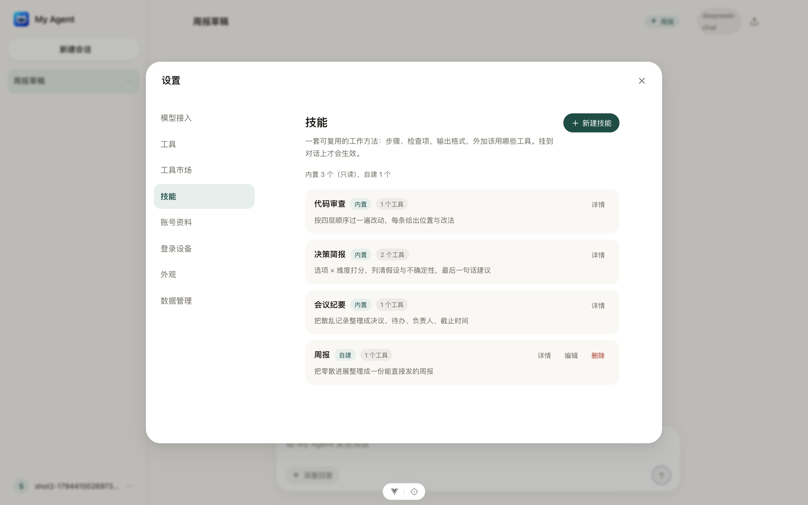

# 阶段 7（下半）：Skill —— 可复用的工作方法

> 状态：**已实现**（2026-11-11）。决策记录见 [`adr/0013-skills-as-method-packages.md`](adr/0013-skills-as-method-packages.md)。
> 前半（MCP 工具接入）见 [`mcp.md`](mcp.md)；工具与审批的底层机制见 [`tools.md`](tools.md)。

## 1. 要解决的问题

MCP 解决的是「**能碰到什么**」：把外部服务器的工具接进来，模型可以查文件、查库、抓网页。
但它没解决「**该怎么干**」——同一个文件系统工具，做代码审查和做资料整理，步骤、检查项、
输出格式完全不同。现在这些差别只能靠用户在对话里反复交代。

Skill 把「一类任务的干法」固化下来：一段写给模型看的**工作方法**（步骤、检查项、输出格式），
外加**这活该用哪些工具**的范围。用户挂上技能，就等于给这一轮对话换了一套作业指导书。

| | MCP | Skill |
|---|---|---|
| 解决 | 能碰到什么（能力边界） | 该怎么干（方法与标准） |
| 形态 | 远端/本地进程 + JSON-RPC | 一段文本 + 工具白名单 |
| 变更成本 | 装一个进程 | 改一段 Markdown |
| 出问题 | 连不上、超时 | 指令写歪、范围给太窄 |

## 2. 调研：别人怎么放「方法」

| 形态 | 代表 | 载体 | 怎么进上下文 | 与本设计的关系 |
|---|---|---|---|---|
| **Agent Skills** | Anthropic Agent Skills / Claude Code 的 `SKILL.md` | 一个目录：`SKILL.md`（frontmatter 元数据 + 正文）+ 可选脚本与资源 | 先只把 `name`/`description` 放进上下文，命中后再读正文（progressive disclosure） | **本设计直接照抄这个形状**：frontmatter + Markdown 正文；但先不做「按需加载第二步」，正文一次性注入（见 §3.2） |
| **GPTs** | OpenAI GPTs | 名称 + 指令 + 知识文件 + actions | 指令整体拼进 system prompt | 与本设计的「指令注入」一致 |
| 斜杠命令 | Claude Code / Cursor 的 `/command` | 一段模板文本 | 用户手动触发 | 对应本设计的「挂载」动作，都是**手动** |
| 提示词库 | 各类 prompt 市场 | 一段文本 | 复制粘贴 | 没有工具范围与落库，退化成便签 |

结论：**Skill = frontmatter 元数据 + Markdown 正文 + 工具白名单**，存储在库里、按会话挂载。
不引入「模型自己挑技能」的二级循环（见 §3.3）。

## 3. 设计

### 3.1 数据形状

```python
@dataclass(frozen=True)
class Skill:
    slug: str            # 稳定标识，^[a-z0-9][a-z0-9-]{0,31}$
    name: str            # 展示名，≤30 字
    description: str      # 一句话，展示在选择器里
    instructions: str     # Markdown 正文，注入 system prompt
    tools: tuple[str, ...] = ()   # 工具白名单；空 = 不限制
    icon: str = "sparkle"
    source: str = "builtin"       # builtin | custom
```

两个来源：

- **内置**：`backend/app/skills/<slug>/SKILL.md`，随代码走、只读、可被 `git` 审阅；
- **自定义**：`skills` 表（按 `user_id` 隔离），设置页里新建/编辑/删除。

两者在接口层合并成一个列表，用 `source` 区分；`slug` 在用户范围内唯一（内置的 slug 不能被自定义覆盖，
建的时候撞了就 400）。

### 3.2 注入方式

`build_system_prompt(skill)` 生成一条 `system` 消息，放在最前面：

```
你是 My Agent，一个能调用工具的个人助手。
<技能：代码审查>
<instructions 正文>

当前可用工具：calculator、read_file…（skill.tools 非空时只列这些）
调用写操作或外部工具前会先请用户确认；被拒绝时按用户给的理由调整，不要重试同一个调用。
```

三个取舍：

1. **一次性注入，不做按需加载**。技能正文通常几百字，一次性进上下文更简单、更可预测；
   等技能库大了（几十个、单个几千字）再做「先给目录、命中后加载」。
2. **正文不改写**。用户写什么就注入什么——不替用户润色，避免「文档说 A、实际执行 B」。
3. **system 消息每次 run 重建**，不落库：技能改了立刻生效，历史消息里也不会存旧版本。

### 3.3 触发：手动挂载，不做自动选择

`conversations.skill_slug` 记录当前挂载的技能（`NULL` = 不挂）。

- 手动：对话工具条上选一个技能，之后这个会话的每次 run 都带着它；
- 不做自动：自动选技能要么多一次模型调用（每次都花钱），要么把「选技能」做成一个工具
  （模型调 `use_skill` → 再进一层循环）。两条路都让「为什么这次走了这个流程」变得难解释。
  先手动，等真的有人嫌麻烦再加。

MCP 的 `mcp__*` 工具名同样可以被写进 `tools` 白名单——技能能同时约束内置工具和外部工具。

### 3.4 工具白名单的语义

- `tools = ()`：不限制，用注册表里的全部工具；
- `tools = ("read_file", "mcp__fs__read")`：**只**保留这些。其它工具既不展示给模型，也执行不了
  （`ToolRegistry` 的 `disabled` 通道，和设置页关工具是同一条路）。

风险与取舍：白名单写窄了，模型会因为没有工具而答不上来。所以
① 选择器里显示每个技能绑定的工具数；② 技能详情能看到具体名字；③ 白名单留空是默认值。

### 3.5 与审批的关系

Skill **不改变** `ToolLevel`：写操作/外部工具照旧挂起等确认。技能只是「方法与范围」，
不是「提权」。这一点写进 ADR，避免以后有人拿技能当权限旁路。

## 4. 内置技能（首批 3 个）

| slug | 名称 | 干什么 | 工具白名单 |
|---|---|---|---|
| `code-review` | 代码审查 | 按「正确性 → 边界 → 可读性 → 性能」四层过一遍，每条给文件:行 + 改法 | `calculator`、`mcp__git__*`（装了才生效） |
| `meeting-notes` | 会议纪要 | 从散乱记录里抽出决议、待办、负责人、截止时间，输出固定表格 | `now` |
| `decision-brief` | 决策简报 | 选项 × 维度打分，列清假设与不确定性，最后给一句建议 | `calculator`、`search_conversations` |

三个都是「方法差异明显、工具需求很小」的活，正好体现 Skill 与 MCP 的分工。

## 5. 数据模型

```sql
CREATE TABLE skills (
  id            INT AUTO_INCREMENT PRIMARY KEY,
  user_id       INT NOT NULL,              -- FK users(id) ON DELETE CASCADE
  slug          VARCHAR(32) NOT NULL,
  name          VARCHAR(30) NOT NULL,
  description   VARCHAR(120) NOT NULL,
  instructions  TEXT NOT NULL,
  tools         JSON NOT NULL DEFAULT ('[]'),
  icon          VARCHAR(32) NOT NULL DEFAULT 'sparkle',
  create_time   DATETIME,
  update_time   DATETIME,
  UNIQUE KEY uq_skills_user_slug (user_id, slug)
);
```

`conversations` 加一列：

```sql
ALTER TABLE conversations ADD COLUMN skill_slug VARCHAR(32) NULL;
```

迁移 revision：`a1b2c3d4e5f6`（down_revision `4f9edca19113`）。

## 6. 接口

| 方法 | 路径 | 说明 |
|---|---|---|
| GET | `/api/skills` | 内置 + 自定义合并列表；带 `source`、`tool_count`、`mounted` |
| POST | `/api/skills` | 新建自定义技能（`slug/name/description/instructions/tools/icon`） |
| PATCH | `/api/skills/{skill_id}` | 改自定义技能；内置的 404（不可改） |
| DELETE | `/api/skills/{skill_id}` | 删自定义技能 |
| PUT | `/api/conversations/{id}/skill` | 挂载/卸载：`{"slug": "code-review"}` 或 `{"slug": null}` |

错误口径沿用现有约定：越权/不存在一律 404；`slug` 重复 400；内置技能只读 404。

## 7. 任务拆分

| # | 任务 | 交付 | 验收 |
|---|---|---|---|
| T1 ✅ | 技能模型与加载器 | `app/skills/{__init__,models,loader}.py`、`app/skills/code-review/SKILL.md` 等 3 个内置技能 | 单测：frontmatter 解析、非法 slug 报错、内置 3 个都能加载 |
| T2 ✅ | 数据模型与迁移 | `models/skill.py`、`conversations.skill_slug`、迁移 `a1b2c3d4e5f6` | 迁移在临时库 up→check→down→up 全绿 |
| T3 ✅ | 执行器接入 | `build_system_prompt()`、`registry.only(names)`、`_with_skill()` 在 `stream_run`/`resume_run` 注入 system 消息 | 单测：挂了技能后有 system 消息且内容含正文；白名单外的工具既不在 `specs()` 里也执行不了 |
| T4 ✅ | 接口 | `api/skills.py`、`schemas/skill.py`、`services/skill_service.py`、`PUT /api/conversations/{id}/skill` | 契约测试：列表合并、内置只读、slug 重复 400、挂载/卸载、越权 404 |
| T5 ✅ | 前端 | `ChatToolbar.vue` 技能胶囊、设置页 `SkillsPanel.vue`（列表/新建/编辑/删除） | 只用 `var(--ma-*)`；规格回写 `DESIGN.md` §5.8 |
| T6 ✅ | 验收 | `frontend/scripts/skills-acceptance.mjs`、`pnpm acceptance:skills` | 7 项全绿（见下节） |

## 7.1 验收结果（2026-11-11）

`pnpm acceptance:skills` 7/7：

| 项 | 断言 |
|---|---|
| S-01 | 设置「技能」节列出 3 个内置技能，都带「内置」标签 |
| S-02 | 内置技能没有「编辑」「删除」入口，只有「详情」 |
| S-03 | 新建自定义技能（标识/名称/说明/正文 + 工具 chip）后出现在列表 |
| S-04 | 编辑自定义技能改名，列表随之更新 |
| S-05 | 对话工具条挂载技能 → 胶囊显示技能名 → 刷新仍在，且 `GET /api/skills?conversation_id=` 的 `mounted` 对得上 |
| S-06 | 删除技能后，挂它的会话回落到「不挂技能」 |
| S-07 | 控制台无报错 |

后端 `make check` 296 passed / 93.14%（含 `tests/test_skills.py` 22 例）。




## 8. 明确不做

- 技能自带脚本/资源文件（Skill 里的 `scripts/`），先只有文本；
- 自动选技能、技能组合（多个技能叠加）；
- 技能市场（内置 3 个 + 自建，够用再说）；
- 「按需加载正文」的两段式上下文（等技能库变大）。

## 9. 风险

| 风险 | 处置 |
|---|---|
| 用户把 API key 之类的秘密写进技能正文 | 正文会进模型上下文、也会存库；设置页给一行提示「不要写敏感信息」；导出/删除随账号 |
| 白名单写窄导致模型无工具可用 | 选择器与详情都显示工具数与名字；空 = 不限制是默认值 |
| 技能正文过长拖慢首字 | 单条正文限 4000 字（与消息上限一致），超出 400 |
| 内置技能被自定义覆盖 | `slug` 在用户范围内唯一，内置 slug 保留，撞名 400 |
