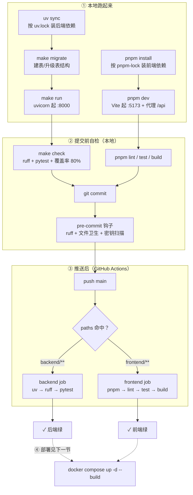
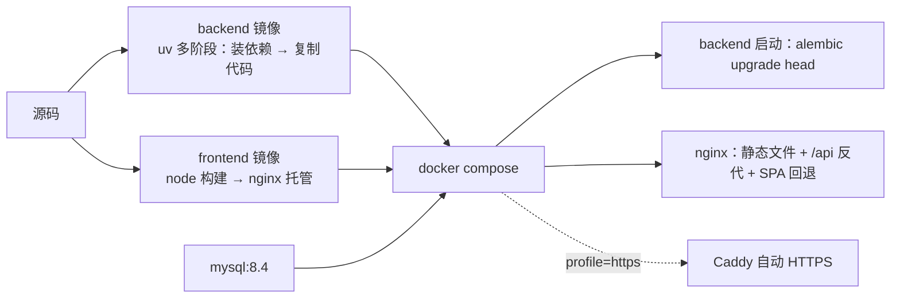

# 工具链：每个工具解决什么问题

> 你不需要记住所有命令，只需要记住**三条链路**：本地跑起来、提交前自检、推送后 CI。
> 全部命令都在项目根执行，或按标注切换目录。
>
> 日常开发可以直接 `./scripts/dev.sh`：一条命令起后端（`uvicorn --reload`）+ 前端（Vite HMR），两个都带热更新，Ctrl-C 一起停。容器只在交付验证时构建，见根 `README.md`「什么时候用哪个」。

## 0. 一张图看全



（图片版：[`images/diagram-toolchain.png`](images/diagram-toolchain.png)，由本节 mermaid 导出；改图请改上面的代码块，图片只是快照）

## 1. 后端工具链

| 工具 | 解决什么问题 | 命令 | 配置在哪 |
|---|---|---|---|
| **uv** | 依赖装得慢、版本漂移。它同时管「解析依赖 + 建虚拟环境 + 锁版本」 | `uv sync`（装依赖）、`uv add pkg`（加依赖）、`uv lock`（重新解析） | `pyproject.toml` → `uv.lock` |
| **FastAPI / uvicorn** | 提供 HTTP 接口与自动文档 | `make run`（= `uvicorn app.main:app --reload`） | `app/main.py` |
| **SQLAlchemy** | 用 Python 类描述表、写查询 | 无独立命令，由代码调用 | `app/database.py`、`app/models/` |
| **Alembic** | 表结构变更要能复现、能回滚（不能靠 `create_all`） | `make revision m="说明"`、`make migrate`、`make check-migration` | `alembic.ini`、`migrations/` |
| **ruff** | 代码风格与明显错误，一个工具代替 flake8+isort+black | `make lint`（只检查）、`make fmt`（自动改） | `pyproject.toml` 的 `[tool.ruff]` |
| **pytest + pytest-cov** | 改完不知道有没有改坏；覆盖率防止测试形同虚设 | `make test`（含 80% 门槛） | `pyproject.toml` 的 `[tool.pytest]` / `[tool.coverage]` |

**为什么不用 requirements.txt**：uv 的 `uv.lock` 锁了完整依赖树（67 个包），`uv sync --frozen` 在任何机器上装出完全一致的环境，CI 也用它。

## 2. 前端工具链

| 工具 | 解决什么问题 | 命令 | 配置在哪 |
|---|---|---|---|
| **pnpm** | 装依赖快、磁盘占用小、workspace 友好 | `pnpm install`、`pnpm dev`、`pnpm build` | `package.json`、`pnpm-lock.yaml` |
| **Vite** | 开发时秒级热更新；生产打包 | `pnpm dev`（:5173）、`pnpm build`（出 `dist/`） | `vite.config.ts`（含 `/api` 代理） |
| **vue-tsc** | 类型检查。`vite build` 不做类型检查，所以 build 脚本里先跑它 | `pnpm type-check`（已包含在 `pnpm build`） | `tsconfig.json` |
| **ESLint** | 抓未使用变量、Vue 模板错误。按 ADR-0002 只开轻量档 | `pnpm lint`、`pnpm lint:fix` | `eslint.config.js` |
| **Prettier** | 格式统一，避免 diff 里全是空白变化 | `pnpm format`、`pnpm format:check` | `.prettierrc.json` |
| **Vitest** | 单元测试：纯逻辑在 `node` 环境跑，组件测试按文件切 `happy-dom` | `pnpm test`、`pnpm test:watch` | `vitest.config.ts`、`src/test/setup.ts` |
| **@vue/test-utils** | 挂载组件、点按钮、断言渲染结果 | `pnpm test` | 各 `*.test.ts` |
| **happy-dom** | 组件测试的 DOM 实现，比 jsdom 快 | — | 测试文件顶部的 `// @vitest-environment happy-dom` |
| **@pinia/testing** | 组件测试里造 Pinia：`createTestingPinia({ stubActions })` | `pnpm test` | 同上 |
| **@vitest/coverage-v8** | 覆盖率报告（不设门槛，页面流程靠 E2E） | `pnpm test:coverage` | `vitest.config.ts` 的 `test.coverage` |
| **eslint-plugin-vuejs-accessibility** | 拦「读屏器真的读不到」的问题：缺 alt / label 未关联 / div 当按钮 | `pnpm lint` | `eslint.config.js` |
| **vite-plugin-vue-devtools** | 开发期组件树 / Pinia 状态 / 路由面板 | `pnpm dev` 后打开浏览器面板 | `vite.config.ts` |
| **Pinia** | 全局状态（登录态、主题）；setup store 写法，卸载手写单例 | 组件里 `useSessionStore()` / `useThemeStore()` | `src/stores/` |
| **markdown-it + DOMPurify** | 把模型回复的 Markdown 渲染成 HTML；原文 HTML 当文本、渲染结果再消毒，外链强制 `_blank` | 页面内自动生效（`/chat`） | `frontend/src/utils/markdown.ts` |
| **puppeteer-core** | 真浏览器跑端到端验收：对话 10 项（可选，需先起前后端） | `pnpm acceptance:chat` | `scripts/chat-acceptance.mjs` |

## 3. 提交与 CI

```
写代码 ──> make check / pnpm lint && pnpm test ──> git commit
                                                     │
                                        pre-commit 钩子（8 个）
                                        ├─ ruff-check / ruff-format      ← 只对 backend
                                        ├─ trailing-whitespace / end-of-file-fixer
                                        ├─ check-yaml（排除 pnpm-lock）/ check-toml
                                        └─ check-added-large-files / detect-private-key
                                                     │
                                                     v
                                            git push origin main
                                                     │
                                    GitHub Actions（paths 命中才跑）
                                    ├─ backend：uv sync --frozen → ruff → pytest（覆盖率 80%）
                                    └─ frontend：pnpm install → lint → test → build
```

**为什么 CI 不连数据库**：测试用占位 `DATABASE_URL` + 内存 SQLite，所以不需要 MySQL service，跑得快（后端 13s、前端 26s）。代价是 MySQL 专有行为（唯一键 1062、外键）测不到，见 `docs/adr/0005-testing-baseline.md`。

**为什么 `make check` 不含迁移检查**：`alembic check` 需要连真实 MySQL，CI 里没有，所以它单独是 `make check-migration`，本地改完模型手动跑。

## 4. 部署链路



细节与运维命令见 `docs/deploy.md`。

（图片版：[`images/diagram-deploy.png`](images/diagram-deploy.png)，由本节 mermaid 导出；改图请改上面的代码块，图片只是快照）

## 5. 测试全景（哪里有什么测试）

| 层 | 在哪 | 数量 | 跑法 | 连库吗 | 拦得住什么 / 拦不住什么 |
|---|---|---|---|---|---|
| 后端探针与路由 | `backend/tests/test_health.py`(4)、`test_errors.py`(5) | 9 | `make test` | 否 | 存活/就绪探针、404 路由、统一响应外壳、5 个异常处理器 |
| 后端模型抽象 | `tests/test_llm.py` | 16 | `make test` | 否（`httpx.MockTransport`） | `FakeLLM` 回显与分片、401/403/402/429/超时/畸形帧的错误映射、上游文案不外泄、代理配置异常兜底 |
| 后端账号服务 | `tests/test_auth_service.py` | 29 | `make test` | 否（内存 SQLite） | 密码规则与哈希、重复邮箱、停用账号、会话签发/过期/撤销、滑动续期、改密踢其他设备；拦不住真实 Argon2 参数调优 |
| 后端账号接口 | `tests/test_auth_api.py` | 19 | `make test` | 否（`dependency_overrides`） | 注册/登录/登出/me/设备/改密、HttpOnly Cookie、未登录一律 401、**A/B 用户数据隔离（越权一律 404）** |
| 后端对话服务 | `tests/test_chat_service.py` | 30 | `make test` | 否（内存 SQLite） | 会话 CRUD、上下文截断与顺序、事务回滚、SSE 事件序列、断开即回滚 |
| 后端对话接口 | `tests/test_chat_api.py` | 20 | `make test` | 否（`dependency_overrides`） | 会话与消息端点、`text/event-stream`、400/404/502/504 |
| 后端设置 | `tests/test_settings_service.py`(11)、`test_settings_api.py`(15) | 26 | `make test` | 否 | 配置回落环境变量、Key 加密与末四位、无主密钥拒绝存 Key、连通性自测、导出 JSON/Markdown、改显示名、注销（含级联删会话）|
| 前端工具函数 | `frontend/src/utils/markdown.test.ts` | 6 | `pnpm test` | 否（纯字符串） | 加粗/列表/代码块/自动换行、原文 HTML 不当标签、外链 rel；拦不住真实 DOM 消毒 |
| 前端 api 层 | `frontend/src/api/client.test.ts`(8)、`chat.test.ts`(9) | 17 | `pnpm test` | 否（假 adapter） | 错误码到提示语的映射、请求封装、SSE 分帧解析、流式超时 35s；拦不住组件渲染与交互 |
| 前端组件 | `ThemeCard.test.ts`(4)、`ModeSwitch.test.ts`(3)、`AppearancePanel.test.ts`(4)、`ModelPanel.test.ts`(4) | 15 | `pnpm test` | 否（happy-dom + 假 store） | 色块是否取对模式、`aria-pressed` 与徽标、v-model 双向绑定、点主题走 store 并落盘、设置表单回填与 Key 掩码；拦不住真实浏览器布局 |
| 端到端 | `frontend/scripts/chat-acceptance.mjs` | 10 项 | `pnpm acceptance:chat` | **是**（真实后端 + 真实库） | 对话页：空态、新建、流式逐字、自动命名、刷新保留、排序、删除；跑前跑后清空会话 |
| 端到端 | `frontend/scripts/auth-acceptance.mjs` | 13 项 | `pnpm acceptance:auth` | **是** | 未登录拦截与 redirect、注册即登录、刷新保持、发消息、退出后再也进不去、重新登录数据仍在、Cookie 不可被 JS 读到 |
| 端到端 | `frontend/scripts/settings-acceptance.mjs` | 13 项 | `pnpm acceptance:settings` | **是** | 模型接入（继承提示→存 fake→测试连接→顶栏标签→fake 回复）、改显示名、设备列表、导出 JSON/Markdown 可解析、注销后无法登录 |

门禁口径：后端 `--cov-fail-under=80`（当前 148 passed / 94.22%）；前端不设覆盖率门槛，只要求 `lint`/`test`/`build` 全绿。决策与代价见 `docs/adr/0005-testing-baseline.md`。

怎么加测试：改服务层就在 `tests/test_chat_service.py` 里用 `db_session` 夹具（内存 SQLite）写一条；改前端 api 封装就在对应 `*.test.ts` 里用 `client.defaults.adapter` 造假响应。

## 6. 常用命令速查

| 我要 | 命令 | 目录 |
|---|---|---|
| 装后端依赖 | `make install` | `backend` |
| 起后端 | `make run` | `backend` |
| 建表/升级表 | `make migrate` | `backend` |
| 跑后端自检 | `make check` | `backend` |
| 装前端依赖 | `pnpm install` | `frontend` |
| 起前端 | `pnpm dev` | `frontend` |
| 跑前端自检 | `pnpm lint && pnpm test && pnpm build` | `frontend` |
| 起整套（容器） | `docker compose up -d --build` | 仓库根 |

> 每个工具「为什么选它、放弃什么」都记在 `docs/adr/` 里。想改技术选型，先改 ADR 再改代码。
