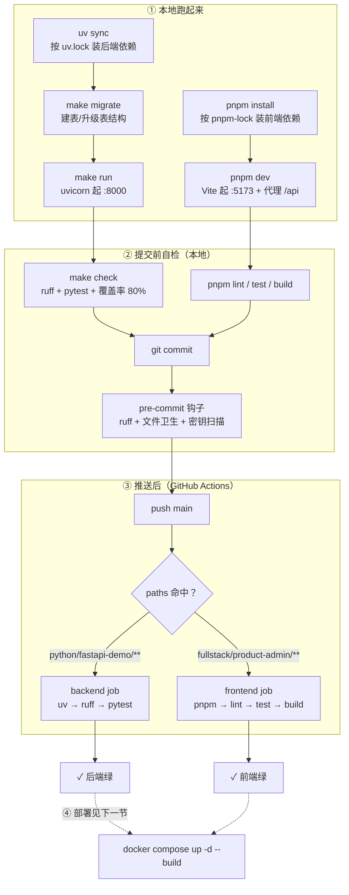
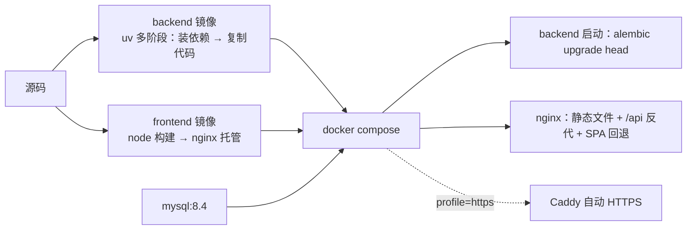

# 工具链：每个工具解决什么问题

> 你不需要记住所有命令，只需要记住**三条链路**：本地跑起来、提交前自检、推送后 CI。
> 全部命令都在项目根执行，或按标注切换目录。

## 0. 一张图看全



（图片版：[`images/diagram-toolchain.png`](images/diagram-toolchain.png)）

## 1. 后端工具链

| 工具 | 解决什么问题 | 命令 | 配置在哪 |
|---|---|---|---|
| **uv** | 依赖装得慢、版本漂移。它同时管「解析依赖 + 建虚拟环境 + 锁版本」 | `uv sync`（装依赖）、`uv add pkg`（加依赖）、`uv lock`（重新解析） | `pyproject.toml` → `uv.lock` |
| **FastAPI / uvicorn** | 提供 HTTP 接口与自动文档 | `make run`（= `uvicorn app.main:app --reload`） | `app/main.py` |
| **SQLAlchemy** | 用 Python 类描述表、写查询 | 无独立命令，由代码调用 | `app/database.py`、`app/models/` |
| **Alembic** | 表结构变更要能复现、能回滚（不能靠 `create_all`） | `make revision m="说明"`、`make migrate`、`make check-migration` | `alembic.ini`、`migrations/` |
| **ruff** | 代码风格与明显错误，一个工具代替 flake8+isort+black | `make lint`（只检查）、`make fmt`（自动改） | `pyproject.toml` 的 `[tool.ruff]` |
| **pytest + pytest-cov** | 改完不知道有没有改坏；覆盖率防止测试形同虚设 | `make test`（含 80% 门槛） | `pyproject.toml` 的 `[tool.pytest]` / `[tool.coverage]` |

**为什么不用 requirements.txt**：uv 的 `uv.lock` 锁了完整依赖树（67 个包），`uv sync --frozen` 在任何机器上装出完全一致的环境，CI 也用它。

## 2. 前端工具链

| 工具 | 解决什么问题 | 命令 | 配置在哪 |
|---|---|---|---|
| **pnpm** | 装依赖快、磁盘占用小、workspace 友好 | `pnpm install`、`pnpm dev`、`pnpm build` | `package.json`、`pnpm-lock.yaml` |
| **Vite** | 开发时秒级热更新；生产打包 | `pnpm dev`（:5173）、`pnpm build`（出 `dist/`） | `vite.config.ts`（含 `/api` 代理） |
| **vue-tsc** | 类型检查。`vite build` 不做类型检查，所以 build 脚本里先跑它 | `pnpm type-check`（已包含在 `pnpm build`） | `tsconfig.json` |
| **ESLint** | 抓未使用变量、Vue 模板错误。按 ADR-0002 只开轻量档 | `pnpm lint`、`pnpm lint:fix` | `eslint.config.js` |
| **Prettier** | 格式统一，避免 diff 里全是空白变化 | `pnpm format`、`pnpm format:check` | `.prettierrc.json` |
| **Vitest** | 单元测试，只测 `src/api`（纯逻辑，不碰 DOM） | `pnpm test`、`pnpm test:watch` | `vitest.config.ts` |
| **puppeteer-core** | 真浏览器跑 18 项端到端验收（可选，需先起前后端） | `pnpm acceptance` | `scripts/acceptance.mjs` |

## 3. 提交与 CI

```
写代码 ──> make check / pnpm lint && pnpm test ──> git commit
                                                     │
                                        pre-commit 钩子（8 个）
                                        ├─ ruff-check / ruff-format      ← 只对 python/fastapi-demo
                                        ├─ trailing-whitespace / end-of-file-fixer
                                        ├─ check-yaml（排除 pnpm-lock）/ check-toml
                                        └─ check-added-large-files / detect-private-key
                                                     │
                                                     v
                                            git push origin main
                                                     │
                                    GitHub Actions（paths 命中才跑）
                                    ├─ backend：uv sync --frozen → ruff → pytest（覆盖率 80%）
                                    └─ frontend：pnpm install → lint → test → build
```

**为什么 CI 不连数据库**：测试用占位 `DATABASE_URL` + 内存 SQLite，所以不需要 MySQL service，跑得快（后端 13s、前端 26s）。代价是 MySQL 专有行为（唯一键 1062、外键）测不到，见 `docs/adr/0005-testing-baseline.md`。

**为什么 `make check` 不含迁移检查**：`alembic check` 需要连真实 MySQL，CI 里没有，所以它单独是 `make check-migration`，本地改完模型手动跑。

## 4. 部署链路



细节与运维命令见 `docs/deploy.md`。

（图片版：[`images/diagram-deploy.png`](images/diagram-deploy.png)）

## 5. 常用命令速查

| 我要 | 命令 | 目录 |
|---|---|---|
| 装后端依赖 | `make install` | `python/fastapi-demo` |
| 起后端 | `make run` | `python/fastapi-demo` |
| 建表/升级表 | `make migrate` | `python/fastapi-demo` |
| 跑后端自检 | `make check` | `python/fastapi-demo` |
| 装前端依赖 | `pnpm install` | `fullstack/product-admin` |
| 起前端 | `pnpm dev` | `fullstack/product-admin` |
| 跑前端自检 | `pnpm lint && pnpm test && pnpm build` | `fullstack/product-admin` |
| 起整套（容器） | `docker compose up -d --build` | 仓库根 |

> 每个工具「为什么选它、放弃什么」都记在 `docs/adr/` 里。想改技术选型，先改 ADR 再改代码。
