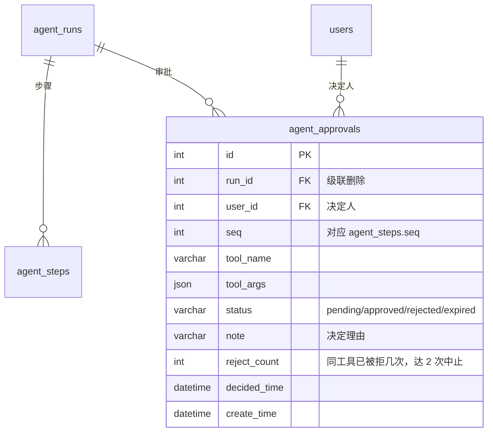
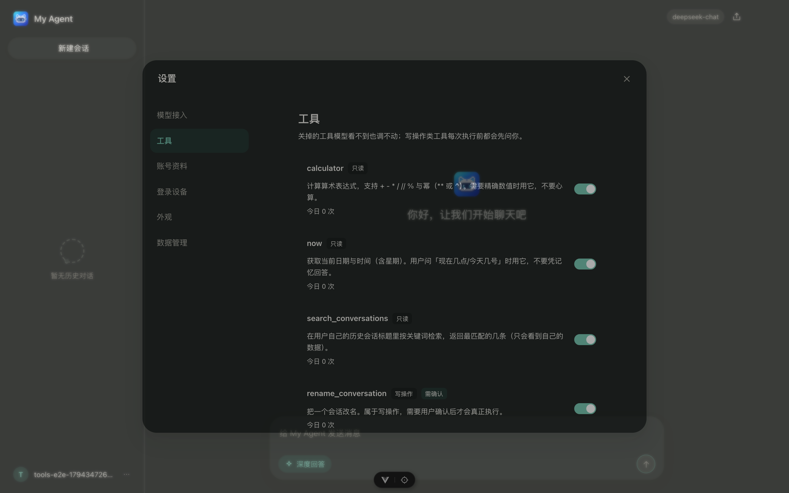
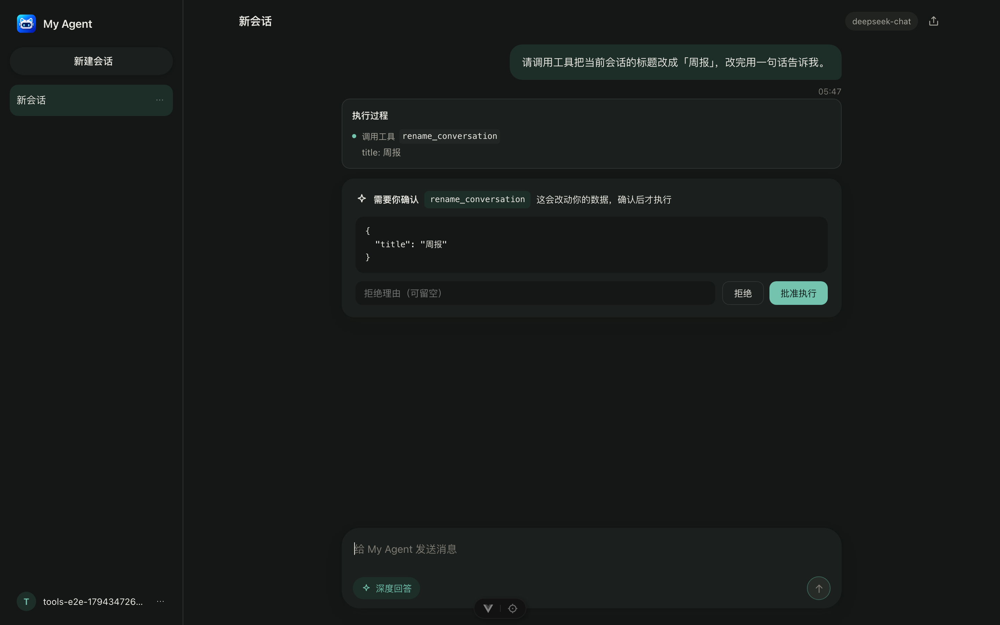

# 阶段 6 设计：工具生态与权限治理

> **状态**：设计待确认（2026-11-10）。确认后才进入实现，按 T1–T7 逐个交付。
> **上游文档**：[`agent.md`](agent.md)（阶段 5 执行循环）、[ADR-0010](adr/0010-agent-execution-loop.md)、[`playbooks/05`](playbooks/05-development-plan-and-mvp-tasks.md) 阶段 6。

## 1. 要解决的问题

阶段 5 已经能跑通「模型请求工具 → 执行 → 结果回灌 → 再请求」的循环，但工具这件事还有四个缺口：

| 缺口 | 现状 | 后果 |
|---|---|---|
| 注册是硬编码的 | `build_registry(session)` 里 `CalculatorTool` / `NowTool` / `SearchConversationsTool` 写死 | 新增工具要改执行器入口，违背「加工具不改循环」 |
| 没有权限分级 | 所有工具都能被模型直接调用 | 一旦加入写操作（改标题、删会话、发请求），模型可以单方面执行 |
| 没有人工审批 | 无 | 写操作无人把关，出事只能事后补救 |
| 没有可观测性 | 只有每次运行的步骤记录 | 答不上「哪个工具最常失败 / 谁在滥用 / 慢在哪」 |

阶段 6 的目标是：**工具可以声明式地加进来，按风险分级，写操作必须经人点一下，且每次调用都留得下证据**。

## 2. 外部参考（都是本阶段真实可借的做法）

| 来源 | 关键做法 | 我们借什么 |
|---|---|---|
| [MCP 规范 `ToolAnnotations`](https://modelcontextprotocol.io/specification/2025-06-18/server/tools#tool-annotations) | 工具可声明 `readOnlyHint` / `destructiveHint` / `idempotentHint` / `openWorldHint`，并明确「这些是提示，不是安全边界」 | 工具的**默认风险等级**由声明推出，但服务端不信任声明 |
| [Claude Code 权限模式](https://code.claude.com/docs/en/permission-modes) | `allow` / `ask` / `deny` 三态规则；`ask` 会暂停等用户确认；支持按工具+参数匹配 | 三态 + **按参数模式**的规则表（如「只允许 `calculator`」但禁止 `9**9`） |
| [OpenAI Agents SDK 的 guardrails / approvals](https://openai.github.io/openai-agents-python/guardrails/) | 运行可在工具调用前中断，把待审批项交回宿主 | 「暂停 → 交回前端 → 恢复」的形状：状态存服务端，不存进程内存 |
| [LangGraph `interrupt()`](https://langchain-ai.github.io/langgraph/concepts/human-in-the-loop/) | 图执行到审批节点挂起，靠 checkpointer 恢复 | 借鉴它的**可恢复性**要求：进程重启后审批仍能继续 |

一句话结论：**审批状态必须是服务端的持久状态**，不能是执行器进程里的一个 `input()` 或 `asyncio.Event`；否则重启、多进程部署都会丢。

## 3. 设计

### 3.1 工具元数据

执行器只认元数据，不认识具体工具：

```python
class ToolLevel(StrEnum):
    READ = "read"        # 只读：查询、计算、读时钟
    WRITE = "write"      # 写本地数据：改标题、删会话、改设置
    EXTERNAL = "external"  # 打外部网络：需要出站白名单


@dataclass(frozen=True)
class ToolMeta:
    name: str
    description: str
    parameters: dict[str, Any]       # JSON Schema，直接给模型
    level: ToolLevel
    timeout_seconds: float = 2.0
    source: str = "builtin"          # builtin | mcp:<server>
    requires_approval: bool = False  # 默认由 level 推出，可显式覆盖
    enabled_by_default: bool = True
```

`requires_approval` 的默认推导：`READ → False`，`WRITE / EXTERNAL → True`。管理员可以给单个工具改这个开关（比如某天允许自动改名），但**降级要留审计**。

### 3.2 注册表：加工具不改循环

```
ToolSource (协议)  ──>  list() -> list[Tool]
   ├── BuiltinSource   内置：calculator / now / search_conversations
   ├── McpSource       阶段 7：把 MCP server 的工具包一层
   └── 未来：PluginSource

ToolRegistry
   ├── 装配：遍历所有 ToolSource，按 name 去重（重名报错，不静默覆盖）
   ├── 过滤：按用户设置剔除 disabled 的工具
   ├── 暴露：specs() 给模型、has() 给执行器、execute() 统一兜异常与超时
   └── 元数据：meta(name) 给策略层判级
```

执行器里只出现三处工具调用（`specs()` / `has()` / `execute()`），加一种工具只新增一个 `Tool` 类并注册进 `BuiltinSource`。

### 3.3 分级与策略

策略层 `ToolPolicy` 回答一个问题：**这次调用能不能直接跑？**

| 情况 | 结果 |
|---|---|
| 工具被用户关闭 | 不出现在 `specs()` 里；模型即使硬编名字也返回 `ok=false`「工具未启用」 |
| `READ` 且未被显式要求审批 | 直接执行 |
| `WRITE` / `EXTERNAL` | 挂起等审批（见 3.4） |
| 命中「参数规则」黑名单（如 `calculator` 表达式含 `**` 且指数 > 20） | 直接拒绝，`ok=false`，不进审批 |
| 每次运行内该工具已失败 3 次 | 按阶段 5 的护栏中止整次运行 |

参数规则用「工具名 + JSON 路径 + 正则/上限」表达，存在配置里，不写死在代码：

```yaml
- tool: calculator
  path: expression
  deny: ['\*\*\s*(?:[3-9]\d|\d{2,})']   # 指数 ≥ 30 直接拒
- tool: search_conversations
  path: limit
  max: 10
```

### 3.4 审批流：四态 + 可恢复

```
用户发消息
   │
   ▼
 run: running ──想要调 write/external 工具──> 建 approval(pending)，run 置 waiting_approval
   │                                                   │
   │                                          前端展示「要调用 X，参数 …」
   │                                                   │
   │                        ┌──────────┬───────────────┐
   │                        ▼          ▼               ▼
   │                    approve    reject         取消运行
   │                        │          │               │
   ▼                        ▼          ▼               ▼
 继续循环 <── 同一次运行恢复 ── 结果回灌「用户拒绝」   run cancelled
```

关键约定：

- **审批是一个独立资源**（`agent_approvals`），带 `decided_by`；**不设过期时间**，页面会一直等用户回复（快模型慢用户是常态，超时判 failed 等于白跑一次）。
- 批准/拒绝都写 `tool_result` 步骤（`content` 记决定与理由），**不伪造工具结果**：批准后才真正执行，拒绝则回灌「用户拒绝，理由：…」让模型自己换路。
- 恢复靠 DB 重放：`run.step_count` + `agent_steps` 已存着，恢复时按 `run_id` 取全部步骤重建 `LLMMessage` 列表，不需要保存 Python 对象。
- 同一 run 只允许一个 pending 审批（避免一次弹五个框）。
- **次数上限**（防「换个参数接着试」的死循环）：单次 run 最多 **5 次审批**、同一工具最多被拒绝 **2 次**；任一超限即中止整次运行，状态 `failed`，理由写「审批次数已达上限」。
- 拒绝不改写用户原话，也不删已发生的步骤——审计要完整。

### 3.5 可观测性

- 每次工具调用已经落 `agent_steps`（`tool_name` / `ok` / `duration_ms`），本阶段补聚合查询：
  - `GET /api/settings/tools/stats?days=7` → 按工具：调用次数、失败率、p95 耗时、最近失败原因（Top 3）。
  - 前端设置页「工具」节展示一张小表，不新建页面。
- 结构化日志统一字段：`event=tool_call tool=… ok=… duration_ms=… run_id=… user_id=…`。
- 每用户每日工具调用上限（默认 500）与单次运行步数上限（沿用 8 步）都在策略层判，超限回 `ok=false`「今日工具调用已达上限」。

### 3.6 MCP 适配层（只为阶段 7 留口子，不实现连接）

```python
class McpSource:
    def __init__(self, server_name: str, client: McpClientLike): ...
    def list(self) -> list[Tool]:
        # name 前缀 mcp__{server}__{tool}，避免与内置重名
        # level 由 annotations 推出：readOnlyHint=True → READ，否则 EXTERNAL
```

本阶段只落协议与一个内存桩（测试用），不接真 server。

## 4. 数据模型



| 表 | 变更 |
|---|---|
| `agent_runs` | `status` 增加 `waiting_approval`（现有 `running/completed/failed/cancelled` 不变） |
| `agent_approvals` | 新表，见上 |
| `user_settings` | 加 `tools_disabled JSON`（工具名数组，默认 `[]`）；`daily_tool_budget INT default 500` |

## 5. 接口契约

| 方法 | 路径 | 说明 |
|---|---|---|
| `GET` | `/api/settings/tools` | 全部工具 + 是否启用 + 级别 + 今日调用数 |
| `PUT` | `/api/settings/tools` | 批量启停 `{disabled: ["calculator"]}` |
| `GET` | `/api/settings/tools/stats?days=7` | 聚合统计 |
| `GET` | `/api/agent/runs/{run_id}/approvals` | 该运行的审批（含已决） |
| `POST` | `/api/agent/runs/{run_id}/approvals/{approval_id}` | `{decision: "approve"\|"reject", note?: string}` |
| `POST` | `/api/conversations/{id}/agent/stream` | 事件新增 `approval_required`（含 `approval_id`、`tool`、`args`、`attempt`）与 `run_waiting` |

约束：

- 全部要求登录；审批只能由 run 的属主决定（越权 404，与既有隔离口径一致）。
- 审批已决或已过期再处理 → 409，带当前状态。
- 开流之前能判的错误（401/404/400/409）仍是普通 JSON；开流之后才进入 SSE。

## 6. 安全与护栏

| 风险 | 处理 |
|---|---|
| 模型伪造工具名 | 注册表 `has()` 校验，未注册/已禁用一律 `ok=false` |
| 参数注入 / 超大输入 | 每个工具用 pydantic `args_model` 校验，字符串长度上限写进模型 |
| 写操作误伤 | `WRITE` 一律审批；同一 run 内同工具连续 3 次失败中止 |
| 外部请求 SSRF | `EXTERNAL` 只允许出站白名单域名（阶段 6 无外网工具，规则先落位） |
| 审批被绕过 | 审批判定在服务端，HTTP 层不接受「已批准」的客户端自述 |
| 审批挂起占资源 | 挂起期间不起线程、不占连接，只有一条 `waiting_approval` 的 run 记录；用户可随时「取消运行」收尾 |
| 无限等待导致 run 越积越多 | 列表页把 `waiting_approval` 的 run 标成「等待你确认」；超过 30 天仍未决定的由清理任务标 `failed`（仅清理，不影响在线体验） |
| 审计缺失 | `agent_steps` + `agent_approvals` 双记录；删除会话级联清理（用户注销即消失） |

## 7. 任务拆分（阶段 6）

| 编号 | 任务 | 交付物 | 验收 |
|---|---|---|---|
| T1 | 工具元数据与注册表重构 | `ToolMeta` / `ToolLevel` / `ToolSource` / `ToolRegistry` 按用户过滤 | 加一个假工具不改执行器；重名注册报错；既有 17 个工具测试仍绿 |
| T2 | 策略层与参数规则 | `ToolPolicy`、规则配置、`daily_tool_budget` | 单测覆盖：读自动、写挂起、黑名单直拒、预算超限 |
| T3 | 审批数据模型与迁移 | `agent_approvals` 表（无 `expires_time`）、`agent_runs.status` 扩值、`user_settings` 两列 | `alembic upgrade/downgrade/upgrade` 通过、`alembic check` 无漂移 |
| T4 | 执行器暂停与恢复 | `stream_run` 遇需审批工具即挂起；`resume_run` 从 DB 重放 | 单测：挂起后事件序列、批准后继续、拒绝后回灌、审批 5 次上限、同工具拒绝 2 次上限 |
| T5 | 接口 | 6 个接口 + SSE 新事件 | 未登录 401、越权 404、重复决定 409 |
| T6 | 前端 | 时间线审批卡片、设置页「工具」节、统计小表 | 批准/拒绝都能走通；刷新后审批仍可处理 |
| T7 | 文档与验收 | `docs/api.md` §6.4、E2E 9 项、README/状态页 | `acceptance:tools` 全绿 |





**落地状态（2026-11-11）**：T1–T7 全部完成。注册表 / 策略层 / 迁移 `2c0c6e7b3613` / 执行器暂停恢复 / 6 个接口 / 前端审批卡片与设置页「工具」节 / `pnpm acceptance:tools` 9 项，均已提交。

## 8. 验收标准

1. 新增一个工具只需一个类 + 一行注册，执行器零改动。
2. `WRITE`/`EXTERNAL` 工具必然产生一条 `agent_approvals`，且 run 状态变 `waiting_approval`。
3. 批准后原 run 继续、拒绝后模型能看到「用户拒绝 + 理由」并换路，二者都留完整步骤。
4. 单次 run 超过 5 次审批、或同一工具被拒绝超过 2 次，run 变 `failed`，理由「审批次数已达上限」，前端可见。
5. 服务重启后，pending 审批仍能批准并恢复（状态在 DB，不在内存）；审批**没有过期时间**，第二天回来点仍然有效。
6. 关闭某个工具后，模型请求它得到 `ok=false`「工具未启用」，而不是抛异常。
7. 统计接口能给出每个工具的调用次数、失败率、p95 耗时。
8. 全部既有门禁保持绿：`make check` ≥ 93%、`pnpm lint/test/build`、四套 E2E。

## 9. 明确不做

- 多 agent / handoff（阶段 9 再谈）。
- 真接 MCP server（阶段 7）；本阶段只落 `McpSource` 协议与内存桩。
- 工具市场、第三方插件安装、按组织的权限策略（当前只有 user/admin 两角色）。
- 审批的批量操作与「记住这个决定」持久规则（先观察真实使用频率）。

## 10. 风险

| 风险 | 影响 | 缓解 |
|---|---|---|
| 审批打断对话节奏 | 用户嫌烦 | 默认只对写/外网工具要审批；读工具永远直跑 |
| 无限等待 → 用户忘了这回事 | run 一直挂在 `waiting_approval` | 侧栏/列表标「等待确认」；允许取消运行；30 天清理任务兜底 |
| 恢复路径复杂 | 容易出半截状态 | 以 `agent_steps` 为唯一真相，恢复只读不写；先写 T4 单测再碰前端 |
| 审批表膨胀 | 数据变多 | 随 run 级联删除；后续可按天归档 |
| 前端状态机复杂 | 时间线与审批交叉 | 前端只认事件，不推断状态；run 状态由后端给 |
